# Black Dranzer (ブラックドランザー)

 

| Campo | Valor |
|---|---|
| Animal | Fênix (cópia artificial) |
| Elemento | Fogo; no jogo, "chamas negras" |
| Inspiração | Réplica da Dranzer (Suzaku) feita pela BioVolt na Abadia Balkov |
| Dono | Boris Balkov / BioVolt (criadora). Usada por Kai Hiwatari (S1 eps. 42–45) e depois devolvida |
| Bey | Black Dranzer (A-38) |
| Primeira aparição | S1 ep. 42 "Drawn to the Darkness" (Kai criança já a havia tocado, em flashback) |

## Inspiração
É a versão "falsificada" de uma Fera Sagrada. Representa a tentação do poder: segundo o anime, o bit chip "faz a alma do blader cair na escuridão". É muito forte contra feras comuns, mas perde força diante das quatro Feras Sagradas. No Lago Baikal, Max (Draciel) defende todos os ataques dela.

## Aparência
- **Wiki**: mesma aparência da Dranzer, com o vermelho trocado por preto.
- **Desenho do jogo** (arte original, mesma anatomia da Dranzer para mostrar que é uma cópia):
  - corpo e penas negro-arroxeados com reflexos lilás;
  - armadura em ouro velho;
  - faixas carmesim nas ombreiras;
  - bico escuro com contorno dourado;
  - olhos vermelhos brilhantes e gema vermelha no peito;
  - pontas das penas em violeta;
  - chamas negras (núcleo quase preto com borda violeta) e aura violeta.

  As chamas negras e o violeta são **interpretação de design**: a wiki diz só que o golpe acontece "num clarão de luz intensa".

## Personalidade
Não tem vontade própria mostrada no anime. Funciona como amplificador do lado sombrio de Kai: poder bruto, frieza e vontade de dominar. Captura as feras bit dos oponentes derrotados.

## Especiais
| Bey | Golpe (EN) | Nome JP | Visual no anime | Efeito proposto no jogo |
|---|---|---|---|---|
| Black Dranzer | **Black Flame Saber** | ブラックフレイムセイバー (Burakku Fureimu Seibā) | A fera sai do chip e ataca a bey inimiga num clarão de luz intensa (estreia no ep. 43) | Clarão e dano alto que ignora a defesa comum (100 / 25 s) |
| Black Dranzer | Captura de feras bit (não é golpe nomeado) | — | Absorve a fera bit do derrotado. Kai captura 7 feras dos All Starz e dos White Tigers | Passiva de chefe: copia o especial do derrotado; -30% contra as 4 Feras Sagradas |

## Aparições marcantes
- **Ep. 43**: vence os All Starz num 4 contra 1.
- **Ep. 44**: captura as feras de Gary, Mariah e Lee.
- **Ep. 45**: no Lago Baikal, vence Tyson, Ray e Kenny, mas é parada por Max (Draciel) e derrotada pela Dranzer lançada por Tyson. Kai a usa para destruir o mainframe da BioVolt.
- **Ep. 48**: os Demolition Boys destroem a bey, mas o chip sobrevive. Voltaire o entrega a Kai, que o tira antes de lançar.

## Paleta
| Uso | Hex |
|---|---|
| Primária (corpo, penas) | `#2a2536` (sombra `#14111c`, brilho `#6e6290`) |
| Secundária (armadura em ouro velho) | `#b8892a` (sombra `#7a5a14`, brilho `#f0d47a`) |
| Faixa carmesim / gema / olho | `#c41e3a` / `#ff2a3a` / `#ff4a4a` |
| Brilho / aura | `#9b3dff` |
| Chamas negras (base → ponta) | `#24082e` → `#6a1fb0` → `#b44cff` → `#f3d6ff`; núcleo `#0e0618` |
| Contorno | `#0d1226` |

## Animações
Mesma estrutura e mesmos grupos da Dranzer (`aura`, `fera`, `tail`, `wing-left`, `wing-right`, `claws`, `body`, `head`, `crest`, `particles`), com efeitos em chamas negras:
- **`emblema.svg`**: fênix escura com pontas das asas, crista e chama da cauda em violeta.
- **`idle.svg`** (3,2 s): flutuação, asas, cabeça e cauda animadas, olho vermelho brilhando, labaredas negras tremulando, brasas violeta e vermelhas.
- **`invocacao.svg`** (1,6 s): coluna de luz violeta e chamas negras em leque. A fênix cresce da âncora e abre as asas, com um clarão lilás.
- **`ataque.svg`** (1,1 s, Black Flame Saber): recuo, mergulho diagonal com rastro e manto de chamas negras e impacto com clarão branco-lilás.

**Obs. para o jogo**: por ser escura, a fera quase some com `blend: screen`. O `dados.json` sugere `normal` (ou `screen` só na aura).

## Sons
- **invocacao** (2,9 s): zumbido sub-grave dissonante (saw em unison com detune largo, lowpass), labareda abafada e o grito da fênix 1 oitava abaixo da Dranzer, com growl e distorção.
- **rugido** (1,9 s): grito grave e rasgado, com segunda voz e sine sub-grave por baixo.
- **ataque** (1,5 s): mergulho com sopro descendente e crescendo sombrio. No impacto, um "clarão" estridente (noise em highpass), estrondo grave saturado e eco do grito.

## Fontes
- https://beyblade.fandom.com/wiki/Black_Dranzer
- https://beyblade.fandom.com/wiki/Black_Flame_Saber
- https://beyblade.fandom.com/wiki/Dranzer_(Bit-Beast) (trecho sobre a Black Dranzer)
- `pesquisa-bakuten/personagens/kai-hiwatari/beyblades/black-dranzer/README.md`
