# Draciel (ドラシエル) — Tartaruga Negra

Fera bit de **Max Tate** ([personagens/max-tate](../../personagens/max-tate/)). Dados estruturados em [`dados.json`](dados.json).

| Campo | Valor |
|---|---|
| Animal | Tartaruga (modelada na tartaruga-aligátor / tartaruga-mordedora) |
| Elemento | Água ("Spirit of Water") |
| Inspiração | Genbu (玄武) / Xuan Wu, a Tartaruga Negra do Norte, um dos Quatro Símbolos |
| Beys | Draciel Metal Ball Defenser, S, F, V, V2, G, MS |
| Emblema | [`emblema.svg`](emblema.svg) |

## Inspiração e história
- Uma das quatro feras sagradas. Genbu é tradicionalmente retratado **entrelaçado com uma serpente**, e isso explica os nomes *Viper Wall* e *Heavy Viper Wall*.
- O nome segue o padrão dos Bladebreakers: "dra(gon)" + unidade militar ("SEAL", dos Navy SEALs), segundo a wiki.
- No dub, Draciel era da avó de Max; no original, da mãe (Judy). Max a recebe num pingente, e a fera aparece pela primeira vez no S1 ep 5, na luta contra Kai.
- A wiki não esclarece se Draciel tira a água do ambiente ou se a cria.

## Aparência (como desenhar)
- **Tartaruga antropomórfica gigante e blindada**, de pé, com braços e pernas grossos e garras claras.
- **Casco** escuro (preto/roxo) com placas hexagonais e **borda serrilhada de espinhos** lilases. Plastrão creme segmentado no peito e na barriga. Protetores do casco sobre os ombros e placas nos antebraços, como escudos.
- **Cabeça de tartaruga-mordedora**: bico em gancho, fileira de calombos no crânio, olhos âmbar pequenos e bravos.
- Na S1 aparece em roxo-rosado monocromático, com brilho roxo (frame de referência já existente no repositório: [`personagens/max-tate/fera-bit.jpg`](../../personagens/max-tate/fera-bit.jpg)). Depois assume as cores do bit chip (preto e roxo).

## Personalidade
Paciente e inabalável. A técnica de Max é aguentar os especiais do adversário até ele se esgotar e, então, contra-atacar com água.

## Especiais por bey
| Especial | Bey | Estreia | Visual no anime | Proposta no jogo |
|---|---|---|---|---|
| Metal Ball Defense | Draciel S | S1 | As bolas de metal da base formam uma defesa em que o oponente bate até parar | +40% de massa efetiva por 6 s; o atacante perde RPM a cada colisão |
| Fortress Defense | Draciel F | V-Force ep 21 | Barreira em volta de Draciel criada com as bolas de metal ("DRACIEL! FORTRESS DEFENSE!") | Escudo hexagonal de 6 s (absorve 50%, devolve 20% como recoil) |
| Viper Wall | Draciel V | V-Force ep 29 | Tempestade de serpentes | Zona de 4 s que reduz a velocidade de quem entra |
| Heavy Viper Wall | Draciel V e V2 | V-Force ep 29 | Ondas de água que afogam o oponente e o arremessam; mais forte na G-Rev | Onda radial com knockback forte |
| Gravity Control / Ultra Gravity Control | Draciel G | G-Rev | Tromba de água gravitacional que prende e desequilibra o oponente | Vórtice que reduz equilíbrio e drena RPM |
| Aqua Shield | Draciel MS | G-Rev ep 45 | Muralha de água enorme que enfraquece o golpe inimigo (vs Ocean Javelin de Poseidon) | Muralha de 4 s: −60% em quem atravessa; contra-ataque com +50% de knockback |

Nomes dublados em PT-BR **não confirmados**. A Draciel Metal Ball Defenser não tem especial com nome confirmado.

## Aparições marcantes
- S1 ep 5: Draciel surge pela primeira vez, contra o Dranzer de Kai (derrota, mas Max ganha a sua fera).
- S1 ep 45: Draciel F segura o Black Dranzer no Lago Baikal até as quatro feras sagradas o vencerem.
- V-Force ep 29: estreia de Viper Wall e Heavy Viper Wall contra Alan McKenzie.
- G-Rev ep 45: Aqua Shield contra Mystel.
- Final da G-Rev: Draciel empresta poder, junto com Driger e Wolborg, para a evolução de Dragoon contra Brooklyn.

## Paleta
| Uso | Hex |
|---|---|
| Primária: casco | `#3b2d66` |
| Secundária: pele | `#6f6b94` |
| Brilho: aura | `#b58cff` |
| Borda do casco e espinhos | `#9a80d8` |
| Plastrão / linhas | `#dcd2a8` / `#8f8460` |
| Olhos | `#ffb12e` |
| Água (clara / média / escura) | `#d9f6ff` / `#4cc7ff` / `#1f6fb8` |
| Sombra do cel shading | `#1a1446` a 42% |
| Contorno | `#0d1226` |

Corpo escuro: no `dados.json` o overlay usa `blend: "normal"`, porque com `screen` a fera sumiria.

## Animações
- **idle.svg** (loop de 3,6 s): respiração pesada do tronco, casco "inflando", cabeça avançando com o bico abrindo, braços em guarda balançando, cauda, aura roxa pulsando, ondulações de água na âncora e bolhas subindo.
- **invocacao.svg** (1,7 s, uma vez): um gêiser de água sobe da bey, uma coroa de respingos e anéis se abrem, gotas são lançadas. Draciel cresce do gêiser em silhueta clara e azulada que ganha cor; os braços descem para a guarda, a cabeça sai do casco e a fera dá um rugido. Termina na pose do idle.
- **ataque.svg** (1,1 s, loop): Heavy Viper Wall. Draciel se firma (squash) e abre os braços; um **escudo hexagonal** de água pisca; duas **serpentes de água** sobem dos lados e se inclinam para fora; uma **muralha de onda** cresce atrás dele e corre para a esquerda; espuma e borrifos sobem.
- Partes animáveis: `#shell`, `#shell-rim`, `#body`, `#head`, `#jaw`, `#eye`, `#arm-left`, `#arm-right`, `#leg-left`, `#leg-right`, `#tail`, `#shoulder-guards`, `#aura`, `#particles`.

## Sons (`sons.json` → `sons/*.wav`)
- **invocacao** (2,8 s): estrondo de terra muito grave (sine 38→62 Hz + triangle), jorro de gêiser (pink em bandpass varrendo 300→2600 Hz), chiado de espuma, ruído grave com lowpass, três "bloops" de bolha (sine subindo) e mugido grave da tartaruga (saw 70–92 Hz com growl e formantes 420/900 Hz).
- **rugido** (1,9 s): bramido grave e áspero (saw 62–88 Hz, growl lento), sub-grave em sine, sibilo de ar (ruído bandpass 3,2 kHz) e corpo em pink grave.
- **ataque** (1,5 s): impacto grave, onda crescendo (pink em bandpass que abre e fecha), arrebentação (ruído com lowpass descendo), espirro agudo, "canto" de água (saw com vibrato lento em bandpass) e bolhas.

## Fontes
- https://beyblade.fandom.com/wiki/Draciel e https://beyblade.fandom.com/wiki/Bit_Chip_-_Draciel
- https://beyblade.fandom.com/wiki/Metal_Ball_Defense , /Fortress_Defense , /Viper_Wall , /Heavy_Viper_Wall , /Aqua_Shield
- https://beyblade.fandom.com/wiki/Max_Tate
- READMEs das beys em `pesquisa-bakuten/personagens/max-tate/beyblades/` e o frame `personagens/max-tate/fera-bit.jpg`
- Arte e sons originais deste projeto (sem decalque).
