# Driger (ドライガー) — Tigre Branco

Fera bit de **Ray Kon** ([personagens/ray-kon](../../personagens/ray-kon/)). Dados estruturados em [`dados.json`](dados.json).

| Campo | Valor |
|---|---|
| Animal | Tigre branco |
| Elemento | Trovão (wiki: "Thunder Spirit"; o infobox do Bit Chip diz "Earth", divergência anotada) |
| Inspiração | Byakko (白虎), Tigre Branco do Oeste, um dos Quatro Símbolos |
| Beys | Driger S, F, V, V2, G, MS |
| Emblema | [`emblema.svg`](emblema.svg) |

## Inspiração e história
- Uma das quatro feras sagradas da lenda, baseada no Tigre Branco cultuado pela tribo White Tigers (Fang Tribe no mangá).
- O ancião da vila (avô de Lee) entrega Driger a Ray, e não ao neto; Ray deixa a vila levando a fera, o que cria a rivalidade com Lee, resolvida no S1 ep 17.
- Ray perde Driger duas vezes no anime original: quando perde a confiança (a fera sai da bey) e quando é selado pelos Saint Shields (V-Force); volta nas duas.
- O estilo de Ray usa artes marciais, e os ataques de Driger imitam isso (trivia da wiki). Os oponentes costumam sair com "marcas de garra".

## Aparência (como desenhar)
- Tigre branco **musculoso**, de quatro patas, com **listras verdes** em pinceladas no tronco, nas patas, na cauda e na cara.
- **Armadura verde em forma de lâmina**: crista curva na testa que corre para trás, lâminas nos antebraços e jarretes e **cauda blindada** em anéis, terminando em ponta.
- Olhos amarelos estreitos, presas brancas, orelhas pequenas e arredondadas, tufos de pelo nas bochechas.
- Na S1 o anime pinta as feras de forma monocromática (Driger fica verde-claro). A partir da V-Force, Driger volta às cores do bit chip (branco e verde).
- Os nossos SVGs mostram Driger de perfil, virado para a esquerda, para encarar Galeon, que olha para a direita.

## Personalidade
Calmo e preciso fora do golpe e feroz no ataque, como Ray (a filosofia "yin-yang" do personagem). Prefere vários golpes rápidos a um único golpe pesado.

## Especiais por bey
| Especial | JP | Bey | Estreia | Visual no anime | Proposta no jogo |
|---|---|---|---|---|---|
| Tiger Claw | 白虎爪撃 | Driger S (e F) | S1 ep 6 | A bey acelera e Driger rasga o alvo com uma rajada de arranhões; no GBA, flash de eletricidade e Driger passa rasgando | Investida com 3-4 acertos rápidos; rastro de 3 garras de luz verde |
| Tiger Fang | 白虎牙撃 | Driger F | S1 ep 49 | Driger invocado ataca o oponente diretamente | Investida única forte |
| Vulcan Claw | 白虎連射爪 | Driger V | V-Force ep 15 | "Barreira cortante" de garras em volta da bey | Garras orbitais; cada contato dá um acerto extra |
| Vulcan Power Claw | バルカンパワークロー | Driger V2 | V-Force ep 40 | Bey irradia poder e entra num upper enquanto Driger golpeia a fera inimiga | Próximo impacto com lift alto + knockback |
| Gatling Claw | ガトリングクロー | Driger G | G-Rev ep 7 | Eletricidade verde; clones de tigre elétrico atacam juntos | 3 clones fantasmas atacam por 2 s |
| Gatling Claw Maximum | ガトリングクローマキシマム | Driger G | G-Rev ep 23 | Raio verde de Ray cai na bey, que ataca em velocidade imperceptível | Velocidade x2 por 3 s, custa rotação |
| Thunder Slash | サンダースラッシュ | Driger MS | G-Rev ep 44 | Driger irradia eletricidade e corta o oponente num golpe só | Carga de 1 s + um golpe de dano altíssimo |

Nomes dublados: "Tiger Claw" aparece igual no dub em inglês; os nomes da dublagem brasileira **não foram confirmados**. No S1 ep 17, Ray vence Lee somando o próprio Black Thunder de Lee ao Tiger Claw.

## Aparições marcantes
- S1 ep 6: primeira batalha contra Tyson, com o Tiger Claw.
- S1 ep 17: final do Torneio Asiático contra Lee (Galeon).
- S1 ep 49: Tiger Fang contra o Falborg de Bryan.
- V-Force ep 33 e 38: Driger é selado por Dunga e depois recuperado (estreia da Driger V2).
- G-Rev ep 23: Gatling Claw Maximum contra Kai (Blazing Gigs Tempest).

## Paleta
| Uso | Hex |
|---|---|
| Primária: pelo | `#f3f6f1` |
| Secundária: listras | `#1f8a4c` |
| Brilho: aura e raios | `#7cff6b` |
| Armadura / sombra / brilho | `#2fb35f` / `#0b3f24` / `#c4ffd6` |
| Pelo distante (patas de trás) | `#d5dde6` |
| Olhos | `#ffd23f` |
| Boca / língua | `#6e1029` / `#d9566e` |
| Sombra do cel shading | `#22336e` a 34% |
| Contorno | `#0d1226` |

## Animações
- **idle.svg** (loop de 3,2 s): flutuação vertical, respiração do tronco, cabeça oscilando com a mandíbula abrindo num rosnado, cauda balançando, aura verde pulsando, faíscas elétricas piscando e partículas subindo. Fera com halo verde (filtro de brilho).
- **invocacao.svg** (1,6 s, uma vez): dois raios caem na âncora, uma coluna de luz verde sobe da bey, anéis de choque se abrem no chão. Driger cresce a partir da bey em silhueta branca superexposta, que volta às cores; a cabeça sobe para a pose, a pata dianteira abaixa, a cauda se desenrola e a mandíbula dá um rugido. Termina na pose do idle.
- **ataque.svg** (1 s, loop): Tiger Claw / Gatling Claw. Agacha, salta para a frente com rotação, a pata dianteira varre, a mandíbula abre, dois clones fantasmas verdes seguem o salto com atraso e três **garras de luz** se desenham com `stroke-dashoffset`, com raios verdes. Volta à pose inicial.
- Partes animáveis: `#body`, `#head`, `#jaw`, `#crest`, `#eye`, `#tail`, `#leg-front`, `#leg-front-far`, `#leg-back`, `#leg-back-far`, `#aura`, `#particles`.

## Sons (`sons.json` → `sons/*.wav`)
- **invocacao** (2,6 s): estalo de trovão (ruído com highpass), estrondo grave em pink noise, zumbido elétrico subindo (saw com vibrato rápido e growl), rugido de tigre (saw em uníssono com growl, drive e formantes 620/1180/2400 Hz) e chiado elétrico agudo no fim.
- **rugido** (1,7 s): rugido de tigre em duas camadas (corpo médio e sub-grave), sopro de garganta em pink com bandpass e ataque de ruído agudo.
- **ataque** (1,3 s): três "rasgos" de garra (ruído bandpass descendo, em 0,12/0,26/0,40 s), descarga elétrica (square com growl), rosnado curto e impacto grave (sine que cai + pink com lowpass).

## Fontes
- https://beyblade.fandom.com/wiki/Driger e https://beyblade.fandom.com/wiki/Bit_Chip_-_Driger
- https://beyblade.fandom.com/wiki/Tiger_Claw , /Tiger_Fang , /Vulcan_Claw , /Vulcan_Power_Claw , /Gatling_Claw , /Gatling_Claw_Maximum , /Thunder_Slash
- https://beyblade.fandom.com/wiki/Ray_Kon
- READMEs das beys em `pesquisa-bakuten/personagens/ray-kon/beyblades/`
- Arte e sons originais deste projeto (sem decalque de imagens oficiais; nenhuma imagem foi baixada da wiki).
