# Gaia Dragoon / Strata Dragoon (ガイアドラグーン): o dragão dourado da terra

 

| Campo | Valor |
|---|---|
| Dono | Daichi Sumeragi |
| Animal / elemento | Dragão alado / **terra** (dedução: Kōryū = centro/terra; nomes Gaia e Daichi = "terra") |
| Inspiração | Kōryū (黄龍, Huanglong), o Dragão Amarelo do Centro, a "quinta fera sagrada" que completa os Quatro Símbolos; no filme é o "Dragão Dourado" cobiçado pelos Shadow Bladers |
| Beys | Gaia Dragoon (filme), Gaia Dragoon V, G e MS |

## Inspiração
A ilustração da fera no repositório (`personagens/daichi-sumeragi/fera-bit.jpg`) traz a legenda **聖獣：黄龍（こうりゅう）**. Herança do pai de Daichi, um lenhador que morreu salvando colegas; por isso todos os golpes remetem a **serras e lâminas de corte** (Hadan = "lâmina que corta").

## Aparência
- **Confirmado (imagem de referência)**: dragão ocidental bípede de corpo amarelo-dourado, peito, ventre e focinho brancos, grandes asas de morcego com ossos dourados e membrana rosa-arroxeada, garras e chifres azuis, juba/cristas rosadas atrás da cabeça, cauda longa.
- **Interpretação no jogo**: olhos verdes (cor não visível na referência), halo serrilhado dourado atrás do corpo representando o Co-Ring Cutter, rochas flutuando e poeira em volta da bey.

## Personalidade
Como o Daichi: jovem, impetuoso, explosivo, bruto; luta melhor em terreno natural (rochas, rios, florestas).

## Especiais por bey
| Bey | Especial | Visual no anime | Proposta no jogo |
|---|---|---|---|
| Gaia Dragoon | Co-Ring Cutter (光輪刃断 Kōrin Hadan) | anel-lâmina de energia; uso no filme não confirmado | anel-lâmina de 2 s: +40% dano, +20% knockback |
| Gaia Dragoon | Spike Slash | sem descrição visual na wiki | investida reta +25% dano |
| Gaia Dragoon V | Vast Hurricane (Burst Hurricane) | gira em círculos levantando redemoinho de poeira (ep. 1) | redemoinho de 3 s, +50% knockback em área curta |
| Gaia Dragoon V | Vast Cutter (Burst Cutter, 轟転刃断 Gōten Hadan) | a fera vira uma serra circular gigante que corta estruturas (ep. 14, derruba o estádio da Torre de Pisa) | golpe único +80% dano, quebra obstáculos |
| Gaia Dragoon G | Great Cutter (豪転刃断 Gōten Hadan) | serra de energia em volta do anel Saucer; a bey rola de lado | serra rolando 2,5 s, +70% dano |
| Gaia Dragoon G | Twin Tornado Attack / Dragoon Tank (dupla com Tyson) | dois tornados sincronizados / as beys avançam unidas | ver dados das beys |
| Gaia Dragoon MS | Spike Saw (爆狂刃断 Bakukyō Hadan) | a fera irrompe do chão e cospe uma rocha flamejante que revela a bey incandescente (ep. 43) | emerge do chão (0,5 s invulnerável) e investe com +90% dano |

## Aparições marcantes
- Filme *Fierce Battle*: o choque com Dragoon V2 enfraquece o selo das feras sombrias; evolui ao final.
- G-Rev ep. 14: Vast Cutter derruba o estádio Torre de Pisa contra Tala.
- G-Rev ep. 17: vence Mathilda, mas a bey é destruída; ep. 18 estreia a G.
- G-Rev ep. 27: Dragoon Tank com Tyson contra Julia & Raul.
- G-Rev ep. 43: Spike Saw contra Ming-Ming (derrota).

## Paleta
| Uso | Hex |
|---|---|
| Corpo (primária) | `#ffd23f` / sombra `#d99a1e` / escuro `#a8700e` |
| Membrana das asas (secundária) | `#c46fd0` / sombra `#8c3f9c` |
| Brilho / aura / serra | `#ffd24a` |
| Ventre e focinho | `#f7f1df` / sombra `#d2c39c` |
| Juba | `#ff8fc0` / sombra `#d45a93` |
| Chifres e garras | `#3d74e0` / sombra `#24479c` |
| Olhos | `#3cff7a` |
| Rocha / poeira | `#9a7550` / `#e9cf94` |

## Animações
- `emblema.svg`: cabeça dourada de perfil sobre a serra branca.
- `idle.svg` (3,2 s): de pé sobre a bey; asas batem lentamente (cada uma no seu eixo), halo-serra gira de forma contínua (1 dente por ciclo), juba ondula, mandíbula abre, braços e cauda balançam, rochas flutuam em ritmos diferentes, poeira gira na base.
- `invocacao.svg` (1,7 s): o chão racha com luz dourada, estilhaços de rocha explodem para fora, coluna dourada; o dragão cresce, abre as asas e os braços com overshoot, ruge; o halo surge girando por último.
- `ataque.svg` (1,0 s): inclina-se para trás e lança para a frente uma serra circular de energia (Vast/Great Cutter) que gira rápido, avança soltando faíscas e um rastro; asas batem e a garra acompanha o arremesso; rochas voam.
- Grupos: `aura`, `halo`, `wing-left`, `wing-right`, `tail`, `leg-left`, `leg-right`, `arm-left`, `arm-right`, `body`, `head`, `jaw`, `mane`, `dust`, `rocks`, `cutter`.

## Sons (`sons.json`)
- `invocacao` (2,8 s): estrondo de terra (triangle grave + noise em lowpass com growl lento), três estalos de rocha, poeira, rugido do dragão e zumbido metálico leve de serra.
- `rugido` (1,7 s): rugido mais agudo/jovem que o do Dragoon, com aspereza, sopro e ronco de terra por baixo.
- `ataque` (1,3 s): rosnado curto, zumbido de serra (saw com unison e vibrato rápido + square agudo), faíscas (noise com growl) e impacto grave.

## Fontes
- `pesquisa-bakuten/personagens/daichi-sumeragi/fera-bit.jpg` (legenda 聖獣：黄龍)
- https://beyblade.fandom.com/wiki/Daichi_Sumeragi
- https://beyblade.fandom.com/wiki/Gaia_Dragoon
- READMEs das beys em `pesquisa-bakuten/personagens/daichi-sumeragi/beyblades/`
