# Griffolyon (グリフォリオン): o grifo dos Majestics

 

| Campo | Valor |
|---|---|
| Dono | Robert Jurgen (Ralph Jürgens no Japão), capitão dos Majestics |
| Animal / elemento | Grifo / **vento** (bit chip na categoria Wind Element da wiki) |
| Inspiração | Grifo da heráldica europeia (leão + águia), coerente com a nobreza alemã e o castelo de Robert. A fera é uma herança de família |
| Beys | Griffolyon (A-28) |

## Aparência
- **Confirmado**: grifo (cabeça, asas e garras de águia; corpo e cauda de leão), **gigantesco**: no ep. 30 domina o navio e faz o Dragoon parecer um lagarto; a wiki explica que o tamanho reflete o espírito de luta superior do Robert. Na 1ª temporada aparece como espírito claro envolto em brilho roxo (`personagens/robert-jurgen/beyblades/griffolyon/fera-bit.jpg`): asas enormes abertas, garras dianteiras de ave, cauda longa de leão com tufo.
- **Interpretação no jogo**: penas brancas com pontas roxas, crista de penas, máscara roxa sobre os olhos, bico e patas dourados, olhos vermelhos, garras escuras.

## Personalidade
Nobre, orgulhoso, honrado; no início arrogante (destrói beys alheias no navio), depois ensina a Tyson que fera e blader são parceiros.

## Especiais
| Especial | Visual no anime | Proposta no jogo |
|---|---|---|
| Wing Dagger | dispara penas das asas que chovem sobre o oponente (wiki) | 5–6 penas-projétil em leque: dano de rotação e empurrão leve |
| Wind Swords | só citado no infobox; visual não confirmado (proposta: lâminas de vento em meia-lua) | investida aérea, dano x1,8 e knockback alto |

## Aparições marcantes
- S1 ep. 30: estreia, destrói beys no navio e tira o Dragoon F do estádio.
- S1 ep. 39: perde para Tyson no Coliseu de Olímpia.
- S1 ep. 47: vence Tyson nas ruínas da Rússia e perde a revanche (lição do "poder interior").
- S1 ep. 50: batalha dos capitães.

## Paleta
| Uso | Hex |
|---|---|
| Penas (primária) | `#ffffff` / sombra `#cfc2f2` / escuro `#a08fd0` |
| Pontas das penas, crista, máscara (secundária) | `#7d43d6` / sombra `#57279e` |
| Brilho / aura / vento | `#c98bff` |
| Corpo de leão | `#f6f2ff` / sombra `#c9bbec` |
| Bico e patas | `#f2c23a` / sombra `#c48a18` |
| Garras | `#2a1d3f` |
| Olhos | `#ff3048` |

## Animações
- `emblema.svg`: cabeça de águia com crista e bico dourado (branco, dourado, contorno).
- `idle.svg` (3,0 s): empinado sobre a bey; as duas asas (3 fileiras de penas cada) batem devagar em eixos próprios, crista e tufo da cauda balançam, bico abre num grito, garras dianteiras e cauda oscilam, penas soltas e rajadas de vento roxo passam.
- `invocacao.svg` (1,6 s): coluna de luz e anel de choque; explosão de penas em todas as direções; o grifo cresce, abre as asas de uma vez (com overshoot) e grita.
- `ataque.svg` (1,0 s): ergue as asas, golpeia para a frente e dispara 7 penas-adaga com rastro roxo que chovem para baixo-esquerda (Wing Dagger), seguidas de uma lâmina de vento em meia-lua (Wind Swords).
- Grupos: `aura`, `wing-left`, `wing-right`, `tail`, `tail-tuft`, `leg-left`, `leg-right`, `arm-left`, `arm-right`, `body`, `head`, `crest`, `jaw`, `wind`, `feathers`, `daggers`.

## Sons (`sons.json`)
- `invocacao` (2,7 s): vento subindo, duas batidas de asa com sub, grito de águia (saw/square 1,1–2,3 kHz com vibrato rápido e formantes altos) sobre um rosnado leonino, reverb longo.
- `rugido` (1,6 s): grito de águia com queda de pitch, sopro de ar e rosnado grave por baixo.
- `ataque` (1,3 s): batida de asa (preparação e golpe), cinco assobios curtos descendentes das penas-adaga, corte de vento (noise em highpass), grito curto e baque grave.

## Fontes
- https://beyblade.fandom.com/wiki/Griffolyon
- https://beyblade.fandom.com/wiki/Wing_Dagger
- https://beyblade.fandom.com/wiki/Bit_Chip_-_Griffolyon
- https://beyblade.fandom.com/wiki/Bit-Beast
- `pesquisa-bakuten/personagens/robert-jurgen/` (README do personagem e da bey, `fera-bit.jpg`)
