# Zeus (ゼウス): o deus das trevas

 

| Campo | Valor |
|---|---|
| Dono | Brooklyn (Masefield), BEGA / Justice Five |
| Animal / elemento | Demônio alado, "quimera" (wiki) / **trevas** (闇の神, "Deus das Trevas", atributo na caixa do brinquedo) |
| Inspiração | Zeus, rei dos deuses gregos, reinterpretado como divindade das trevas; o bit chip mostra o Zeus estilizado como no anime e a wiki diz que a fera lembra uma Quimera |
| Beys | Zeus (A-129) |

## Aparência
Baseada nos frames do anime que já estão no repositório (`personagens/brooklyn-masefield/beyblades/zeus/fera-bit.png`, `anime-king-of-darkness.png`, `anime.png`):
- **Confirmado (frames)**: figura humanoide demoníaca de armadura negra-azulada; **olhos verdes brilhantes**; rosto escuro emoldurado por **lâminas vermelho-alaranjadas**; **crista em V dourada** na testa; **cabelo/plumagem branca** no alto da cabeça; **peitoral vermelho com listras amarelas em V** (efeito de chamas), repetidas na cintura; **braços/asas enormes azul-aço** com garras abrindo atrás dela; surge de um **vórtice de trevas** com tentáculos em forma de serpente.
- **Interpretação no jogo**: as asas foram desenhadas como leques de lâminas azul-aço com fio claro (a forma exata não aparece nos frames); parte inferior do corpo dissolvida em névoa; gema verde no peito; ombreiras com espinhos dourados.

## Personalidade
Reflete o Brooklyn: calmo e desdenhoso, deixa o oponente se cansar; quando se entedia ou é pressionado, explode em violência total. Afeta também o espírito do blader adversário.

## Especiais
| Especial | Visual no anime | Proposta no jogo |
|---|---|---|
| King of Darkness (único especial) | trevas surgem atrás de Brooklyn, que "desaparece"; Zeus emerge da névoa negra, desfere uma rajada de golpes e termina com um smash intenso; o oponente parece se afogar em água negra (G-Rev ep. 42) | escurece a arena por 3 s (−30% precisão do oponente), 4–5 golpes rápidos e smash final com +120% knockback |
| Asas negras / buraco negro (sem nome oficial) | na final (ep. 51–52) Brooklyn funde as emoções com Zeus, cria um buraco negro e ganha asas negras | modo chefe berserk de 8 s: +50% ataque, −30% equilíbrio, uso único |

## Aparições marcantes
- G-Rev ep. 41–42: esmaga bladers da BEGA e Kai (estreia do King of Darkness; Kai sai ferido).
- G-Rev ep. 47–48: primeira derrota, para Kai, no Justice Five.
- G-Rev ep. 51–52: final contra Tyson; buraco negro, asas negras, trevas rompidas pelas feras dos amigos do Tyson.

## Paleta
| Uso | Hex |
|---|---|
| Armadura (primária) | `#272c4a` / sombra `#151a30` / escuro `#0e1122` |
| Peitoral e moldura do rosto (secundária) | `#e8421c` / sombra `#a8260f` |
| Brilho / aura | `#5a6cff` (luz azul-violeta das trevas) |
| Listras, crista, garras | `#ffd23a` / sombra `#d99a12` |
| Asas | `#34437e` / sombra `#1f2952` / fio `#8ea2ff` |
| Cabelo | `#eef1f8` / sombra `#a9b2cf` |
| Olhos e gema | `#55ff7a` |
| Névoa / tentáculos | `#151827` |

Overlay com `blend: normal` (não `screen`): a fera é quase preta e sumiria com screen.

## Animações
- `emblema.svg`: elmo negro com crista em V dourada, moldura e olhos verdes.
- `idle.svg` (3,4 s): flutua sobre a névoa; asas de lâminas respiram em eixos próprios, três tentáculos de trevas com olhos verdes ondulam em fases diferentes, mechas do cabelo balançam, olhos pulsam, braços se movem devagar, aura azul-violeta pulsa.
- `invocacao.svg` (1,8 s): poça de trevas se abre sob a bey, vórtice de três braços gira atrás; Zeus sobe da névoa, abre as asas e os braços, os olhos acendem com um clarão verde; termina na pose do idle.
- `ataque.svg` (1,2 s): a arena escurece (vinheta), Zeus avança e as garras fazem uma rajada de 5 cortes brilhantes em sequência, depois o smash: esfera de energia escura com anel azul que explode em onda de choque.
- Grupos: `aura`, `wing-left`, `wing-right`, `tendrils`, `arm-left`, `arm-right`, `body`, `head`, `hair`, `eyes`, `dark`, `cuts`, `smash`, `vortex`.

## Sons (`sons.json`)
- `invocacao` (3,0 s): drone sombrio que cresce (sub + saw desafinada com filtro abrindo), "coro" em vogal escura (formantes ~420/780 Hz), estalo agudo e tom frio quando os olhos acendem, rugido demoníaco com growl e drive.
- `rugido` (1,9 s): rugido grave e metálico (saw x4 com growl forte, square em bandpass), coro sustentado e sub.
- `ataque` (1,5 s): sucção de ar, cinco golpes rápidos (transientes de noise + batidas graves), smash com estrondo grave e rosnado, cauda longa de reverb.

## Fontes
- https://beyblade.fandom.com/wiki/King_of_Darkness
- https://beyblade.fandom.com/wiki/Bit_Chip_-_Zeus
- https://beyblade.fandom.com/wiki/Zeus
- https://beyblade.fandom.com/wiki/Brooklyn
- https://myanimelist.net/character/7122
- Frames em `pesquisa-bakuten/personagens/brooklyn-masefield/beyblades/zeus/`
