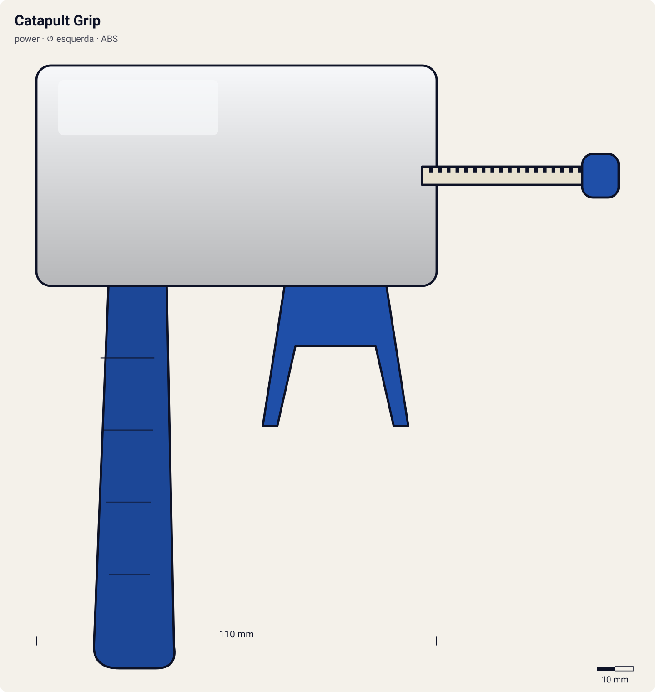

# Catapult Grip

<!-- auto:inicio (gerado por npm run build:research; não edite este bloco) -->

| Atributo | Valor |
|---|---|
| Força | 8 |
| RPM máx. (estimado) | 6650 |
| Precisão | 5 |
| Controle de ângulo | 6 |
| Facilidade | 6 |
<!-- auto:fim -->

**Nome JP:** カタパルトグリップ · **Tipo:** power · **Rotação:** esquerda · **Sistema:** spin-gear · **No anime:** sim

Grip com mecanismo de catapulta: o EZ Shooter corre num trilho com mola. Puxar o winder recua o lançador e gira a bey; no fim da puxada a mola dispara o lançador para frente e a bey sai com avanço (wiki, Grip).

Dados para o jogo em [`dados.json`](dados.json). Arte: `lancador.svg` será gerado por `scripts/render-art.js` a partir de `forma` (não desenhe à mão).

## Produto (Takara / Hasbro)

- Catapult Grip (Takara)
- Dragoon S Special Set com Catapult Grip branco (Takara)

**Acessórios:** EZ Shooter (esquerdo, no caso do Tyson); Mola de catapulta.

**Material:** ABS + Mola de aço.

| Medida | Valor | Fonte |
|---|---|---|
| comprimento_mm | 110 | estimado: trilho da catapulta |
| largura_mm | 55 | estimado |
| altura_mm | 110 | estimado |
| peso_g | 60 | estimado |
| curso_corda_mm | 218 | estimado |

## Ripcords

De fábrica: [Dragon Winder](../ripcords/dragon-winder/). Compatíveis: [Winder padrão (Beyblade Winder)](../ripcords/winder-padrao/), [Ripcord Hasbro (era plástica)](../ripcords/winder-hasbro/), [Dragon Winder](../ripcords/dragon-winder/), [Neo-Dragon Winder](../ripcords/neo-dragon-winder/), [Ultimate Winder](../ripcords/ultimate-winder/). O rpm_max abaixo foi estimado com o ripcord de fábrica; trocar de ripcord aplica a razão dos multiplicadores (ver o [README do catálogo](../README.md#ripcords)).

## Como funciona

Mesma transmissão do lançador de ripcord (cremalheira → pinhão → prongs; ver a ficha do [EZ Shooter](../ez-shooter/README.md)), com um mecanismo a mais que entrega energia **fora** da rotação:
- **Catapult Grip:** o EZ Shooter corre num trilho com mola. Puxar o winder recua o lançador (comprimindo a mola) e gira a bey; no fim da puxada a mola dispara o lançador para frente e a bey sai com velocidade linear (wiki).
- **RC Shooter:** o lançamento é comum; depois dele, o gatilho vira um controle de rádio que empurra a bey RC para frente ou para trás (wiki).

**O papel do grip:** o cabo em pistola põe a mão que segura o lançador **abaixo e atrás** do ponto de lançamento, como numa pistola. Assim o punho trava o ângulo (menos inclinação acidental), o braço absorve o tranco da puxada e a outra mão puxa o winder em linha reta, alinhado com a fenda. Resultado: quase a mesma rotação, mas muito mais **precisão** e **controle de ângulo**. Acessórios como Spring Support/Spring Trigger (mola que guia a corda), Rubber Grip (borracha antiderrapante) e Metal Trigger (peso e apoio para o dedo) reforçam isso (wiki, Grip/Customize Grip).

## Quem usa no anime

- **Tyson** (s1; dragoon-s): Ep. 8: Kenny dá ao Tyson um novo "Catapult Grip Shooter" antes do torneio asiático (Hong Kong). Usado até o ep. 17.

## Técnica de lançamento dos personagens

### Tyson

- **No anime:** Canhoto, mas às vezes lança com a mão direita para controlar melhor o lançador (wiki). Rotação esquerda desde a Dragoon S. Truques: no ep. 1 alonga o winder para ter mais força e corre até o estádio, pulando para lançar do alto; no ep. 4 lança com o lançador virado para cima (a Dragoon S "some e reaparece"). Na G-Rev ep. 21 o lançamento sai fraco quando ele está abalado; no ep. 39 o tranco da Dragoon MS joga o corpo dele para trás.
- **Frase de lançamento:** "3, 2, 1... Let it rip!" (EN) / "Go Shoot!" (JP); "Dragoon, attack!"
- **No mini-game:** Bônus de força com "lançamento com corrida" (segurar o analógico para frente durante a contagem); variação "lançador para cima" (inclinação > 60°) faz a bey quicar e cair num ponto aleatório perto do centro. Penalidade de força se a vida/moral estiver baixa (G-Rev ep. 21).

## Atributos e mini-game

| Força | rpm máx. | Precisão | Controle de ângulo | Facilidade |
|---|---|---|---|---|
| 8 | 6650 | 5 | 6 | 6 |

Todos estimados (escala 1–10). A mola não aumenta o giro: puxar o winder também recua o lançador; ao soltar, a catapulta joga a beyblade para frente (wiki). O ganho é de velocidade linear (avanço inicial), não de rpm; precisão cai porque o tranco desvia o eixo.

**Tradução para o DualShock 4** (regras gerais no [README do catálogo](../README.md#mini-game-de-lançamento-dualshock-4)):

- **R2 (puxar):** apertar até o fim em ~300 ms. A janela perfeita é de **100 ms** em torno do "Let it rip!"; força máxima x1.15.
- **Analógico esquerdo (inclinar/mirar):** até 35° de inclinação; desvio angular aleatório de ±8°, reduzido pela assistência de mira (0.1).
- **Catapulta:** +35% de velocidade linear inicial (a bey entra avançando).
- forca_maxima > 1 aplica-se ao impulso linear inicial (avanço), não ao rpm.

## Referências visuais

Nenhuma foto local deste lançador existe no repositório (as fotos da wiki estão atrás do CDN bloqueado). Cores e formas em `forma` são estimadas e marcadas em `obs_cores`.

## Incertezas

- Medidas e peso são **estimativas** coerentes entre os lançadores (nenhuma ficha técnica oficial foi encontrada).

## Fontes

- https://beyblade.fandom.com/wiki/Grip
- https://beyblade.fandom.com/wiki/Beyblade_-_Episode_08
- https://beyblade.fandom.com/wiki/Dragoon_S
- https://beyblade.fandom.com/wiki/List_of_Original_Series_products_(Takara)
