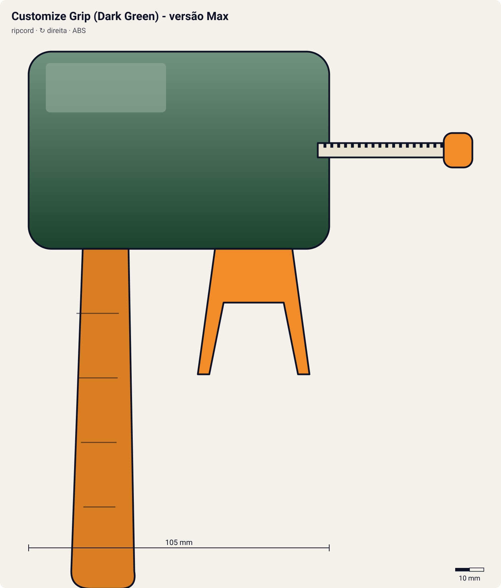

# Customize Grip (Dark Green) - versão Max

<!-- auto:inicio (gerado por npm run build:research; não edite este bloco) -->

| Atributo | Valor |
|---|---|
| Força | 7 |
| RPM máx. (estimado) | 6750 |
| Precisão | 8 |
| Controle de ângulo | 8 |
| Facilidade | 8 |
<!-- auto:fim -->

**Nome JP:** カスタマイズグリップ · **Tipo:** ripcord · **Rotação:** direita · **Sistema:** engine-gear · **No anime:** sim

Customize Grip na cor Dark Green, a versão do personagem. Cabo em pistola onde se encaixa o EZ Shooter; aceita Rubber Grip, Spring Support e Metal Trigger (wiki).

Dados para o jogo em [`dados.json`](dados.json). Arte: `lancador.svg` será gerado por `scripts/render-art.js` a partir de `forma` (não desenhe à mão).

## Produto (Takara / Hasbro)

- A-105 Customize Grip (Green, "Max Version")
- A-43 Customize Grip (Dark Blue, modelo original)
- Peças: A-57/A-58/A-92 Rubber Grip, A-59 Spring Support, A-65/A-96 Metal Trigger, A-79 Metal Grip

**Acessórios:** EZ Shooter direito; Rubber Grip (borracha do cabo); Spring Support (mola de alinhamento); Metal Trigger (gatilho/anel de metal para o dedo); Turbo Winder (nas beys Engine Gear).

**Material:** ABS + Borracha (Rubber Grip), Metal (Metal Trigger, Metal Grip), Mola de aço (Spring Support). Ponto fraco conhecido: a entrada do winder desgasta com o uso, pior nos lançadores esquerdos (wiki).

| Medida | Valor | Fonte |
|---|---|---|
| comprimento_mm | 105 | estimado |
| largura_mm | 55 | estimado |
| altura_mm | 125 | estimado |
| peso_g | 65 | estimado: sem Metal Trigger; +15 g com ele |
| curso_corda_mm | 145 | estimado |

## Ripcords

De fábrica: [Winder padrão (Beyblade Winder)](../ripcords/winder-padrao/). Compatíveis: [Winder padrão (Beyblade Winder)](../ripcords/winder-padrao/), [Ripcord Hasbro (era plástica)](../ripcords/winder-hasbro/), [Dragon Winder](../ripcords/dragon-winder/), [Neo-Dragon Winder](../ripcords/neo-dragon-winder/), [Ultimate Winder](../ripcords/ultimate-winder/). O rpm_max abaixo foi estimado com o ripcord de fábrica; trocar de ripcord aplica a razão dos multiplicadores (ver o [README do catálogo](../README.md#ripcords)).

## Como funciona

O **winder** (ripcord) é uma régua de plástico com uma fileira de dentes: uma **cremalheira**. Ao entrar pela fenda do lançador, os dentes engatam num **pinhão** (engrenagem pequena; 10 dentes no EZ Shooter, segundo a wiki). O pinhão é ligado aos **dois prongs**, que se encaixam nas aberturas ao lado do Bit Chip e empurram as abas do Spin Gear.

Ao puxar, a cremalheira passa reto pelo pinhão e o faz girar, levando a beyblade junto. Cada dente que passa avança um dente do pinhão: o Dragon Winder (68 dentes) dá **~6,8 voltas** num pinhão de 10 dentes. A rotação final depende sobretudo da **velocidade da mão no fim da puxada** e do **raio do pinhão**: rpm ≈ v / (2π·r) × 60. Com ~3,5 m/s e r ≈ 5,1 mm, isso dá ~6.500 rpm. Pinhão menor (Power Custom, 9 dentes) dá mais rpm com a mesma mão.

Quando a cremalheira sai, o pinhão fica livre (catraca) e a bey, ainda presa só pela gravidade e pelos prongs, cai. Se o lançador estiver inclinado, a bey sai inclinada. Se a puxada for torta, a corda raspa na fenda: perde força e desgasta o lançador (a wiki recomenda endireitar o winder em água quente).

**Sentido de rotação:** os prongs só empurram as abas do Spin Gear num sentido. Um SG esquerdo tem as abas invertidas e precisa de um lançador esquerdo, que inverte o sentido com uma engrenagem extra (Left EZ original) ou com o winder entrando de cabeça para baixo (Neo Reverse). O Dual Shooter do HMS tem duas fendas, uma para cada sentido.

**O papel do grip:** o cabo em pistola põe a mão que segura o lançador **abaixo e atrás** do ponto de lançamento, como numa pistola. Assim o punho trava o ângulo (menos inclinação acidental), o braço absorve o tranco da puxada e a outra mão puxa o winder em linha reta, alinhado com a fenda. Resultado: quase a mesma rotação, mas muito mais **precisão** e **controle de ângulo**. Acessórios como Spring Support/Spring Trigger (mola que guia a corda), Rubber Grip (borracha antiderrapante) e Metal Trigger (peso e apoio para o dedo) reforçam isso (wiki, Grip/Customize Grip).

## Quem usa no anime

- **Max** (g-revolution; draciel-g): Wiki (Customize Grip): os quatro protagonistas usam versões coloridas do Customize Grip em G-Revolution; a Takara vendeu as cores de cada um.

Beys que apontam para este lançador em [`_mapa.json`](../_mapa.json): `max-tate/draciel-g`.

## Técnica de lançamento dos personagens

### Max

- **No anime:** Lançamento centralizado, sem pressa, ângulo reto (sem tilt), mirando o centro do estádio. Ep. 3: usa um EZ Grip para firmar o lançador. Ep. 5: lança a bey "em reverso" para anular o ataque do Kai.
- **Frase de lançamento:** "Let it rip!" / "Go Shoot!"; "Draciel, Viper Wall!"
- **No mini-game:** Assistência de mira para o centro; inclinação limitada (bey de defesa). A mira LED do Marksmen Grip mostra o ponto de queda.

## Atributos e mini-game

| Força | rpm máx. | Precisão | Controle de ângulo | Facilidade |
|---|---|---|---|---|
| 7 | 6750 | 8 | 8 | 8 |

Todos estimados (escala 1–10). Grip modular: o cabo em pistola + Spring Support deixam a puxada reta (+3%); o Metal Trigger dá peso e ponto de apoio. Com EZ Shooter direito: ~6750 rpm.

**Tradução para o DualShock 4** (regras gerais no [README do catálogo](../README.md#mini-game-de-lançamento-dualshock-4)):

- **R2 (puxar):** apertar até o fim em ~260 ms. A janela perfeita é de **135 ms** em torno do "Let it rip!"; força máxima x1.03.
- **Analógico esquerdo (inclinar/mirar):** até 35° de inclinação; desvio angular aleatório de ±3°, reduzido pela assistência de mira (0.35).
- Grip "de competição": melhor equilíbrio entre força e precisão da era plástica.

## Referências visuais

Nenhuma foto local deste lançador existe no repositório (as fotos da wiki estão atrás do CDN bloqueado). Cores e formas em `forma` são estimadas e marcadas em `obs_cores`.

## Incertezas

- Medidas e peso são **estimativas** coerentes entre os lançadores (nenhuma ficha técnica oficial foi encontrada).

## Fontes

- https://beyblade.fandom.com/wiki/Customize_Grip
- https://beyblade.fandom.com/wiki/Grip
- https://beyblade.fandom.com/wiki/List_of_Original_Series_products_(Takara)
