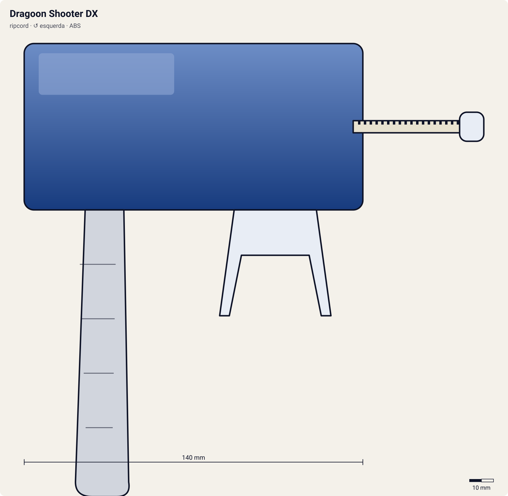

# Dragoon Shooter DX

<!-- auto:inicio (gerado por npm run build:research; não edite este bloco) -->

| Atributo | Valor |
|---|---|
| Força | 7 |
| RPM máx. (estimado) | 6750 |
| Precisão | 7 |
| Controle de ângulo | 7 |
| Facilidade | 6 |
<!-- auto:fim -->

**Nome JP:** ドラグーンシューターDX · **Tipo:** ripcord · **Rotação:** esquerda · **Sistema:** spin-gear · **No anime:** sim

Lançador eletrônico em forma de dragão. Dispensa o EZ Shooter (o mecanismo é embutido) e, ligado, oferece minijogos usando o winder e os Bit Chips (wiki).

Dados para o jogo em [`dados.json`](dados.json). Arte: `lancador.svg` será gerado por `scripts/render-art.js` a partir de `forma` (não desenhe à mão).

## Produto (Takara / Hasbro)

- A-19 Dragoon Shooter DX (Takara)
- Frost Silver Version (exclusivo Toys "R" Us)
- A-21 DX Shooter Exclusive Code (corda própria)

**Acessórios:** Eletrônica com minijogos (winder e Bit Chips); DX Shooter Exclusive Code (A-21).

**Material:** ABS + Circuito eletrônico, LCD/sons e pilhas.

| Medida | Valor | Fonte |
|---|---|---|
| comprimento_mm | 140 | estimado: wiki: segundo maior grip da era, atrás só do RC Shooter |
| largura_mm | 70 | estimado |
| altura_mm | 125 | estimado |
| peso_g | 140 | estimado: com pilhas |
| curso_corda_mm | 218 | estimado |

## Ripcords

De fábrica: [Dragon Winder](../ripcords/dragon-winder/). Compatíveis: [Winder padrão (Beyblade Winder)](../ripcords/winder-padrao/), [Ripcord Hasbro (era plástica)](../ripcords/winder-hasbro/), [Dragon Winder](../ripcords/dragon-winder/), [Neo-Dragon Winder](../ripcords/neo-dragon-winder/), [Ultimate Winder](../ripcords/ultimate-winder/). O rpm_max abaixo foi estimado com o ripcord de fábrica; trocar de ripcord aplica a razão dos multiplicadores (ver o [README do catálogo](../README.md#ripcords)).

## Como funciona

O **winder** (ripcord) é uma régua de plástico com uma fileira de dentes: uma **cremalheira**. Ao entrar pela fenda do lançador, os dentes engatam num **pinhão** (engrenagem pequena; 10 dentes no EZ Shooter, segundo a wiki). O pinhão é ligado aos **dois prongs**, que se encaixam nas aberturas ao lado do Bit Chip e empurram as abas do Spin Gear.

Ao puxar, a cremalheira passa reto pelo pinhão e o faz girar, levando a beyblade junto. Cada dente que passa avança um dente do pinhão: o Dragon Winder (68 dentes) dá **~6,8 voltas** num pinhão de 10 dentes. A rotação final depende sobretudo da **velocidade da mão no fim da puxada** e do **raio do pinhão**: rpm ≈ v / (2π·r) × 60. Com ~3,5 m/s e r ≈ 5,1 mm, isso dá ~6.500 rpm. Pinhão menor (Power Custom, 9 dentes) dá mais rpm com a mesma mão.

Quando a cremalheira sai, o pinhão fica livre (catraca) e a bey, ainda presa só pela gravidade e pelos prongs, cai. Se o lançador estiver inclinado, a bey sai inclinada. Se a puxada for torta, a corda raspa na fenda: perde força e desgasta o lançador (a wiki recomenda endireitar o winder em água quente).

**Sentido de rotação:** os prongs só empurram as abas do Spin Gear num sentido. Um SG esquerdo tem as abas invertidas e precisa de um lançador esquerdo, que inverte o sentido com uma engrenagem extra (Left EZ original) ou com o winder entrando de cabeça para baixo (Neo Reverse). O Dual Shooter do HMS tem duas fendas, uma para cada sentido.

**O papel do grip:** o cabo em pistola põe a mão que segura o lançador **abaixo e atrás** do ponto de lançamento, como numa pistola. Assim o punho trava o ângulo (menos inclinação acidental), o braço absorve o tranco da puxada e a outra mão puxa o winder em linha reta, alinhado com a fenda. Resultado: quase a mesma rotação, mas muito mais **precisão** e **controle de ângulo**. Acessórios como Spring Support/Spring Trigger (mola que guia a corda), Rubber Grip (borracha antiderrapante) e Metal Trigger (peso e apoio para o dedo) reforçam isso (wiki, Grip/Customize Grip).

## Quem usa no anime

- **Tyson** (s1; dragoon-s, dragoon-f): Ep. 17 (final asiático contra o Lee): o Tyson recebe o Dragoon Shooter DX. Segue com ele na Dragoon F.

Beys que apontam para este lançador em [`_mapa.json`](../_mapa.json): `tyson-granger/dragoon-f`.

## Técnica de lançamento dos personagens

### Tyson

- **No anime:** Canhoto, mas às vezes lança com a mão direita para controlar melhor o lançador (wiki). Rotação esquerda desde a Dragoon S. Truques: no ep. 1 alonga o winder para ter mais força e corre até o estádio, pulando para lançar do alto; no ep. 4 lança com o lançador virado para cima (a Dragoon S "some e reaparece"). Na G-Rev ep. 21 o lançamento sai fraco quando ele está abalado; no ep. 39 o tranco da Dragoon MS joga o corpo dele para trás.
- **Frase de lançamento:** "3, 2, 1... Let it rip!" (EN) / "Go Shoot!" (JP); "Dragoon, attack!"
- **No mini-game:** Bônus de força com "lançamento com corrida" (segurar o analógico para frente durante a contagem); variação "lançador para cima" (inclinação > 60°) faz a bey quicar e cair num ponto aleatório perto do centro. Penalidade de força se a vida/moral estiver baixa (G-Rev ep. 21).

## Atributos e mini-game

| Força | rpm máx. | Precisão | Controle de ângulo | Facilidade |
|---|---|---|---|---|
| 7 | 6750 | 7 | 7 | 6 |

Todos estimados (escala 1–10). Mesma transmissão de pinhão do EZ Shooter; o corpo grande e pesado estabiliza a mão (+3%). Sentido esquerdo inferido: é o lançador temático do Dragoon e o Tyson só usa rotação esquerda a partir da Dragoon S.

**Tradução para o DualShock 4** (regras gerais no [README do catálogo](../README.md#mini-game-de-lançamento-dualshock-4)):

- **R2 (puxar):** apertar até o fim em ~300 ms. A janela perfeita é de **125 ms** em torno do "Let it rip!"; força máxima x1.03.
- **Analógico esquerdo (inclinar/mirar):** até 35° de inclinação; desvio angular aleatório de ±4°, reduzido pela assistência de mira (0.2).
- Lançador "de fera": tem som/efeito de rugido do Dragoon no HUD ao acertar a janela perfeita.

## Referências visuais

Nenhuma foto local deste lançador existe no repositório (as fotos da wiki estão atrás do CDN bloqueado). Cores e formas em `forma` são estimadas e marcadas em `obs_cores`.

## Incertezas

- Medidas e peso são **estimativas** coerentes entre os lançadores (nenhuma ficha técnica oficial foi encontrada).
- Sentido de rotação do brinquedo não está escrito na wiki (inferido: esquerdo).

## Fontes

- https://beyblade.fandom.com/wiki/Dragoon_Shooter_DX
- https://beyblade.fandom.com/wiki/Launcher
- https://beyblade.fandom.com/wiki/Beyblade_-_Episode_17
- https://beyblade.fandom.com/wiki/List_of_Original_Series_products_(Takara)
