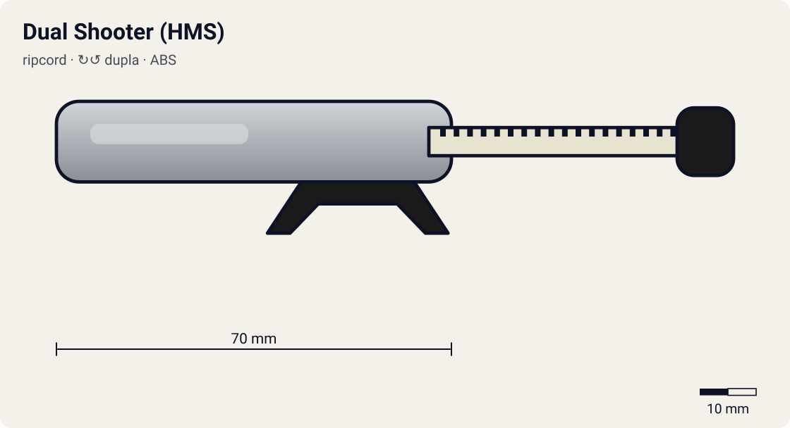

# Dual Shooter (HMS)

<!-- auto:inicio (gerado por npm run build:research; não edite este bloco) -->

| Atributo | Valor |
|---|---|
| Força | 8 |
| RPM máx. (estimado) | 7400 |
| Precisão | 6 |
| Controle de ângulo | 6 |
| Facilidade | 8 |
<!-- auto:fim -->

**Nome JP:** デュアルシューター · **Tipo:** ripcord · **Rotação:** dupla · **Sistema:** hms · **No anime:** sim

Lançador padrão do Hard Metal System. Tem duas entradas de winder (uma para cada sentido): o sentido de rotação muda sem trocar peças da bey (wiki).

Dados para o jogo em [`dados.json`](dados.json). Arte: `lancador.svg` será gerado por `scripts/render-art.js` a partir de `forma` (não desenhe à mão).

## Produto (Takara / Hasbro)

- Incluso nas Starters HMS (Takara A-123 a A-126, MA-01)
- MA-06 HMS Dual Shooter (Light Blue)
- HMS Boosters: Dual Shooter Silver/Bronze
- Hasbro: "Dual Launcher" das Starters Metal System

**Acessórios:** G-Winder (único winder HMS, todos do mesmo comprimento, plástico mais grosso).

**Material:** ABS + G-Winder em plástico mais rígido e grosso.

| Medida | Valor | Fonte |
|---|---|---|
| comprimento_mm | 70 | estimado |
| largura_mm | 48 | estimado: beys HMS são menores |
| altura_mm | 26 | estimado |
| peso_g | 17 | estimado |
| curso_corda_mm | 218 | estimado: G-Winder derivado do Dragon Winder |

## Ripcords

De fábrica: [G-Winder (HMS)](../ripcords/g-winder/). Compatíveis: [G-Winder (HMS)](../ripcords/g-winder/). O rpm_max abaixo foi estimado com o ripcord de fábrica; trocar de ripcord aplica a razão dos multiplicadores (ver o [README do catálogo](../README.md#ripcords)).

## Como funciona

O **winder** (ripcord) é uma régua de plástico com uma fileira de dentes: uma **cremalheira**. Ao entrar pela fenda do lançador, os dentes engatam num **pinhão** (engrenagem pequena; 10 dentes no EZ Shooter, segundo a wiki). O pinhão é ligado aos **dois prongs**, que se encaixam nas aberturas ao lado do Bit Chip e empurram as abas do Spin Gear.

Ao puxar, a cremalheira passa reto pelo pinhão e o faz girar, levando a beyblade junto. Cada dente que passa avança um dente do pinhão: o Dragon Winder (68 dentes) dá **~6,8 voltas** num pinhão de 10 dentes. A rotação final depende sobretudo da **velocidade da mão no fim da puxada** e do **raio do pinhão**: rpm ≈ v / (2π·r) × 60. Com ~3,5 m/s e r ≈ 5,1 mm, isso dá ~6.500 rpm. Pinhão menor (Power Custom, 9 dentes) dá mais rpm com a mesma mão.

Quando a cremalheira sai, o pinhão fica livre (catraca) e a bey, ainda presa só pela gravidade e pelos prongs, cai. Se o lançador estiver inclinado, a bey sai inclinada. Se a puxada for torta, a corda raspa na fenda: perde força e desgasta o lançador (a wiki recomenda endireitar o winder em água quente).

**Sentido de rotação:** os prongs só empurram as abas do Spin Gear num sentido. Um SG esquerdo tem as abas invertidas e precisa de um lançador esquerdo, que inverte o sentido com uma engrenagem extra (Left EZ original) ou com o winder entrando de cabeça para baixo (Neo Reverse). O Dual Shooter do HMS tem duas fendas, uma para cada sentido.

## Quem usa no anime

- **Tyson** (g-revolution; dragoon-ms, dragoon-ms-ultimate-version): Wiki do Tyson: "Dual Shooter (Currently)". G-Rev ep. 39: na primeira puxada da Dragoon MS, o tranco joga o Tyson para trás e derruba Ray e Rick; a bey abre uma cratera.
- **Kai** (g-revolution; dranzer-ms): Inferido: Dual Shooter é o lançador padrão de toda bey HMS (wiki).
- **Max** (g-revolution; draciel-ms): Inferido (padrão HMS).
- **Daichi** (g-revolution; gaia-dragoon-ms): Inferido (padrão HMS).

Beys que apontam para este lançador em [`_mapa.json`](../_mapa.json): `tyson-granger/dragoon-ms`, `tyson-granger/dragoon-ms-ultimate-version`, `kai-hiwatari/dranzer-ms`, `max-tate/draciel-ms`, `daichi-sumeragi/gaia-dragoon-ms`.

## Técnica de lançamento dos personagens

### Tyson

- **No anime:** Canhoto, mas às vezes lança com a mão direita para controlar melhor o lançador (wiki). Rotação esquerda desde a Dragoon S. Truques: no ep. 1 alonga o winder para ter mais força e corre até o estádio, pulando para lançar do alto; no ep. 4 lança com o lançador virado para cima (a Dragoon S "some e reaparece"). Na G-Rev ep. 21 o lançamento sai fraco quando ele está abalado; no ep. 39 o tranco da Dragoon MS joga o corpo dele para trás.
- **Frase de lançamento:** "3, 2, 1... Let it rip!" (EN) / "Go Shoot!" (JP); "Dragoon, attack!"
- **No mini-game:** Bônus de força com "lançamento com corrida" (segurar o analógico para frente durante a contagem); variação "lançador para cima" (inclinação > 60°) faz a bey quicar e cair num ponto aleatório perto do centro. Penalidade de força se a vida/moral estiver baixa (G-Rev ep. 21).

### Kai

- **No anime:** Lançamento forte e preciso. Na G-Rev ep. 39 a Hilary lança a Hopper 2 "imitando o jeito como o Kai lança a Dranzer" (trivia da wiki), sinal de que a pose do Kai é marcante. Contra rivais fortes vai com tudo desde o lançamento.
- **Frase de lançamento:** "Let it rip!" / "Go Shoot!"; "Dranzer, go!"
- **No mini-game:** Janela perfeita um pouco mais estreita, mas com bônus de precisão (desvio angular x0,8) quando acertada: estilo "frio e exato".

### Max

- **No anime:** Lançamento centralizado, sem pressa, ângulo reto (sem tilt), mirando o centro do estádio. Ep. 3: usa um EZ Grip para firmar o lançador. Ep. 5: lança a bey "em reverso" para anular o ataque do Kai.
- **Frase de lançamento:** "Let it rip!" / "Go Shoot!"; "Draciel, Viper Wall!"
- **No mini-game:** Assistência de mira para o centro; inclinação limitada (bey de defesa). A mira LED do Marksmen Grip mostra o ponto de queda.

### Daichi

- **No anime:** Lançamento forte e direto, muitas vezes contra o terreno/obstáculos; tira a bey e o lançador e dispara gritando "Take that!" (wiki).
- **Frase de lançamento:** "Take that!"; "Let it rip!"
- **No mini-game:** Força +, precisão −: janela perfeita curta, mas forca_maxima +5% quando a puxada é muito rápida.

## Atributos e mini-game

| Força | rpm máx. | Precisão | Controle de ângulo | Facilidade |
|---|---|---|---|---|
| 8 | 7400 | 6 | 6 | 8 |

Todos estimados (escala 1–10). Duas entradas de winder (esquerda e direita): basta virar o G-Winder (wiki). Beys HMS são menores e com AR metálico; a wiki diz que a velocidade de rotação "melhorou dramaticamente". Estimado +13% sobre a referência.

**Tradução para o DualShock 4** (regras gerais no [README do catálogo](../README.md#mini-game-de-lançamento-dualshock-4)):

- **R2 (puxar):** apertar até o fim em ~290 ms. A janela perfeita é de **115 ms** em torno do "Let it rip!"; força máxima x1.13.
- **Analógico esquerdo (inclinar/mirar):** até 30° de inclinação; desvio angular aleatório de ±5°, reduzido pela assistência de mira (0.1).
- **L1/R1:** escolher o sentido de rotação antes da puxada (lançador de rotação dupla).
- **Recuo:** tranco de câmera/vibração proporcional (0.6).
- L1/R1 escolhe o lado do winder (esquerda/direita) antes da puxada. Recuo forte: tranco de câmera (ep. 39).

## Referências visuais

Nenhuma foto local deste lançador existe no repositório (as fotos da wiki estão atrás do CDN bloqueado). Cores e formas em `forma` são estimadas e marcadas em `obs_cores`.

## Incertezas

- Medidas e peso são **estimativas** coerentes entre os lançadores (nenhuma ficha técnica oficial foi encontrada).

## Fontes

- https://beyblade.fandom.com/wiki/Dual_Shooter
- https://beyblade.fandom.com/wiki/Hard_Metal_System
- https://beyblade.fandom.com/wiki/G-Winder
- https://beyblade.fandom.com/wiki/Tyson_Granger
- https://beyblade.fandom.com/wiki/Beyblade:_G-Revolution_-_Episode_39
