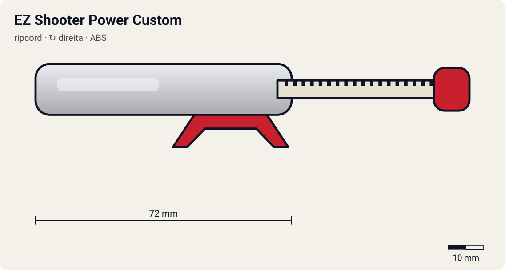

# EZ Shooter Power Custom

<!-- auto:inicio (gerado por npm run build:research; não edite este bloco) -->

| Atributo | Valor |
|---|---|
| Força | 8 |
| RPM máx. (estimado) | 7270 |
| Precisão | 5 |
| Controle de ângulo | 5 |
| Facilidade | 7 |
<!-- auto:fim -->

**Nome JP:** イージーシューターパワーカスタム · **Tipo:** ripcord · **Rotação:** direita · **Sistema:** engine-gear · **No anime:** não (só brinquedo)

Versão de rotação direita do EZ Shooter com engrenagem de 9 dentes, menor, que dá ~11% mais força. Raro (wiki).

Dados para o jogo em [`dados.json`](dados.json). Arte: `lancador.svg` será gerado por `scripts/render-art.js` a partir de `forma` (não desenhe à mão).

## Produto (Takara / Hasbro)

- A-119 G-Revolution EZ Shooter Power Custom (Takara)

**Acessórios:** Winder padrão.

**Material:** ABS.

| Medida | Valor | Fonte |
|---|---|---|
| comprimento_mm | 72 | estimado |
| largura_mm | 52 | estimado |
| altura_mm | 26 | estimado |
| peso_g | 16 | estimado |
| curso_corda_mm | 145 | estimado |

## Ripcords

De fábrica: [Winder padrão (Beyblade Winder)](../ripcords/winder-padrao/). Compatíveis: [Winder padrão (Beyblade Winder)](../ripcords/winder-padrao/), [Ripcord Hasbro (era plástica)](../ripcords/winder-hasbro/), [Dragon Winder](../ripcords/dragon-winder/), [Neo-Dragon Winder](../ripcords/neo-dragon-winder/), [Ultimate Winder](../ripcords/ultimate-winder/). O rpm_max abaixo foi estimado com o ripcord de fábrica; trocar de ripcord aplica a razão dos multiplicadores (ver o [README do catálogo](../README.md#ripcords)).

## Como funciona

O **winder** (ripcord) é uma régua de plástico com uma fileira de dentes: uma **cremalheira**. Ao entrar pela fenda do lançador, os dentes engatam num **pinhão** (engrenagem pequena; 10 dentes no EZ Shooter, segundo a wiki). O pinhão é ligado aos **dois prongs**, que se encaixam nas aberturas ao lado do Bit Chip e empurram as abas do Spin Gear.

Ao puxar, a cremalheira passa reto pelo pinhão e o faz girar, levando a beyblade junto. Cada dente que passa avança um dente do pinhão: o Dragon Winder (68 dentes) dá **~6,8 voltas** num pinhão de 10 dentes. A rotação final depende sobretudo da **velocidade da mão no fim da puxada** e do **raio do pinhão**: rpm ≈ v / (2π·r) × 60. Com ~3,5 m/s e r ≈ 5,1 mm, isso dá ~6.500 rpm. Pinhão menor (Power Custom, 9 dentes) dá mais rpm com a mesma mão.

Quando a cremalheira sai, o pinhão fica livre (catraca) e a bey, ainda presa só pela gravidade e pelos prongs, cai. Se o lançador estiver inclinado, a bey sai inclinada. Se a puxada for torta, a corda raspa na fenda: perde força e desgasta o lançador (a wiki recomenda endireitar o winder em água quente).

**Sentido de rotação:** os prongs só empurram as abas do Spin Gear num sentido. Um SG esquerdo tem as abas invertidas e precisa de um lançador esquerdo, que inverte o sentido com uma engrenagem extra (Left EZ original) ou com o winder entrando de cabeça para baixo (Neo Reverse). O Dual Shooter do HMS tem duas fendas, uma para cada sentido.

## Quem usa no anime

Ninguém entre os 10 personagens estudados: modelo de brinquedo da época, catalogado para o modo loja/desafio do jogo.

## Atributos e mini-game

| Força | rpm máx. | Precisão | Controle de ângulo | Facilidade |
|---|---|---|---|---|
| 8 | 7270 | 5 | 5 | 7 |

Todos estimados (escala 1–10). Pinhão de 9 dentes em vez de 10, de diâmetro menor: "aumenta a força do lançamento em ~11%" (wiki). 6550 x 10/9 ≈ 7270 rpm; puxada um pouco mais pesada.

**Tradução para o DualShock 4** (regras gerais no [README do catálogo](../README.md#mini-game-de-lançamento-dualshock-4)):

- **R2 (puxar):** apertar até o fim em ~270 ms. A janela perfeita é de **110 ms** em torno do "Let it rip!"; força máxima x1.11.
- **Analógico esquerdo (inclinar/mirar):** até 30° de inclinação; desvio angular aleatório de ±6°.
- Item de loja/upgrade.

## Referências visuais

Nenhuma foto local deste lançador existe no repositório (as fotos da wiki estão atrás do CDN bloqueado). Cores e formas em `forma` são estimadas e marcadas em `obs_cores`.

## Incertezas

- Medidas e peso são **estimativas** coerentes entre os lançadores (nenhuma ficha técnica oficial foi encontrada).

## Fontes

- https://beyblade.fandom.com/wiki/Launcher
- https://beyblade.fandom.com/wiki/List_of_Original_Series_products_(Takara)
