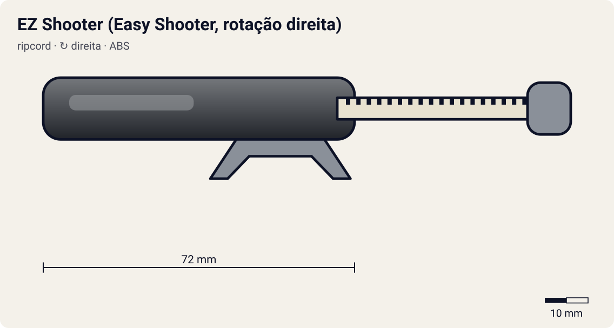

# EZ Shooter (Easy Shooter, rotação direita)

<!-- auto:inicio (gerado por npm run build:research; não edite este bloco) -->

| Atributo | Valor |
|---|---|
| Força | 6 |
| RPM máx. (estimado) | 6550 |
| Precisão | 5 |
| Controle de ângulo | 5 |
| Facilidade | 8 |
<!-- auto:fim -->

**Nome JP:** イージーシューター · **Tipo:** ripcord · **Rotação:** direita · **Sistema:** spin-gear · **No anime:** sim

Lançador básico de rotação direita da era plástica. O winder (corda dentada) entra pela traseira e os dois dentes de encaixe (prongs) prendem a beyblade nas aberturas ao lado do Bit Chip.

Dados para o jogo em [`dados.json`](dados.json). Arte: `lancador.svg` será gerado por `scripts/render-art.js` a partir de `forma` (não desenhe à mão).

## Produto (Takara / Hasbro)

- A-22 Easy Shooter (Takara)
- BeyShooter / EZ Shooter (Takara, pré A-series)
- Launcher padrão das Starters Hasbro

**Acessórios:** Winder padrão (ripcord curto com argola); Compatível com EZ Shooter Grip, Catapult Grip, Marksmen Grip e Customize Grip.

**Material:** ABS + POM ou ABS nas engrenagens internas (estimado). Corpo em ABS moldado; winder em plástico flexível (PE/PP, estimado).

| Medida | Valor | Fonte |
|---|---|---|
| comprimento_mm | 72 | estimado |
| largura_mm | 52 | estimado: largura dos dentes de encaixe (prongs) ~ diâmetro do Bit Chip + abas do SG |
| altura_mm | 26 | estimado |
| peso_g | 16 | estimado |
| curso_corda_mm | 145 | estimado: winder padrão: "o mais curto de todos" segundo a wiki (Ripcord) |

## Ripcords

De fábrica: [Winder padrão (Beyblade Winder)](../ripcords/winder-padrao/). Compatíveis: [Winder padrão (Beyblade Winder)](../ripcords/winder-padrao/), [Ripcord Hasbro (era plástica)](../ripcords/winder-hasbro/), [Dragon Winder](../ripcords/dragon-winder/), [Neo-Dragon Winder](../ripcords/neo-dragon-winder/), [Ultimate Winder](../ripcords/ultimate-winder/), [Ripcord alongado do Tyson (anime)](../ripcords/ripcord-alongado-tyson/). O rpm_max abaixo foi estimado com o ripcord de fábrica; trocar de ripcord aplica a razão dos multiplicadores (ver o [README do catálogo](../README.md#ripcords)).

## Como funciona

O **winder** (ripcord) é uma régua de plástico com uma fileira de dentes: uma **cremalheira**. Ao entrar pela fenda do lançador, os dentes engatam num **pinhão** (engrenagem pequena; 10 dentes no EZ Shooter, segundo a wiki). O pinhão é ligado aos **dois prongs**, que se encaixam nas aberturas ao lado do Bit Chip e empurram as abas do Spin Gear.

Ao puxar, a cremalheira passa reto pelo pinhão e o faz girar, levando a beyblade junto. Cada dente que passa avança um dente do pinhão: o Dragon Winder (68 dentes) dá **~6,8 voltas** num pinhão de 10 dentes. A rotação final depende sobretudo da **velocidade da mão no fim da puxada** e do **raio do pinhão**: rpm ≈ v / (2π·r) × 60. Com ~3,5 m/s e r ≈ 5,1 mm, isso dá ~6.500 rpm. Pinhão menor (Power Custom, 9 dentes) dá mais rpm com a mesma mão.

Quando a cremalheira sai, o pinhão fica livre (catraca) e a bey, ainda presa só pela gravidade e pelos prongs, cai. Se o lançador estiver inclinado, a bey sai inclinada. Se a puxada for torta, a corda raspa na fenda: perde força e desgasta o lançador (a wiki recomenda endireitar o winder em água quente).

**Sentido de rotação:** os prongs só empurram as abas do Spin Gear num sentido. Um SG esquerdo tem as abas invertidas e precisa de um lançador esquerdo, que inverte o sentido com uma engrenagem extra (Left EZ original) ou com o winder entrando de cabeça para baixo (Neo Reverse). O Dual Shooter do HMS tem duas fendas, uma para cada sentido.

## Quem usa no anime

- **Tyson** (s1; dragoon-grip-attacker): Ep. 1: lança a Grip Attacker (rotação direita) com um lançador comum; depois alonga a corda (winder) para ganhar força contra o Carlos.
- **Tyson** (s1, v-force; dranzer-f, master-dragoon): Inferido: as duas beys emprestadas são de rotação direita e exigem lançador direito; o modelo exato não aparece descrito nas fontes.
- **Ray** (s1; driger-s): Wiki (Ray Kon): EZ Shooter preto com winder preto, usado com a Driger S até o ep. 20.
- **Kai** (s1; dranzer-s): Inferido: antes do ep. 14 (Spring Shooter) Kai usa um lançador direito comum.
- **Lee** (s1, g-revolution; galeon, galeon-2, galeon-2-eg): Não confirmado: as fontes não citam um lançador especial do Lee; ficha padrão até haver confirmação.
- **Tala** (s1, g-revolution; wolborg-2, wolborg-4): Não confirmado: nenhuma fonte textual descreve o lançador dos Demolition Boys/Blitzkrieg Boys.
- **Bryan** (s1, g-revolution; falborg, falborg-2): Não confirmado (mesmo caso do Tala).
- **Daichi** (g-revolution; gaia-dragoon, gaia-dragoon-v, gaia-dragoon-g): Não confirmado: a wiki só registra que ele "tira a beyblade e o lançador e dispara" gritando "Take that!".
- **Brooklyn** (g-revolution; zeus): Não confirmado: a galeria da wiki tem a imagem "Brooklyn's Launcher", mas não há descrição em texto e a imagem não pode ser baixada (CDN bloqueado).

Beys que apontam para este lançador em [`_mapa.json`](../_mapa.json): `tyson-granger/dragoon-grip-attacker`, `tyson-granger/dranzer-f`, `tyson-granger/master-dragoon`, `ray-kon/driger-s`, `daichi-sumeragi/gaia-dragoon`, `daichi-sumeragi/gaia-dragoon-v`, `daichi-sumeragi/gaia-dragoon-g`, `tala/wolborg-2`, `tala/wolborg-4`, `bryan-kuznetsov/falborg`, `bryan-kuznetsov/falborg-2`, `brooklyn-masefield/zeus`, `lee/galeon`, `lee/galeon-2`, `lee/galeon-2-eg`.

## Técnica de lançamento dos personagens

### Tyson

- **No anime:** Canhoto, mas às vezes lança com a mão direita para controlar melhor o lançador (wiki). Rotação esquerda desde a Dragoon S. Truques: no ep. 1 alonga o winder para ter mais força e corre até o estádio, pulando para lançar do alto; no ep. 4 lança com o lançador virado para cima (a Dragoon S "some e reaparece"). Na G-Rev ep. 21 o lançamento sai fraco quando ele está abalado; no ep. 39 o tranco da Dragoon MS joga o corpo dele para trás.
- **Frase de lançamento:** "3, 2, 1... Let it rip!" (EN) / "Go Shoot!" (JP); "Dragoon, attack!"
- **No mini-game:** Bônus de força com "lançamento com corrida" (segurar o analógico para frente durante a contagem); variação "lançador para cima" (inclinação > 60°) faz a bey quicar e cair num ponto aleatório perto do centro. Penalidade de força se a vida/moral estiver baixa (G-Rev ep. 21).

### Ray

- **No anime:** Lançamento firme e reto; a Driger orbita rápido e entra em investidas repetidas (pesquisa do personagem). Usa winder preto com o EZ Shooter e o Driger Shooter, e o Ultimate Winder verde com o BeyUltimate Shooter (wiki).
- **Frase de lançamento:** "Let it rip!" / "Go Shoot!"; "Driger, Tiger Claw!"
- **No mini-game:** Tremor do analógico reduzido (mira estável); bônus de órbita quando lançado com inclinação lateral de 10–20°.

### Kai

- **No anime:** Lançamento forte e preciso. Na G-Rev ep. 39 a Hilary lança a Hopper 2 "imitando o jeito como o Kai lança a Dranzer" (trivia da wiki), sinal de que a pose do Kai é marcante. Contra rivais fortes vai com tudo desde o lançamento.
- **Frase de lançamento:** "Let it rip!" / "Go Shoot!"; "Dranzer, go!"
- **No mini-game:** Janela perfeita um pouco mais estreita, mas com bônus de precisão (desvio angular x0,8) quando acertada: estilo "frio e exato".

### Lee

- **No anime:** Lançamento forte e direto, buscando o choque de frente (S1 ep. 17: empurra a Dragoon para fora no primeiro round).
- **Frase de lançamento:** "Let it rip!" / "Go Shoot!"; "Galeon, Black Lightning!"
- **No mini-game:** Bônus de impulso linear ao lançar mirando diretamente o oponente.

### Tala

- **No anime:** Lançamento firme e central; a Wolborg ocupa o centro e deixa o adversário gastar energia (ex.: contra o Lee na G-Rev ep. 22).
- **Frase de lançamento:** "Let it rip!" / "Go Shoot!"; "Wolborg, Novae Rog!"
- **No mini-game:** Lançamento "de stamina": bônus de rpm ao acertar a janela com força entre 80 e 95% (não precisa de força máxima).

### Bryan

- **No anime:** Lançamento forte e agressivo, direto no adversário e na parede (pesquisa do personagem).
- **Frase de lançamento:** "Let it rip!" / "Go Shoot!"; "Falborg, Storm Strike!"
- **No mini-game:** Inclinação agressiva permitida (até 40°) para lançamento em diagonal contra o oponente.

### Daichi

- **No anime:** Lançamento forte e direto, muitas vezes contra o terreno/obstáculos; tira a bey e o lançador e dispara gritando "Take that!" (wiki).
- **Frase de lançamento:** "Take that!"; "Let it rip!"
- **No mini-game:** Força +, precisão −: janela perfeita curta, mas forca_maxima +5% quando a puxada é muito rápida.

### Brooklyn

- **No anime:** Gênio natural: só precisou aprender o básico de "como lançar direito" com o Hiro (wiki). G-Rev ep. 38: com um lançamento simples, destrói uma rocha. Ep. 50: treinando lançamentos, fura as paredes e o teto da sala de treino. A Zeus vai para o centro e "flutua".
- **Frase de lançamento:** "Let it rip!"; "King of Darkness!"
- **No mini-game:** Janela perfeita mais larga (talento natural) e desvio mínimo. No modo história, pode ter lançamento "perfeito automático" como chefe.

## Atributos e mini-game

| Força | rpm máx. | Precisão | Controle de ângulo | Facilidade |
|---|---|---|---|---|
| 6 | 6550 | 5 | 5 | 8 |

Todos estimados (escala 1–10). Referência da escala. Pinhão de 10 dentes (wiki) ~5,1 mm de raio primitivo; mão a ~3,5 m/s no fim do curso => ~6550 rpm. Sem grip, a mão segura o próprio corpo pequeno do lançador: precisão e controle de ângulo medianos.

**Tradução para o DualShock 4** (regras gerais no [README do catálogo](../README.md#mini-game-de-lançamento-dualshock-4)):

- **R2 (puxar):** apertar até o fim em ~260 ms. A janela perfeita é de **120 ms** em torno do "Let it rip!"; força máxima x1.
- **Analógico esquerdo (inclinar/mirar):** até 30° de inclinação; desvio angular aleatório de ±6°.
- Lançador de referência (multiplicadores = 1).

## Referências visuais

Nenhuma foto local deste lançador existe no repositório (as fotos da wiki estão atrás do CDN bloqueado). Cores e formas em `forma` são estimadas e marcadas em `obs_cores`.

## Incertezas

- Medidas e peso são **estimativas** coerentes entre os lançadores (nenhuma ficha técnica oficial foi encontrada).

## Fontes

- https://beyblade.fandom.com/wiki/Launcher
- https://beyblade.fandom.com/wiki/Right-Spin_Shooters
- https://beyblade.fandom.com/wiki/Ripcord
- https://beyblade.fandom.com/wiki/Ray_Kon
- https://beyblade.fandom.com/wiki/List_of_Original_Series_products_(Takara)
- https://beyblade.fandom.com/wiki/Beyblade_-_Episode_01
