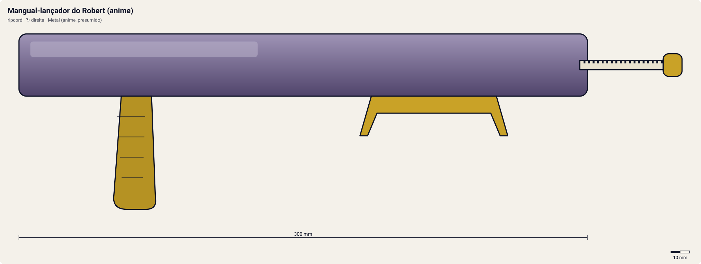

# Mangual-lançador do Robert (anime)

<!-- auto:inicio (gerado por npm run build:research; não edite este bloco) -->

| Atributo | Valor |
|---|---|
| Força | 9 |
| RPM máx. (estimado) | 7200 |
| Precisão | 5 |
| Controle de ângulo | 7 |
| Facilidade | 4 |
<!-- auto:fim -->

**Tipo:** ripcord · **Rotação:** direita · **Sistema:** spin-gear · **No anime:** sim

O Robert usa um mangual como lançador e arma (wiki). Não existe como brinquedo; a ficha é a interpretação de jogo dessa cena.

Dados para o jogo em [`dados.json`](dados.json). Arte: `lancador.svg` será gerado por `scripts/render-art.js` a partir de `forma` (não desenhe à mão).

## Produto (Takara / Hasbro)

- Exclusivo do anime (sem brinquedo)

**Acessórios:** Corrente e cabo de mangual (anime).

**Material:** Metal (anime, presumido) + ABS no mecanismo de encaixe (presumido, se fosse brinquedo). Objeto de ficção: material e medidas são interpretação para o jogo.

| Medida | Valor | Fonte |
|---|---|---|
| comprimento_mm | 300 | estimado: cabo de mangual curto; interpretação |
| largura_mm | 60 | estimado |
| altura_mm | 60 | estimado |
| peso_g | 400 | estimado: interpretação; pesado de propósito |
| curso_corda_mm | 250 | estimado |

## Ripcords

De fábrica: [Winder padrão (Beyblade Winder)](../ripcords/winder-padrao/). Compatíveis: [Winder padrão (Beyblade Winder)](../ripcords/winder-padrao/), [Ripcord Hasbro (era plástica)](../ripcords/winder-hasbro/), [Dragon Winder](../ripcords/dragon-winder/), [Neo-Dragon Winder](../ripcords/neo-dragon-winder/), [Ultimate Winder](../ripcords/ultimate-winder/). O rpm_max abaixo foi estimado com o ripcord de fábrica; trocar de ripcord aplica a razão dos multiplicadores (ver o [README do catálogo](../README.md#ripcords)).

## Como funciona

O **winder** (ripcord) é uma régua de plástico com uma fileira de dentes: uma **cremalheira**. Ao entrar pela fenda do lançador, os dentes engatam num **pinhão** (engrenagem pequena; 10 dentes no EZ Shooter, segundo a wiki). O pinhão é ligado aos **dois prongs**, que se encaixam nas aberturas ao lado do Bit Chip e empurram as abas do Spin Gear.

Ao puxar, a cremalheira passa reto pelo pinhão e o faz girar, levando a beyblade junto. Cada dente que passa avança um dente do pinhão: o Dragon Winder (68 dentes) dá **~6,8 voltas** num pinhão de 10 dentes. A rotação final depende sobretudo da **velocidade da mão no fim da puxada** e do **raio do pinhão**: rpm ≈ v / (2π·r) × 60. Com ~3,5 m/s e r ≈ 5,1 mm, isso dá ~6.500 rpm. Pinhão menor (Power Custom, 9 dentes) dá mais rpm com a mesma mão.

Quando a cremalheira sai, o pinhão fica livre (catraca) e a bey, ainda presa só pela gravidade e pelos prongs, cai. Se o lançador estiver inclinado, a bey sai inclinada. Se a puxada for torta, a corda raspa na fenda: perde força e desgasta o lançador (a wiki recomenda endireitar o winder em água quente).

**Sentido de rotação:** os prongs só empurram as abas do Spin Gear num sentido. Um SG esquerdo tem as abas invertidas e precisa de um lançador esquerdo, que inverte o sentido com uma engrenagem extra (Left EZ original) ou com o winder entrando de cabeça para baixo (Neo Reverse). O Dual Shooter do HMS tem duas fendas, uma para cada sentido.

**O papel do grip:** o cabo em pistola põe a mão que segura o lançador **abaixo e atrás** do ponto de lançamento, como numa pistola. Assim o punho trava o ângulo (menos inclinação acidental), o braço absorve o tranco da puxada e a outra mão puxa o winder em linha reta, alinhado com a fenda. Resultado: quase a mesma rotação, mas muito mais **precisão** e **controle de ângulo**. Acessórios como Spring Support/Spring Trigger (mola que guia a corda), Rubber Grip (borracha antiderrapante) e Metal Trigger (peso e apoio para o dedo) reforçam isso (wiki, Grip/Customize Grip).

## Quem usa no anime

- **Robert** (s1; griffolyon): Wiki (Robert Jürgens): "His launcher, and weapon, is a flail." Estreia na S1 ep. 30 (no navio para a Inglaterra) e flashback no ep. 33.

Beys que apontam para este lançador em [`_mapa.json`](../_mapa.json): `robert-jurgen/griffolyon`.

## Técnica de lançamento dos personagens

### Robert

- **No anime:** Lançamento forte e "de cima": a bey desce em investida enquanto o Griffolyon gigante paira sobre o estádio. Usa um mangual como lançador e arma (wiki). Estreia esmagando o Tyson no navio (S1 ep. 30).
- **Frase de lançamento:** "Let it rip!"; "Griffolyon!"
- **No mini-game:** Lançamento aéreo: arco alto (inclinação para trás no analógico) que soma impacto na aterrissagem; difícil de mirar.

## Atributos e mini-game

| Força | rpm máx. | Precisão | Controle de ângulo | Facilidade |
|---|---|---|---|---|
| 9 | 7200 | 5 | 7 | 4 |

Todos estimados (escala 1–10). Interpretação de jogo: a massa do mangual dá impulso para o lançamento "de cima" do Robert (a bey desce em investida) => força alta e bom controle do ângulo vertical, mas precisão lateral baixa e difícil de usar. rpm ~+10% (alavanca maior).

**Tradução para o DualShock 4** (regras gerais no [README do catálogo](../README.md#mini-game-de-lançamento-dualshock-4)):

- **R2 (puxar):** apertar até o fim em ~340 ms. A janela perfeita é de **95 ms** em torno do "Let it rip!"; força máxima x1.12.
- **Analógico esquerdo (inclinar/mirar):** até 50° de inclinação; desvio angular aleatório de ±7°.
- **Lançamento aéreo:** inclinar o analógico para trás faz um arco alto; a bey cai em investida (bônus de impacto).
- Permite lançamento em arco alto (queda em investida): bonus de impacto na aterrissagem.

## Referências visuais

Nenhuma foto local deste lançador existe no repositório (as fotos da wiki estão atrás do CDN bloqueado). Cores e formas em `forma` são estimadas e marcadas em `obs_cores`.

## Incertezas

- Medidas e peso são **estimativas** coerentes entre os lançadores (nenhuma ficha técnica oficial foi encontrada).
- O formato exato do mangual e como a bey é presa nele não estão descritos em texto.

## Fontes

- https://beyblade.fandom.com/wiki/Robert_J%C3%BCrgens
- https://beyblade.fandom.com/wiki/Beyblade_-_Episode_30
- https://beyblade.fandom.com/wiki/Beyblade_-_Episode_33
