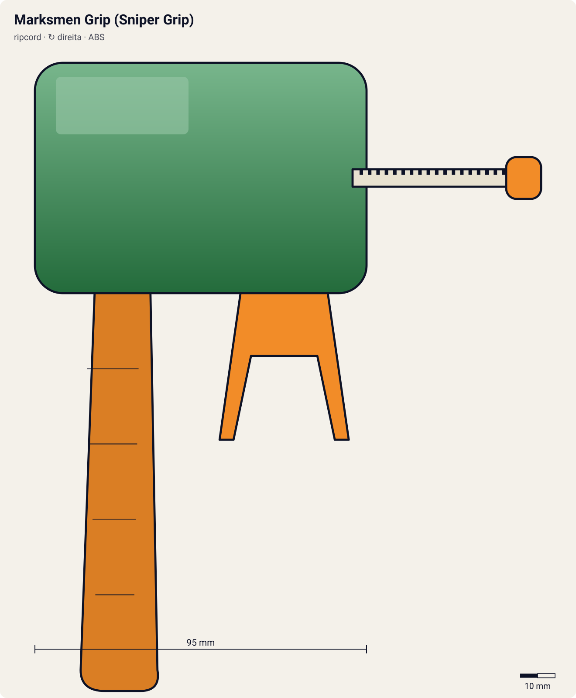

# Marksmen Grip (Sniper Grip)

<!-- auto:inicio (gerado por npm run build:research; não edite este bloco) -->

| Atributo | Valor |
|---|---|
| Força | 6 |
| RPM máx. (estimado) | 6650 |
| Precisão | 9 |
| Controle de ângulo | 8 |
| Facilidade | 7 |
<!-- auto:fim -->

**Nome JP:** スナイパーグリップ · **Tipo:** ripcord · **Rotação:** direita · **Sistema:** spin-gear · **No anime:** sim

Launcher Grip com mira LED (Sniper Scope). Quando a mira fica na vertical, emite luz vermelha para projetar onde a beyblade vai cair (wiki).

Dados para o jogo em [`dados.json`](dados.json). Arte: `lancador.svg` será gerado por `scripts/render-art.js` a partir de `forma` (não desenhe à mão).

## Produto (Takara / Hasbro)

- A-15 Sniper Grip (Takara)
- Marksmen Grip (Hasbro, embalagens S1 e V-Force)
- A-68 / A-106 Sniper Scope (mira avulsa)
- A-86 Sniper Compass

**Acessórios:** LED Sight / Sniper Scope (mira com luz vermelha); EZ Shooter direito ou esquerdo.

**Material:** ABS + LED vermelho + pilhas, lente translúcida.

| Medida | Valor | Fonte |
|---|---|---|
| comprimento_mm | 95 | estimado |
| largura_mm | 55 | estimado |
| altura_mm | 120 | estimado: com a mira levantada |
| peso_g | 70 | estimado: inclui pilhas da mira |
| curso_corda_mm | 145 | estimado |

## Ripcords

De fábrica: [Winder padrão (Beyblade Winder)](../ripcords/winder-padrao/). Compatíveis: [Winder padrão (Beyblade Winder)](../ripcords/winder-padrao/), [Ripcord Hasbro (era plástica)](../ripcords/winder-hasbro/), [Dragon Winder](../ripcords/dragon-winder/), [Neo-Dragon Winder](../ripcords/neo-dragon-winder/), [Ultimate Winder](../ripcords/ultimate-winder/). O rpm_max abaixo foi estimado com o ripcord de fábrica; trocar de ripcord aplica a razão dos multiplicadores (ver o [README do catálogo](../README.md#ripcords)).

## Como funciona

O **winder** (ripcord) é uma régua de plástico com uma fileira de dentes: uma **cremalheira**. Ao entrar pela fenda do lançador, os dentes engatam num **pinhão** (engrenagem pequena; 10 dentes no EZ Shooter, segundo a wiki). O pinhão é ligado aos **dois prongs**, que se encaixam nas aberturas ao lado do Bit Chip e empurram as abas do Spin Gear.

Ao puxar, a cremalheira passa reto pelo pinhão e o faz girar, levando a beyblade junto. Cada dente que passa avança um dente do pinhão: o Dragon Winder (68 dentes) dá **~6,8 voltas** num pinhão de 10 dentes. A rotação final depende sobretudo da **velocidade da mão no fim da puxada** e do **raio do pinhão**: rpm ≈ v / (2π·r) × 60. Com ~3,5 m/s e r ≈ 5,1 mm, isso dá ~6.500 rpm. Pinhão menor (Power Custom, 9 dentes) dá mais rpm com a mesma mão.

Quando a cremalheira sai, o pinhão fica livre (catraca) e a bey, ainda presa só pela gravidade e pelos prongs, cai. Se o lançador estiver inclinado, a bey sai inclinada. Se a puxada for torta, a corda raspa na fenda: perde força e desgasta o lançador (a wiki recomenda endireitar o winder em água quente).

**Sentido de rotação:** os prongs só empurram as abas do Spin Gear num sentido. Um SG esquerdo tem as abas invertidas e precisa de um lançador esquerdo, que inverte o sentido com uma engrenagem extra (Left EZ original) ou com o winder entrando de cabeça para baixo (Neo Reverse). O Dual Shooter do HMS tem duas fendas, uma para cada sentido.

**O papel do grip:** o cabo em pistola põe a mão que segura o lançador **abaixo e atrás** do ponto de lançamento, como numa pistola. Assim o punho trava o ângulo (menos inclinação acidental), o braço absorve o tranco da puxada e a outra mão puxa o winder em linha reta, alinhado com a fenda. Resultado: quase a mesma rotação, mas muito mais **precisão** e **controle de ângulo**. Acessórios como Spring Support/Spring Trigger (mola que guia a corda), Rubber Grip (borracha antiderrapante) e Metal Trigger (peso e apoio para o dedo) reforçam isso (wiki, Grip/Customize Grip).

## Quem usa no anime

- **Max** (s1; draciel-s, draciel-f): Ep. 14: Kenny entrega ao Max a Draciel S e o Marksmen Grip. Uso com a Draciel F inferido (não há troca registrada até o fim da S1).
- **Max** (v-force; draciel-v, draciel-v2): Inferido: a Hasbro relançou o Marksmen Grip em embalagem V-Force; o anime não é citado nas fontes.

Beys que apontam para este lançador em [`_mapa.json`](../_mapa.json): `max-tate/draciel-s`, `max-tate/draciel-f`, `max-tate/draciel-v`, `max-tate/draciel-v2`.

## Técnica de lançamento dos personagens

### Max

- **No anime:** Lançamento centralizado, sem pressa, ângulo reto (sem tilt), mirando o centro do estádio. Ep. 3: usa um EZ Grip para firmar o lançador. Ep. 5: lança a bey "em reverso" para anular o ataque do Kai.
- **Frase de lançamento:** "Let it rip!" / "Go Shoot!"; "Draciel, Viper Wall!"
- **No mini-game:** Assistência de mira para o centro; inclinação limitada (bey de defesa). A mira LED do Marksmen Grip mostra o ponto de queda.

## Atributos e mini-game

| Força | rpm máx. | Precisão | Controle de ângulo | Facilidade |
|---|---|---|---|---|
| 6 | 6650 | 9 | 8 | 7 |

Todos estimados (escala 1–10). Mesma transmissão do EZ Shooter (rpm de referência + ganho do grip). A mira, na posição vertical, projeta uma luz vermelha onde a bey deve cair (wiki): é o lançador de maior precisão da S1.

**Tradução para o DualShock 4** (regras gerais no [README do catálogo](../README.md#mini-game-de-lançamento-dualshock-4)):

- **R2 (puxar):** apertar até o fim em ~260 ms. A janela perfeita é de **130 ms** em torno do "Let it rip!"; força máxima x1.
- **Analógico esquerdo (inclinar/mirar):** até 25° de inclinação; desvio angular aleatório de ±2.5°, reduzido pela assistência de mira (0.6).
- **Mira LED:** o HUD mostra o ponto de queda em vermelho.
- No HUD: ponto vermelho no estádio mostrando onde a bey vai cair enquanto o analógico mira.

## Referências visuais

Nenhuma foto local deste lançador existe no repositório (as fotos da wiki estão atrás do CDN bloqueado). Cores e formas em `forma` são estimadas e marcadas em `obs_cores`.

## Incertezas

- Medidas e peso são **estimativas** coerentes entre os lançadores (nenhuma ficha técnica oficial foi encontrada).

## Fontes

- https://beyblade.fandom.com/wiki/Marksmen_Grip
- https://beyblade.fandom.com/wiki/Grip
- https://beyblade.fandom.com/wiki/LED_Sight
- https://beyblade.fandom.com/wiki/Beyblade_-_Episode_14
- https://beyblade.fandom.com/wiki/List_of_Original_Series_products_(Takara)
