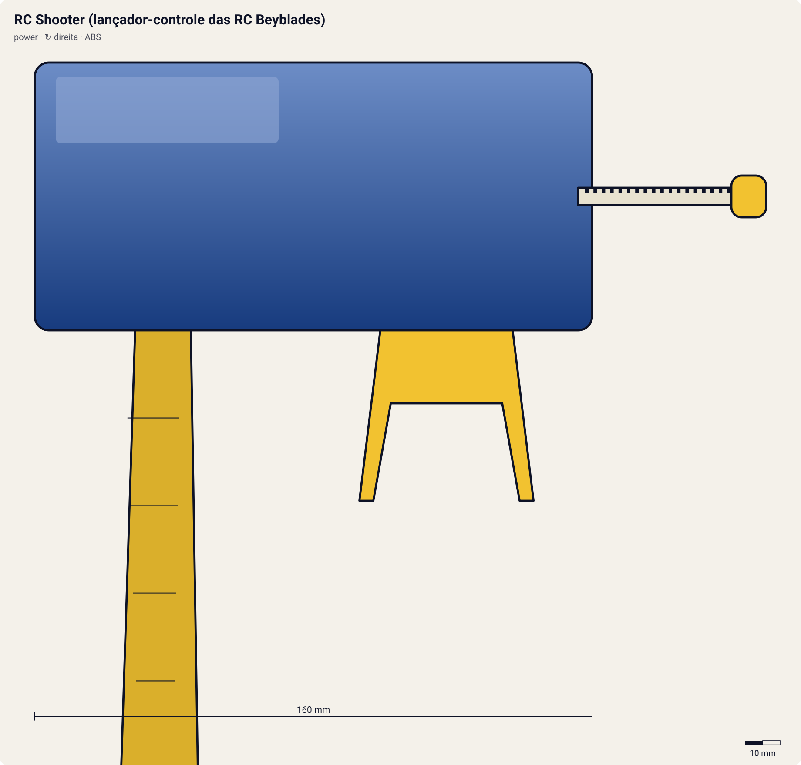

# RC Shooter (lançador-controle das RC Beyblades)

<!-- auto:inicio (gerado por npm run build:research; não edite este bloco) -->

| Atributo | Valor |
|---|---|
| Força | 6 |
| RPM máx. (estimado) | 6400 |
| Precisão | 7 |
| Controle de ângulo | 6 |
| Facilidade | 5 |
<!-- auto:fim -->

**Nome JP:** RCシューター · **Tipo:** power · **Rotação:** direita · **Sistema:** magnacore · **No anime:** não (só brinquedo)

Lançador com rádio-controle incluso nas Remote Control Beyblades. Ligado, o gatilho empurrado para frente ou para trás conduz a bey RC (wiki). É o maior grip da era plástica e da HMS.

Dados para o jogo em [`dados.json`](dados.json). Arte: `lancador.svg` será gerado por `scripts/render-art.js` a partir de `forma` (não desenhe à mão).

## Produto (Takara / Hasbro)

- Incluso nas RC Beyblades da Takara (ex.: Dragoon V2 High Power Custom)
- Hasbro RA-01 "Dragoon V" (RC)

**Acessórios:** Gatilho de controle (frente/trás); Neo-Dragon Winder; Pilhas.

**Material:** ABS + Eletrônica de rádio, pilhas.

| Medida | Valor | Fonte |
|---|---|---|
| comprimento_mm | 160 | estimado: wiki: maior grip da era |
| largura_mm | 75 | estimado |
| altura_mm | 140 | estimado |
| peso_g | 180 | estimado |
| curso_corda_mm | 218 | estimado |

## Ripcords

De fábrica: [Neo-Dragon Winder](../ripcords/neo-dragon-winder/). Compatíveis: [Winder padrão (Beyblade Winder)](../ripcords/winder-padrao/), [Ripcord Hasbro (era plástica)](../ripcords/winder-hasbro/), [Dragon Winder](../ripcords/dragon-winder/), [Neo-Dragon Winder](../ripcords/neo-dragon-winder/), [Ultimate Winder](../ripcords/ultimate-winder/). O rpm_max abaixo foi estimado com o ripcord de fábrica; trocar de ripcord aplica a razão dos multiplicadores (ver o [README do catálogo](../README.md#ripcords)).

## Como funciona

Mesma transmissão do lançador de ripcord (cremalheira → pinhão → prongs; ver a ficha do [EZ Shooter](../ez-shooter/README.md)), com um mecanismo a mais que entrega energia **fora** da rotação:
- **Catapult Grip:** o EZ Shooter corre num trilho com mola. Puxar o winder recua o lançador (comprimindo a mola) e gira a bey; no fim da puxada a mola dispara o lançador para frente e a bey sai com velocidade linear (wiki).
- **RC Shooter:** o lançamento é comum; depois dele, o gatilho vira um controle de rádio que empurra a bey RC para frente ou para trás (wiki).

**O papel do grip:** o cabo em pistola põe a mão que segura o lançador **abaixo e atrás** do ponto de lançamento, como numa pistola. Assim o punho trava o ângulo (menos inclinação acidental), o braço absorve o tranco da puxada e a outra mão puxa o winder em linha reta, alinhado com a fenda. Resultado: quase a mesma rotação, mas muito mais **precisão** e **controle de ângulo**. Acessórios como Spring Support/Spring Trigger (mola que guia a corda), Rubber Grip (borracha antiderrapante) e Metal Trigger (peso e apoio para o dedo) reforçam isso (wiki, Grip/Customize Grip).

## Quem usa no anime

Ninguém entre os 10 personagens estudados: modelo de brinquedo da época, catalogado para o modo loja/desafio do jogo.

## Atributos e mini-game

| Força | rpm máx. | Precisão | Controle de ângulo | Facilidade |
|---|---|---|---|---|
| 6 | 6400 | 7 | 6 | 5 |

Todos estimados (escala 1–10). Mecanismo de lançamento comum; a eletrônica e a RC Flat Base pesada (37,7 g) reduzem o rpm (~-2%). Depois do lançamento, o gatilho empurrado para frente/trás controla a bey (wiki).

**Tradução para o DualShock 4** (regras gerais no [README do catálogo](../README.md#mini-game-de-lançamento-dualshock-4)):

- **R2 (puxar):** apertar até o fim em ~300 ms. A janela perfeita é de **120 ms** em torno do "Let it rip!"; força máxima x0.98.
- **Analógico esquerdo (inclinar/mirar):** até 25° de inclinação; desvio angular aleatório de ±5°, reduzido pela assistência de mira (0.2).
- **Controle RC:** R2/L2 depois do lançamento = frente/trás por 20 s.
- Só para o modo brinquedo/desafio; nenhum personagem usa no anime.

## Referências visuais

Nenhuma foto local deste lançador existe no repositório (as fotos da wiki estão atrás do CDN bloqueado). Cores e formas em `forma` são estimadas e marcadas em `obs_cores`.

## Incertezas

- Medidas e peso são **estimativas** coerentes entre os lançadores (nenhuma ficha técnica oficial foi encontrada).
- A Dragoon V2 High Power Custom do anime é de rotação esquerda (inferido) e a do brinquedo RC é direita (wiki); o anime não mostra controle remoto.

## Fontes

- https://beyblade.fandom.com/wiki/Launcher
- https://beyblade.fandom.com/wiki/Dragoon_V2_High_Power_Custom
