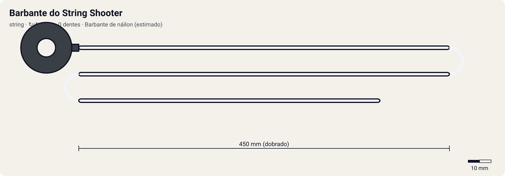

# Barbante do String Shooter

<!-- auto:inicio (gerado por npm run build:research; não edite este bloco) -->

| Medida / atributo | Valor |
|---|---|
| Comprimento | 450 estimado mm |
| Largura · espessura | 1,5 estimado · 1,5 estimado mm |
| Dentes (passo) | 0 (0 mm) |
| Peso | 1 estimado g |
| Spin entregue | 7 |
| Facilidade | 2 |
| Durabilidade | 6 |
<!-- auto:fim -->

**Nome JP:** ストリング · **Tipo:** string · **Sentido:** dupla

Barbante enrolado à mão num eixo do String Shooter HMS. Não há mola de retorno como nos string launchers da era Metal (wiki).

Dados em [`dados.json`](dados.json). A arte será gerada a partir de `forma` (comprimento, dentes, cor, pegador).

## Produto

- Incluso no A-134 HMS Dual Shooter (String Version)

**Material:** Barbante de náilon (estimado) + Pegador plástico.

| Medida | Valor | Fonte |
|---|---|---|
| comprimento_mm | 450 | estimado |
| largura_mm | 1.5 | estimado: diâmetro do barbante |
| espessura_mm | 1.5 | estimado |
| numero_dentes | 0 | oficial: barbante liso, sem dentes |
| passo_dente_mm | 0 | oficial: não se aplica |
| peso_g | 1 | estimado |

## Como funciona

O barbante é enrolado à mão no carretel do lançador. A puxada desenrola o barbante e gira os prongs; quanto maior o curso, mais tempo a mão tem para acelerar. Não há dentes nem mola de retorno: é preciso abrir e enrolar de novo a cada lançamento (wiki, String Shooter).

## Compatibilidade

[String Shooter (HMS Dual Shooter String Version)](../../string-shooter/).

## Quem usa no anime

Nenhum dos 10 personagens, segundo as fontes.

## Atributos e mini-game

| Spin entregue | Facilidade | Durabilidade |
|---|---|---|
| 7 | 2 | 6 |

Estimados (1–10). Curso longo e sem dentes para empenar; mas é enrolado à mão a cada lançamento ("muito trabalhoso", wiki) e não rebobina sozinho.

- **multiplicador_rpm:** 1 (winder padrão = 1,00).
- **curso_puxada_mm:** 350: o curso do R2 corresponde a este comprimento; ripcords mais longos pedem uma puxada mais longa (tempo ideal ≈ curso / 0,85 m/s).
- **desgaste_por_batalha:** 1, durabilidade 100.
- O multiplicador do barbante já está no rpm do String Shooter; preparo lento (girar o analógico direito).

## Incertezas

- Medidas físicas sem ficha oficial: estimadas com passo de dente comum de ~3,2 mm (coerente com 68 dentes ≈ 218 mm de cremalheira).
- Comprimento e pegador do barbante não documentados.

## Fontes

- https://beyblade.fandom.com/wiki/String_Shooter
- https://beyblade.fandom.com/wiki/Launcher
