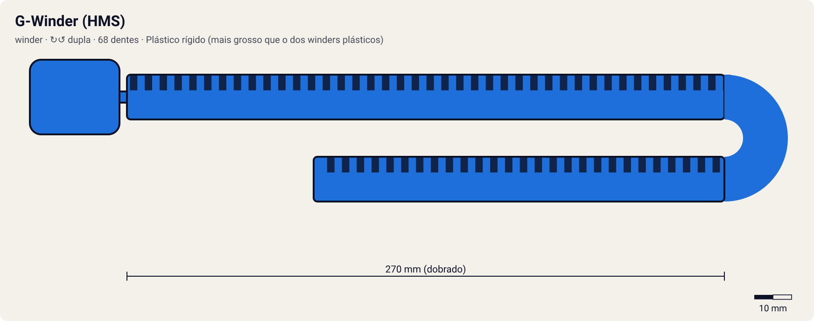

# G-Winder (HMS)

<!-- auto:inicio (gerado por npm run build:research; não edite este bloco) -->

| Medida / atributo | Valor |
|---|---|
| Comprimento | 270 estimado mm |
| Largura · espessura | 12 estimado · 3 estimado mm |
| Dentes (passo) | 68 estimado (3,2 estimado mm) |
| Peso | 8 estimado g |
| Spin entregue | 7 |
| Facilidade | 8 |
| Durabilidade | 9 |
<!-- auto:fim -->

**Nome JP:** Gワインダー · **Tipo:** winder · **Sentido:** dupla

Único winder do Hard Metal System. O desenho deriva do Dragon Winder, todos têm o mesmo comprimento e o plástico é bem mais grosso e firme (wiki).

Dados em [`dados.json`](dados.json). A arte será gerada a partir de `forma` (comprimento, dentes, cor, pegador).

## Produto

- MA-07 HMS G-Winder (Takara)
- Incluso nas Starters HMS e no Bey Double Shooter (A-130 azul c/ winder vermelho, prata c/ preto; MA-02 c/ amarelo)

**Material:** Plástico rígido (mais grosso que o dos winders plásticos). Mais durável e fácil de endireitar (wiki).

| Medida | Valor | Fonte |
|---|---|---|
| comprimento_mm | 270 | estimado |
| largura_mm | 12 | estimado |
| espessura_mm | 3 | estimado: wiki: mais grosso e firme que os winders plásticos |
| numero_dentes | 68 | estimado: derivado do Dragon Winder (wiki); todos do mesmo comprimento |
| passo_dente_mm | 3.2 | estimado |
| peso_g | 8 | estimado |

## Como funciona

Cada dente da cremalheira passa por um dente do pinhão do lançador. Com 68 dentes num pinhão de 10, a bey dá ~6.8 voltas durante a puxada. O que define o rpm final é a velocidade da mão no fim do curso: um ripcord mais longo (curso de 218 mm) dá mais tempo para acelerar. Por isso o multiplicador é 1.05 em relação ao winder padrão. O pegador muda a firmeza: o anel é para um dedo; o pegador de dragão (horizontal ou em T) é para dois.

## Compatibilidade

[Dual Shooter (HMS)](../../dual-shooter/), [HMS Customize Grip (Ray: Dual Shooter preto + G-Winder azul)](../../hms-customize-grip/), [Bey Double Shooter](../../bey-double-shooter/).

## Quem usa no anime

- **Ray** (driger-ms; G-Rev, torneio contra a BEGA): Wiki (Ray Kon): Dual Shooter preto com G-Winder azul.
- **Tyson** (dragoon-ms, dragoon-ms-ultimate-version; G-Rev ep. 39): Inferido: o G-Winder é o único winder HMS. No ep. 39 a puxada joga o Tyson para trás.
- **Kai** (dranzer-ms): Inferido (único winder HMS).
- **Max** (draciel-ms): Inferido.
- **Daichi** (gaia-dragoon-ms): Inferido.

Beys que apontam para este ripcord em `_mapa.json` (chave `ripcords`): `tyson-granger/dragoon-ms`, `tyson-granger/dragoon-ms-ultimate-version`, `kai-hiwatari/dranzer-ms`, `ray-kon/driger-ms`, `max-tate/draciel-ms`, `daichi-sumeragi/gaia-dragoon-ms`.

## Atributos e mini-game

| Spin entregue | Facilidade | Durabilidade |
|---|---|---|
| 7 | 8 | 9 |

Estimados (1–10). Mesmo curso do Dragon Winder, mas rígido: não empena e transmite a puxada sem perda. Vira para escolher o sentido no Dual Shooter (wiki).

- **multiplicador_rpm:** 1.05 (winder padrão = 1,00).
- **curso_puxada_mm:** 218: o curso do R2 corresponde a este comprimento; ripcords mais longos pedem uma puxada mais longa (tempo ideal ≈ curso / 0,85 m/s).
- **desgaste_por_batalha:** 1, durabilidade 100.
- O sentido vem da fenda do Dual Shooter (L1/R1).

## Incertezas

- Medidas físicas sem ficha oficial: estimadas com passo de dente comum de ~3,2 mm (coerente com 68 dentes ≈ 218 mm de cremalheira).

## Fontes

- https://beyblade.fandom.com/wiki/G-Winder
- https://beyblade.fandom.com/wiki/Ripcord
- https://beyblade.fandom.com/wiki/Hard_Metal_System
- https://beyblade.fandom.com/wiki/Ray_Kon
- https://beyblade.fandom.com/wiki/Bey_Double_Shooter
