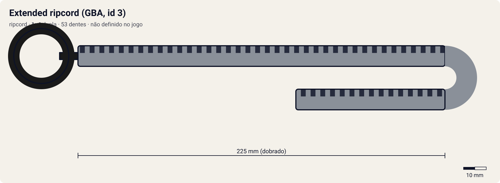

# Extended ripcord (GBA, id 3)

<!-- auto:inicio (gerado por npm run build:research; não edite este bloco) -->

| Medida / atributo | Valor |
|---|---|
| Comprimento | ? mm |
| Largura · espessura | ? · ? mm |
| Dentes (passo) | ? (? mm) |
| Peso | ? g |
| Spin entregue | 6 |
| Facilidade | 7 |
| Durabilidade | 6 |
<!-- auto:fim -->

**Tipo:** ripcord · **Sentido:** dupla

Ripcord id 3 do Beyblade G-Revolution de GBA (Atari/Hasbro, 2003). Item separado do lançador, comprado na loja e com durabilidade.

Dados em [`dados.json`](dados.json). A arte será gerada a partir de `forma` (comprimento, dentes, cor, pegador).

## Produto

- Item de loja do Beyblade G-Revolution (GBA), id 3

**Material:** não definido no jogo.

| Medida | Valor | Fonte |
|---|---|---|
| comprimento_mm | — | estimado: o jogo não define medidas |
| largura_mm | — | estimado |
| espessura_mm | — | estimado |
| numero_dentes | — | estimado |
| passo_dente_mm | — | estimado |
| peso_g | — | estimado |

## No jogo de GBA

Na ROM (docs/REVERSE_ENGINEERING.md, seção "Lançadores e cordas"), lançador e ripcord são itens separados, quatro de cada, comprados na loja e equipados. O ripcord **não soma stats** à bey. A cada batalha a durabilidade (máx. 100) cai **id + strength do jogador**; ao chegar a 0, o item quebra. Este é o id 3: dura 33 batalhas com strength 0. O multiplicador de rpm em `mecanica_jogo` é uma extrapolação deste projeto para o mini-game; no GBA ele seria 1.

## Compatibilidade

No GBA, qualquer ripcord vai com qualquer um dos 4 lançadores do jogo (Competition/Professional/Metal/Plastic), que não estão neste catálogo.

## Quem usa no anime

Nenhum dos 10 personagens, segundo as fontes.

## Atributos e mini-game

| Spin entregue | Facilidade | Durabilidade |
|---|---|---|
| 6 | 7 | 6 |

Estimados (1–10). Na ROM, o ripcord não soma stats à bey; o efeito encontrado é o desgaste: a durabilidade (máx. 100) cai id + strength a cada batalha, então o id 3 dura 33 batalhas com strength 0. spin_entregue/multiplicador são interpretação deste projeto, na ordem de preço/qualidade do jogo.

- **multiplicador_rpm:** 1.03 (winder padrão = 1,00).
- **curso_puxada_mm:** —: o curso do R2 corresponde a este comprimento; ripcords mais longos pedem uma puxada mais longa (tempo ideal ≈ curso / 0,85 m/s).
- **desgaste_por_batalha:** 3 + strength do jogador (como na ROM), durabilidade 100.
- Desgaste fiel à ROM; multiplicador_rpm é extrapolação (no GBA = 1).

## Incertezas

- Medidas físicas sem ficha oficial: estimadas com passo de dente comum de ~3,2 mm (coerente com 68 dentes ≈ 218 mm de cremalheira).

## Fontes

- docs/REVERSE_ENGINEERING.md, seção "Lançadores e cordas" (ROM BB2E)
