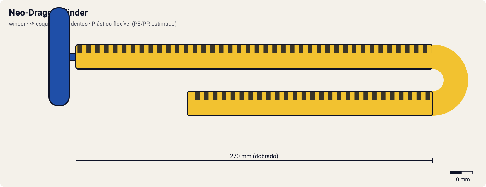

# Neo-Dragon Winder

<!-- auto:inicio (gerado por npm run build:research; não edite este bloco) -->

| Medida / atributo | Valor |
|---|---|
| Comprimento | 270 estimado mm |
| Largura · espessura | 11 estimado · 2,2 estimado mm |
| Dentes (passo) | 68 estimado (3,2 estimado mm) |
| Peso | 6 estimado g |
| Spin entregue | 7 |
| Facilidade | 9 |
| Durabilidade | 6 |
<!-- auto:fim -->

**Nome JP:** ネオドラゴンワインダー · **Tipo:** winder · **Sentido:** esquerda

Sucessor do Dragon Winder, com o pegador de dragão na vertical. Veio com as Dragoon posteriores e com as RC Beyblades (wiki).

Dados em [`dados.json`](dados.json). A arte será gerada a partir de `forma` (comprimento, dentes, cor, pegador).

## Produto

- Incluso nas Dragoon posteriores e nas RC Beyblades (Takara)

**Material:** Plástico flexível (PE/PP, estimado).

| Medida | Valor | Fonte |
|---|---|---|
| comprimento_mm | 270 | estimado |
| largura_mm | 11 | estimado |
| espessura_mm | 2.2 | estimado |
| numero_dentes | 68 | estimado: wiki: "muito parecido em uso" com o Dragon Winder |
| passo_dente_mm | 3.2 | estimado |
| peso_g | 6 | estimado |

## Como funciona

Cada dente da cremalheira passa por um dente do pinhão do lançador. Com 68 dentes num pinhão de 10, a bey dá ~6.8 voltas durante a puxada. O que define o rpm final é a velocidade da mão no fim do curso: um ripcord mais longo (curso de 218 mm) dá mais tempo para acelerar. Por isso o multiplicador é 1.06 em relação ao winder padrão. O pegador muda a firmeza: o anel é para um dedo; o pegador de dragão (horizontal ou em T) é para dois.

## Compatibilidade

[EZ Shooter (Easy Shooter, rotação direita)](../../ez-shooter/), [Left EZ Shooter (lançador esquerdo original, "Dragoon")](../../left-ez-shooter/), [Neo Reverse Shooter (Neo Left EZ Shooter)](../../neo-reverse-shooter/), [EZ Shooter Grip (Easy Shooter Grip)](../../ez-shooter-grip/), [Catapult Grip](../../catapult-grip/), [Marksmen Grip (Sniper Grip)](../../marksmen-grip/), [Spring Shooter](../../spring-shooter/), [Dragoon Shooter DX](../../dragoon-shooter-dx/), [Driger Shooter DX](../../driger-shooter-dx/), [Dranzer Shooter DX](../../dranzer-shooter-dx/), [Bey Ultimate Shooter (BeyUltimate Shooter)](../../bey-ultimate-shooter/), [Customize Grip (Off-White) - versão Tyson](../../customize-grip-tyson/), [Customize Grip (Gun Metallic / preto) - versão Kai](../../customize-grip-kai/), [Customize Grip (Sky Blue) - versão Ray](../../customize-grip-ray/), [Customize Grip (Dark Green) - versão Max](../../customize-grip-max/), [EZ Shooter Power Custom](../../ez-shooter-power-custom/), [EZ Shooter Spring Custom](../../ez-shooter-spring-custom/), [Duotron Launcher (Hasbro)](../../duotron-launcher/), [Mangual-lançador do Robert (anime)](../../griffolyon-flail/), [RC Shooter (lançador-controle das RC Beyblades)](../../rc-shooter/).

## Quem usa no anime

- **Tyson** (dragoon-gt, dragoon-v2-high-power-custom): Inferido do brinquedo (Dragoons posteriores e RC Beyblades, wiki). Não citado no anime.

Beys que apontam para este ripcord em `_mapa.json` (chave `ripcords`): `tyson-granger/dragoon-v2-high-power-custom`, `tyson-granger/dragoon-gt`.

## Atributos e mini-game

| Spin entregue | Facilidade | Durabilidade |
|---|---|---|
| 7 | 9 | 6 |

Estimados (1–10). Mesmo comprimento do Dragon Winder; o pegador vertical dá mais firmeza (muitos jogadores o consideram o melhor winder, wiki): +1% de rpm estimado.

- **multiplicador_rpm:** 1.06 (winder padrão = 1,00).
- **curso_puxada_mm:** 218: o curso do R2 corresponde a este comprimento; ripcords mais longos pedem uma puxada mais longa (tempo ideal ≈ curso / 0,85 m/s).
- **desgaste_por_batalha:** 2, durabilidade 100.

## Incertezas

- Medidas físicas sem ficha oficial: estimadas com passo de dente comum de ~3,2 mm (coerente com 68 dentes ≈ 218 mm de cremalheira).

## Fontes

- https://beyblade.fandom.com/wiki/Ripcord
