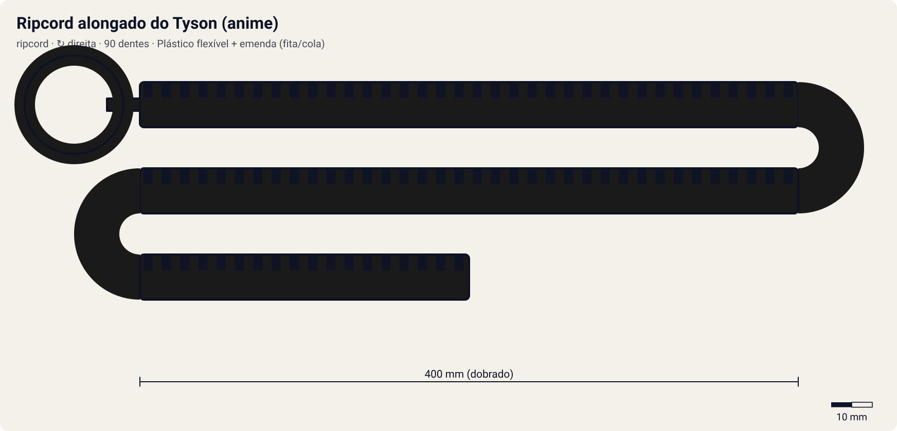

# Ripcord alongado do Tyson (anime)

<!-- auto:inicio (gerado por npm run build:research; não edite este bloco) -->

| Medida / atributo | Valor |
|---|---|
| Comprimento | 400 estimado mm |
| Largura · espessura | 11 estimado · 2,2 estimado mm |
| Dentes (passo) | 90 estimado (3,2 estimado mm) |
| Peso | 8 estimado g |
| Spin entregue | 8 |
| Facilidade | 3 |
| Durabilidade | 2 |
<!-- auto:fim -->

**Tipo:** ripcord · **Sentido:** direita

No ep. 1, o Tyson monta um ripcord duas vezes mais longo para a Dragoon Grip Attacker (wiki, episódio 1).

Dados em [`dados.json`](dados.json). A arte será gerada a partir de `forma` (comprimento, dentes, cor, pegador).

## Produto

- Exclusivo do anime (montagem caseira)

**Material:** Plástico flexível + emenda (fita/cola). Interpretação: a emenda é o ponto fraco.

| Medida | Valor | Fonte |
|---|---|---|
| comprimento_mm | 400 | estimado: dois winders padrão emendados |
| largura_mm | 11 | estimado |
| espessura_mm | 2.2 | estimado |
| numero_dentes | 90 | estimado: 2 x 45 |
| passo_dente_mm | 3.2 | estimado |
| peso_g | 8 | estimado |

## Como funciona

Cada dente da cremalheira passa por um dente do pinhão do lançador. Com 90 dentes num pinhão de 10, a bey dá ~9.0 voltas durante a puxada. O que define o rpm final é a velocidade da mão no fim do curso: um ripcord mais longo (curso de 288 mm) dá mais tempo para acelerar. Por isso o multiplicador é 1.1 em relação ao winder padrão. O pegador muda a firmeza: o anel é para um dedo; o pegador de dragão (horizontal ou em T) é para dois.

## Compatibilidade

[EZ Shooter (Easy Shooter, rotação direita)](../../ez-shooter/).

## Quem usa no anime

- **Tyson** (dragoon-grip-attacker; S1 ep. 1): O Tyson acha que um ripcord duas vezes mais longo dá mais força contra o Carlos; na versão japonesa a ideia vem dos peixes no espeto do avô. O Carlos diz que ele "não é o primeiro a tentar isso".

Beys que apontam para este ripcord em `_mapa.json` (chave `ripcords`): `tyson-granger/dragoon-grip-attacker`.

## Atributos e mini-game

| Spin entregue | Facilidade | Durabilidade |
|---|---|---|
| 8 | 3 | 2 |

Estimados (1–10). Curso dobrado = muito mais tempo de aceleração, mas a corda longa entorta e a emenda pode prender: força alta, facilidade e durabilidade baixas.

- **multiplicador_rpm:** 1.1 (winder padrão = 1,00).
- **curso_puxada_mm:** 288: o curso do R2 corresponde a este comprimento; ripcords mais longos pedem uma puxada mais longa (tempo ideal ≈ curso / 0,85 m/s).
- **desgaste_por_batalha:** 10, durabilidade 100.
- Item de história (ep. 1). 15% de chance de travar a puxada se o R2 não for contínuo.

## Incertezas

- Medidas físicas sem ficha oficial: estimadas com passo de dente comum de ~3,2 mm (coerente com 68 dentes ≈ 218 mm de cremalheira).

## Fontes

- https://beyblade.fandom.com/wiki/Beyblade_-_Episode_01
