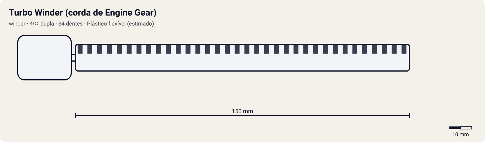

# Turbo Winder (corda de Engine Gear)

<!-- auto:inicio (gerado por npm run build:research; não edite este bloco) -->

| Medida / atributo | Valor |
|---|---|
| Comprimento | 150 estimado mm |
| Largura · espessura | 12 estimado · 2,2 estimado mm |
| Dentes (passo) | 34 estimado (3,2 estimado mm) |
| Peso | 4 estimado g |
| Spin entregue | 1 |
| Facilidade | 7 |
| Durabilidade | 7 |
<!-- auto:fim -->

**Nome JP:** ターボワインダー · **Tipo:** winder · **Sentido:** dupla

Winder que dá corda no Engine Gear antes do lançamento; acompanha toda bey Engine Gear, e as Turbo/Reverse EG trazem um maior (wiki, Turbo Winders).

Dados em [`dados.json`](dados.json). A arte será gerada a partir de `forma` (comprimento, dentes, cor, pegador).

## Produto

- Incluso em toda bey Engine Gear
- Versão maior nas beys com Turbo/Reverse EG

**Material:** Plástico flexível (estimado).

| Medida | Valor | Fonte |
|---|---|---|
| comprimento_mm | 150 | estimado |
| largura_mm | 12 | estimado |
| espessura_mm | 2.2 | estimado |
| numero_dentes | 34 | estimado: curso curto, só para a mola |
| passo_dente_mm | 3.2 | estimado |
| peso_g | 4 | estimado |

## Como funciona

Cada dente da cremalheira passa por um dente do pinhão do lançador. Com 34 dentes num pinhão de 10, a bey dá ~3.4 voltas durante a puxada. O que define o rpm final é a velocidade da mão no fim do curso: um ripcord mais longo (curso de 110 mm) dá mais tempo para acelerar. Por isso o multiplicador é 0 em relação ao winder padrão. O pegador muda a firmeza: o anel é para um dedo; o pegador de dragão (horizontal ou em T) é para dois.

## Compatibilidade

[Turbo Winder (corda de Engine Gear)](../../turbo-winder/).

Não entra em lançador: passa pelo Engine Gear para dar corda na mola. Ver a ficha de lançador lancadores/turbo-winder.

## Quem usa no anime

- **Tyson** (dragoon-g, dragoon-gt): Starter Dragoon G: Turbo Winder branco (wiki).
- **Kai** (dranzer-g, dranzer-gt): Inferido (toda bey EG).

## Atributos e mini-game

| Spin entregue | Facilidade | Durabilidade |
|---|---|---|
| 1 | 7 | 7 |

Estimados (1–10). Não gira a bey no lançamento; só carrega a mola do Engine Gear (wiki). Bônus de rpm na ficha do lançador turbo-winder (carga_eg).

- **multiplicador_rpm:** 0 (winder padrão = 1,00).
- **curso_puxada_mm:** 110: o curso do R2 corresponde a este comprimento; ripcords mais longos pedem uma puxada mais longa (tempo ideal ≈ curso / 0,85 m/s).
- **desgaste_por_batalha:** 1, durabilidade 100.
- Usado na fase L2 de carga do Engine Gear.

## Incertezas

- Medidas físicas sem ficha oficial: estimadas com passo de dente comum de ~3,2 mm (coerente com 68 dentes ≈ 218 mm de cremalheira).

## Fontes

- https://beyblade.fandom.com/wiki/Turbo_Winders
- https://beyblade.fandom.com/wiki/Dragoon_G
