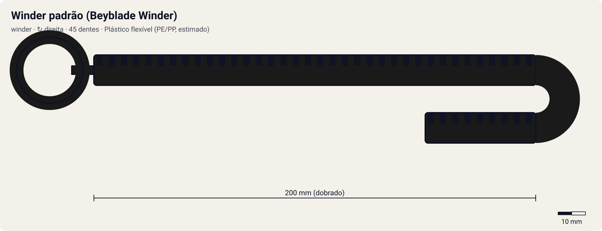

# Winder padrão (Beyblade Winder)

<!-- auto:inicio (gerado por npm run build:research; não edite este bloco) -->

| Medida / atributo | Valor |
|---|---|
| Comprimento | 200 estimado mm |
| Largura · espessura | 11 estimado · 2,2 estimado mm |
| Dentes (passo) | 45 estimado (3,2 estimado mm) |
| Peso | 4 estimado g |
| Spin entregue | 5 |
| Facilidade | 8 |
| Durabilidade | 5 |
<!-- auto:fim -->

**Nome JP:** ワインダー · **Tipo:** winder · **Sentido:** direita

O winder que vem com os EZ Shooters direitos. É o mais curto de todos e tem um anel na ponta para o dedo indicador (wiki, Ripcord).

Dados em [`dados.json`](dados.json). A arte será gerada a partir de `forma` (comprimento, dentes, cor, pegador).

## Produto

- A-23 Beyblade Winder (Takara, avulso)
- Incluso nos EZ Shooters direitos

**Material:** Plástico flexível (PE/PP, estimado). Empena com o uso; a wiki ensina a endireitar em água quente.

| Medida | Valor | Fonte |
|---|---|---|
| comprimento_mm | 200 | estimado: cremalheira + pegador de anel |
| largura_mm | 11 | estimado |
| espessura_mm | 2.2 | estimado |
| numero_dentes | 45 | estimado: inferido: a wiki diz que o primeiro winder Hasbro da era Metal tem 45 dentes e é "igual ao winder da série original"; o padrão Takara é o mais curto de todos |
| passo_dente_mm | 3.2 | estimado |
| peso_g | 4 | estimado |

## Como funciona

Cada dente da cremalheira passa por um dente do pinhão do lançador. Com 45 dentes num pinhão de 10, a bey dá ~4.5 voltas durante a puxada. O que define o rpm final é a velocidade da mão no fim do curso: um ripcord mais longo (curso de 144 mm) dá mais tempo para acelerar. Por isso o multiplicador é 1 em relação ao winder padrão. O pegador muda a firmeza: o anel é para um dedo; o pegador de dragão (horizontal ou em T) é para dois.

## Compatibilidade

[EZ Shooter (Easy Shooter, rotação direita)](../../ez-shooter/), [Left EZ Shooter (lançador esquerdo original, "Dragoon")](../../left-ez-shooter/), [Neo Reverse Shooter (Neo Left EZ Shooter)](../../neo-reverse-shooter/), [EZ Shooter Grip (Easy Shooter Grip)](../../ez-shooter-grip/), [Catapult Grip](../../catapult-grip/), [Marksmen Grip (Sniper Grip)](../../marksmen-grip/), [Spring Shooter](../../spring-shooter/), [Dragoon Shooter DX](../../dragoon-shooter-dx/), [Driger Shooter DX](../../driger-shooter-dx/), [Dranzer Shooter DX](../../dranzer-shooter-dx/), [Bey Ultimate Shooter (BeyUltimate Shooter)](../../bey-ultimate-shooter/), [Customize Grip (Off-White) - versão Tyson](../../customize-grip-tyson/), [Customize Grip (Gun Metallic / preto) - versão Kai](../../customize-grip-kai/), [Customize Grip (Sky Blue) - versão Ray](../../customize-grip-ray/), [Customize Grip (Dark Green) - versão Max](../../customize-grip-max/), [EZ Shooter Power Custom](../../ez-shooter-power-custom/), [EZ Shooter Spring Custom](../../ez-shooter-spring-custom/), [Duotron Launcher (Hasbro)](../../duotron-launcher/), [Mangual-lançador do Robert (anime)](../../griffolyon-flail/), [RC Shooter (lançador-controle das RC Beyblades)](../../rc-shooter/).

## Quem usa no anime

- **Ray** (driger-s, driger-f, driger-v, driger-g; S1 eps. 1–20 (EZ Shooter); S1 ep. 21 → V-Force ep. 12 (Driger Shooter); G-Rev (Customize Grip "Ray Special")): Wiki (Ray Kon): winder preto "padrão" com o EZ Shooter, com o Driger Shooter e no Customize Grip.
- **Kai** (dranzer-s, dranzer-f, black-dranzer, dranzer-v, dranzer-v2, dranzer-g, dranzer-gt): Inferido: lançadores direitos vêm com o winder padrão; a fonte não detalha o ripcord do Kai.

Beys que apontam para este ripcord em `_mapa.json` (chave `ripcords`): `tyson-granger/dranzer-f`, `tyson-granger/master-dragoon`, `kai-hiwatari/dranzer-s`, `kai-hiwatari/dranzer-f`, `kai-hiwatari/black-dranzer`, `kai-hiwatari/dranzer-v`, `kai-hiwatari/dranzer-v2`, `kai-hiwatari/dranzer-g`, `kai-hiwatari/dranzer-gt`, `ray-kon/driger-s`, `ray-kon/driger-f`, `ray-kon/driger-v`, `ray-kon/driger-g`, `max-tate/draciel-metal-ball-defenser`, `max-tate/draciel-s`, `max-tate/draciel-f`, `max-tate/draciel-v`, `max-tate/draciel-v2`, `max-tate/draciel-g`, `daichi-sumeragi/gaia-dragoon`, `daichi-sumeragi/gaia-dragoon-v`, `daichi-sumeragi/gaia-dragoon-g`, `tala/wolborg-2`, `tala/wolborg-4`, `bryan-kuznetsov/falborg`, `bryan-kuznetsov/falborg-2`, `brooklyn-masefield/zeus`, `lee/galeon`, `lee/galeon-2`, `lee/galeon-2-eg`, `robert-jurgen/griffolyon`.

## Atributos e mini-game

| Spin entregue | Facilidade | Durabilidade |
|---|---|---|
| 5 | 8 | 5 |

Estimados (1–10). Referência (multiplicador 1,00). É o mais curto de todos (wiki): menos curso para a mão acelerar. Anel para um dedo: fácil, mas a puxada sai menos firme que com pegador de dois dedos.

- **multiplicador_rpm:** 1 (winder padrão = 1,00).
- **curso_puxada_mm:** 144: o curso do R2 corresponde a este comprimento; ripcords mais longos pedem uma puxada mais longa (tempo ideal ≈ curso / 0,85 m/s).
- **desgaste_por_batalha:** 2, durabilidade 100.
- Durabilidade 100; perde 2 por batalha (+1 se a puxada for torta).

## Incertezas

- Medidas físicas sem ficha oficial: estimadas com passo de dente comum de ~3,2 mm (coerente com 68 dentes ≈ 218 mm de cremalheira).

## Fontes

- https://beyblade.fandom.com/wiki/Ripcord
- https://beyblade.fandom.com/wiki/Ray_Kon
- https://beyblade.fandom.com/wiki/List_of_Original_Series_products_(Takara)
