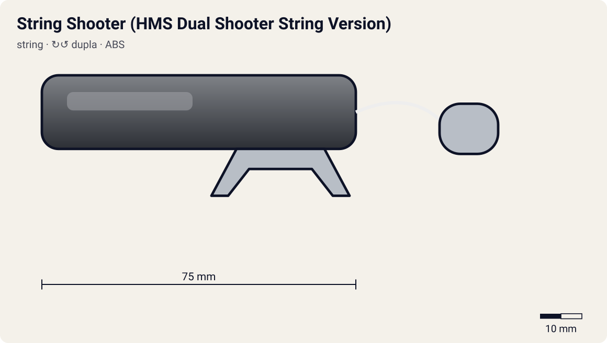

# String Shooter (HMS Dual Shooter String Version)

<!-- auto:inicio (gerado por npm run build:research; não edite este bloco) -->

| Atributo | Valor |
|---|---|
| Força | 7 |
| RPM máx. (estimado) | 7000 |
| Precisão | 6 |
| Controle de ângulo | 5 |
| Facilidade | 3 |
<!-- auto:fim -->

**Nome JP:** ストリングシューター · **Tipo:** string · **Rotação:** dupla · **Sistema:** hms · **No anime:** não (só brinquedo)

Lançador HMS que troca o winder por um barbante: abre-se a caixa e enrola-se a corda num eixo. Esconde o sentido de rotação do adversário, mas é lento de preparar (wiki). Não é o string launcher autorretrátil da era Metal: aqui não há mola de retorno.

Dados para o jogo em [`dados.json`](dados.json). Arte: `lancador.svg` será gerado por `scripts/render-art.js` a partir de `forma` (não desenhe à mão).

## Produto (Takara / Hasbro)

- A-134 HMS Dual Shooter (String Version) (Takara)

**Acessórios:** Barbante (enrolado à mão num eixo interno).

**Material:** ABS + Barbante de náilon (estimado).

| Medida | Valor | Fonte |
|---|---|---|
| comprimento_mm | 75 | estimado |
| largura_mm | 50 | estimado |
| altura_mm | 32 | estimado |
| peso_g | 22 | estimado |
| curso_corda_mm | 350 | estimado: corda mais longa que um winder |

## Ripcords

De fábrica: [Barbante do String Shooter](../ripcords/corda-string-shooter/). Compatíveis: [Barbante do String Shooter](../ripcords/corda-string-shooter/). O rpm_max abaixo foi estimado com o ripcord de fábrica; trocar de ripcord aplica a razão dos multiplicadores (ver o [README do catálogo](../README.md#ripcords)).

## Como funciona

Não há cremalheira. Abre-se o lançador e enrola-se à mão um **barbante** num eixo (carretel) ligado aos prongs. Ao puxar o barbante, ele desenrola e gira o eixo; o fim do barbante solta do carretel e a bey cai.

A rotação depende do **raio do carretel** e da velocidade da mão, como no ripcord, mas o curso é maior (o barbante é mais longo que um winder) e a sensação é diferente (wiki). Como o barbante pode ser enrolado nos dois sentidos, o adversário **não vê** de que lado ele vai girar.

**Diferença para o String Launcher moderno:** o lançador da era Metal tem uma mola que rebobina o barbante sozinho depois da puxada. O String Shooter de 2003 **não rebobina**: precisa ser aberto e enrolado de novo a cada lançamento ("muito trabalhoso", wiki).

## Quem usa no anime

Ninguém entre os 10 personagens estudados: modelo de brinquedo da época, catalogado para o modo loja/desafio do jogo.

## Atributos e mini-game

| Força | rpm máx. | Precisão | Controle de ângulo | Facilidade |
|---|---|---|---|---|
| 7 | 7000 | 6 | 5 | 3 |

Todos estimados (escala 1–10). Sem cremalheira: o barbante enrolado num eixo gira o mecanismo. Curso maior compensa o eixo de raio maior; "sensação bem diferente" e "muito trabalhoso de enrolar" (wiki). Esconde do adversário o sentido escolhido.

**Tradução para o DualShock 4** (regras gerais no [README do catálogo](../README.md#mini-game-de-lançamento-dualshock-4)):

- **R2 (puxar):** apertar até o fim em ~420 ms. A janela perfeita é de **100 ms** em torno do "Let it rip!"; força máxima x1.07.
- **Analógico esquerdo (inclinar/mirar):** até 30° de inclinação; desvio angular aleatório de ±6°.
- **L1/R1:** escolher o sentido de rotação antes da puxada (lançador de rotação dupla).
- **Sentido oculto:** a IA não vê o sentido escolhido; preparar leva ~4 s (girar o analógico direito para enrolar o barbante).
- O adversário (IA) não vê o sentido escolhido. Preparar leva tempo (girar o analógico direito para enrolar a corda).

## Referências visuais

Nenhuma foto local deste lançador existe no repositório (as fotos da wiki estão atrás do CDN bloqueado). Cores e formas em `forma` são estimadas e marcadas em `obs_cores`.

## Incertezas

- Medidas e peso são **estimativas** coerentes entre os lançadores (nenhuma ficha técnica oficial foi encontrada).

## Fontes

- https://beyblade.fandom.com/wiki/String_Shooter
- https://beyblade.fandom.com/wiki/Launcher
- https://beyblade.fandom.com/wiki/List_of_Original_Series_products_(Takara)
