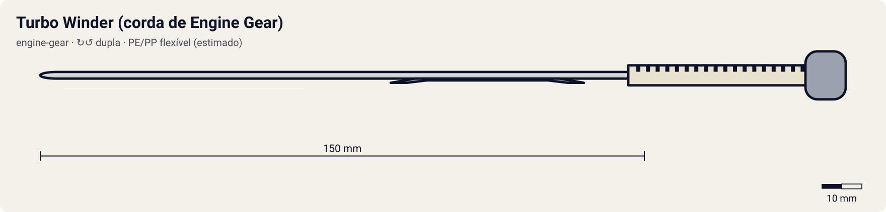

# Turbo Winder (corda de Engine Gear)

<!-- auto:inicio (gerado por npm run build:research; não edite este bloco) -->

| Atributo | Valor |
|---|---|
| Força | 1 |
| Precisão | 1 |
| Controle de ângulo | 1 |
| Facilidade | 7 |
<!-- auto:fim -->

**Nome JP:** ターボワインダー · **Tipo:** engine-gear · **Rotação:** dupla · **Sistema:** engine-gear · **No anime:** sim

Winder curto que dá corda na mola interna do Engine Gear antes de lançar. Acompanha toda bey Engine Gear; Turbo e Reverse EG vêm com Turbo Winders maiores (wiki).

Dados para o jogo em [`dados.json`](dados.json). Arte: `lancador.svg` será gerado por `scripts/render-art.js` a partir de `forma` (não desenhe à mão).

## Produto (Takara / Hasbro)

- Incluso em toda beyblade Engine Gear (Takara/Hasbro)
- Turbo Winder maior nas beys Turbo/Reverse EG
- Zeus Starter Key (ゼウススターターキー, A-129) - acessório da Zeus citado na caixa

**Acessórios:** Usado junto com o lançador normal do personagem.

**Material:** PE/PP flexível (estimado) + Zeus Starter Key: ABS (caixa A-129).

| Medida | Valor | Fonte |
|---|---|---|
| comprimento_mm | 150 | estimado |
| largura_mm | 12 | estimado |
| altura_mm | 3 | estimado |
| peso_g | 4 | estimado |
| curso_corda_mm | 110 | estimado: curso curto: só dá corda na mola do Engine Gear |

## Ripcords

De fábrica: [Turbo Winder (corda de Engine Gear)](../ripcords/turbo-winder/). Compatíveis: [Turbo Winder (corda de Engine Gear)](../ripcords/turbo-winder/). O rpm_max abaixo foi estimado com o ripcord de fábrica; trocar de ripcord aplica a razão dos multiplicadores (ver o [README do catálogo](../README.md#ripcords)).

## Como funciona

O **Engine Gear** é um Spin Gear com uma **mola espiral** interna e uma embreagem (clutch) ligada à base. Antes de lançar, passa-se o **Turbo Winder** pelo Engine Gear: os dentes giram o núcleo e enrolam a mola. A base trava a mola até o gatilho: um impacto (Hit Release), a perda de rotação (clutch) ou a abertura das alavancas. Aí a mola descarrega e a ponta gira mais rápido ou a bey dá uma arrancada.

O Turbo Winder **não lança** a bey; o lançamento continua sendo do lançador normal do personagem. O Turbo Engine Gear (Dragoon GT) solta até 4 vezes mais energia que o normal, por menos tempo (wiki).

## Quem usa no anime

- **Tyson** (g-revolution; dragoon-g, dragoon-gt): Starter Dragoon G: Turbo Winder branco (wiki). Dragoon GT usa o Turbo EG (até 4x a saída normal).
- **Kai** (g-revolution; dranzer-g, dranzer-gt): ver fontes.
- **Ray** (g-revolution; driger-g): ver fontes.
- **Max** (g-revolution; draciel-g): ver fontes.
- **Daichi** (g-revolution; gaia-dragoon-g): ver fontes.
- **Tala** (g-revolution; wolborg-4): ver fontes.
- **Bryan** (g-revolution; falborg-2): ver fontes.
- **Brooklyn** (g-revolution; zeus): A caixa da Zeus (A-129) lista a "Zeus Starter Key" em ABS; foto em referencia/.
- **Lee** (g-revolution; galeon-2-eg): ver fontes.

## Técnica de lançamento dos personagens

### Tyson

- **No anime:** Canhoto, mas às vezes lança com a mão direita para controlar melhor o lançador (wiki). Rotação esquerda desde a Dragoon S. Truques: no ep. 1 alonga o winder para ter mais força e corre até o estádio, pulando para lançar do alto; no ep. 4 lança com o lançador virado para cima (a Dragoon S "some e reaparece"). Na G-Rev ep. 21 o lançamento sai fraco quando ele está abalado; no ep. 39 o tranco da Dragoon MS joga o corpo dele para trás.
- **Frase de lançamento:** "3, 2, 1... Let it rip!" (EN) / "Go Shoot!" (JP); "Dragoon, attack!"
- **No mini-game:** Bônus de força com "lançamento com corrida" (segurar o analógico para frente durante a contagem); variação "lançador para cima" (inclinação > 60°) faz a bey quicar e cair num ponto aleatório perto do centro. Penalidade de força se a vida/moral estiver baixa (G-Rev ep. 21).

### Kai

- **No anime:** Lançamento forte e preciso. Na G-Rev ep. 39 a Hilary lança a Hopper 2 "imitando o jeito como o Kai lança a Dranzer" (trivia da wiki), sinal de que a pose do Kai é marcante. Contra rivais fortes vai com tudo desde o lançamento.
- **Frase de lançamento:** "Let it rip!" / "Go Shoot!"; "Dranzer, go!"
- **No mini-game:** Janela perfeita um pouco mais estreita, mas com bônus de precisão (desvio angular x0,8) quando acertada: estilo "frio e exato".

### Ray

- **No anime:** Lançamento firme e reto; a Driger orbita rápido e entra em investidas repetidas (pesquisa do personagem). Usa winder preto com o EZ Shooter e o Driger Shooter, e o Ultimate Winder verde com o BeyUltimate Shooter (wiki).
- **Frase de lançamento:** "Let it rip!" / "Go Shoot!"; "Driger, Tiger Claw!"
- **No mini-game:** Tremor do analógico reduzido (mira estável); bônus de órbita quando lançado com inclinação lateral de 10–20°.

### Max

- **No anime:** Lançamento centralizado, sem pressa, ângulo reto (sem tilt), mirando o centro do estádio. Ep. 3: usa um EZ Grip para firmar o lançador. Ep. 5: lança a bey "em reverso" para anular o ataque do Kai.
- **Frase de lançamento:** "Let it rip!" / "Go Shoot!"; "Draciel, Viper Wall!"
- **No mini-game:** Assistência de mira para o centro; inclinação limitada (bey de defesa). A mira LED do Marksmen Grip mostra o ponto de queda.

### Daichi

- **No anime:** Lançamento forte e direto, muitas vezes contra o terreno/obstáculos; tira a bey e o lançador e dispara gritando "Take that!" (wiki).
- **Frase de lançamento:** "Take that!"; "Let it rip!"
- **No mini-game:** Força +, precisão −: janela perfeita curta, mas forca_maxima +5% quando a puxada é muito rápida.

### Tala

- **No anime:** Lançamento firme e central; a Wolborg ocupa o centro e deixa o adversário gastar energia (ex.: contra o Lee na G-Rev ep. 22).
- **Frase de lançamento:** "Let it rip!" / "Go Shoot!"; "Wolborg, Novae Rog!"
- **No mini-game:** Lançamento "de stamina": bônus de rpm ao acertar a janela com força entre 80 e 95% (não precisa de força máxima).

### Bryan

- **No anime:** Lançamento forte e agressivo, direto no adversário e na parede (pesquisa do personagem).
- **Frase de lançamento:** "Let it rip!" / "Go Shoot!"; "Falborg, Storm Strike!"
- **No mini-game:** Inclinação agressiva permitida (até 40°) para lançamento em diagonal contra o oponente.

### Brooklyn

- **No anime:** Gênio natural: só precisou aprender o básico de "como lançar direito" com o Hiro (wiki). G-Rev ep. 38: com um lançamento simples, destrói uma rocha. Ep. 50: treinando lançamentos, fura as paredes e o teto da sala de treino. A Zeus vai para o centro e "flutua".
- **Frase de lançamento:** "Let it rip!"; "King of Darkness!"
- **No mini-game:** Janela perfeita mais larga (talento natural) e desvio mínimo. No modo história, pode ter lançamento "perfeito automático" como chefe.

### Lee

- **No anime:** Lançamento forte e direto, buscando o choque de frente (S1 ep. 17: empurra a Dragoon para fora no primeiro round).
- **Frase de lançamento:** "Let it rip!" / "Go Shoot!"; "Galeon, Black Lightning!"
- **No mini-game:** Bônus de impulso linear ao lançar mirando diretamente o oponente.

## Atributos e mini-game

| Força | rpm máx. | Precisão | Controle de ângulo | Facilidade |
|---|---|---|---|---|
| 1 | — (não lança) | 1 | 1 | 7 |

Todos estimados (escala 1–10). Não lança a bey: só dá corda na mola do Engine Gear antes do lançamento (wiki, Turbo Winders). O efeito é um "segundo fôlego" quando a embreagem (clutch) da base solta. Por isso força/precisão/controle ficam no mínimo da escala (1) e rpm_max = null; o ganho fica em mecanica_jogo.bonus_rpm_eg.

**Tradução para o DualShock 4:** fase opcional *antes* do lançamento nas beys Engine Gear. L2 (analógico): segurar e soltar antes do lançamento; cada ciclo completo enche 1/3 da mola. Até 3 ciclos; mola cheia = +1500 rpm por 1800 ms quando a embreagem soltar (Turbo EG: +3000 rpm por 700 ms). Ver o [README geral](../README.md#mini-game-de-lançamento-dualshock-4).

## Referências visuais

- [`referencia/zeus-com-starter-key.jpg`](referencia/zeus-com-starter-key.jpg): Zeus montada ao lado do acessório preto que a caixa chama de Zeus Starter Key. (copiado de `personagens/brooklyn-masefield/beyblades/zeus/referencia/pecas-montada-com-launcher.jpg`)
- [`referencia/zeus-caixa-verso.jpg`](referencia/zeus-caixa-verso.jpg): Verso da caixa A-129: "使用樹脂: ベイブレード本体及びゼウススターターキー (ABS樹脂)". (copiado de `personagens/brooklyn-masefield/beyblades/zeus/referencia/pecas-caixa-verso-pecas.jpg`)

## Incertezas

- Medidas e peso são **estimativas** coerentes entre os lançadores (nenhuma ficha técnica oficial foi encontrada).
- Função exata da Zeus Starter Key não confirmada (provável chave de corda do Engine Gear/First Clutch Base).

## Fontes

- https://beyblade.fandom.com/wiki/Turbo_Winders
- https://beyblade.fandom.com/wiki/Engine_Gear
- https://beyblade.fandom.com/wiki/Dragoon_G
- https://beyblade.fandom.com/wiki/Zeus
