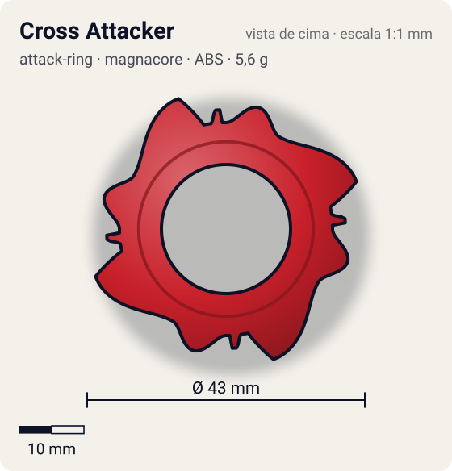
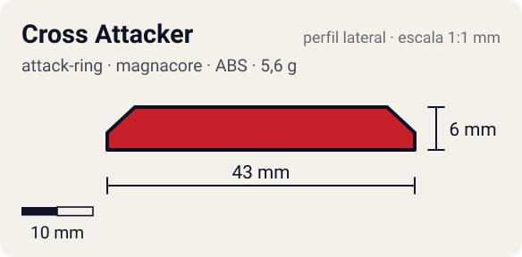

# Cross Attacker

<!-- auto:inicio (gerado por npm run build:research; não edite este bloco) -->
 

| Medidas e material | |
|---|---|
| Diâmetro | 43 estimado mm |
| Altura / espessura | 6 estimado mm |
| Peso | 5,6 wiki g |
| Material | ABS (opaco) |
| Estrelas Takara (A / D / S) | 2,5 / 1 / 1,5 |
| Usada em | [Dranzer V](../../../personagens/kai-hiwatari/beyblades/dranzer-v/) |
<!-- auto:fim -->

| Campo | Valor |
|---|---|
| Id | `attack-ring/cross-attacker` |
| Categoria | Attack Ring |
| Sistema | Magnacore System |
| Material | ABS |
| Acabamento | opaco |
| Cores (primária / secundária / detalhe) | `#c8202a` / `#f2c230` / `#1a1a1a` |

## Beys que usam

- `kai-hiwatari/dranzer-v` ([ficha](../../../personagens/kai-hiwatari/beyblades/dranzer-v/README.md))

## Formato

Simetria 4, diâmetro pequeno (~43 mm). Cada setor: **cabeça de fênix** arredondada (~19,5 mm) seguida de uma **asa** que sobe em rampa íngreme e termina numa ponta afiada (~21,5 mm); depois, um **espinho minúsculo** de face plana (~18,5 mm) separa do próximo conjunto.

AR pequeno com 4 cabeças de fênix, cada uma seguida de uma asa com rampa íngreme; espinhos minúsculos entre os conjuntos.

## Função em batalha

Upper e smash moderados na direita; inútil na esquerda.

## Reação por sentido de rotação

- **Direita (horário visto de cima):** Sentido de fábrica: a rampa da asa faz upper e a ponta dá smash moderado.
- **Esquerda (anti-horário):** As frentes arredondadas das asas lideram: muito recoil; não usar.
- Sentido ótimo: **direita**. Tipo de contato: **upper**, 4 contato(s), recoil 0,45 (0–1, estimado).

## Combos conhecidos

- Wiki: Cross Attacker, Wide Defense, Grip Base (Dragoon Grip Attacker): smash + algum upper.

## Medidas, material e stats

| Item | Valor | Fonte |
|---|---|---|
| Diâmetro | 43 mm | estimado (2 × maior raio da `forma`) |
| Altura | 6 mm | estimado |
| Peso | 5,6 g | wiki |
| Material | ABS | — |
| Ataque / Defesa / Stamina | 3 / 1 / 2 | Beyblade Wiki, Part Infobox |
| Raio de contato | 21,5 mm | estimado |

## Forma (parâmetros do gerador de SVG)

Convenção: ângulos em graus, sentido horário visto de cima, 0° = topo; o setor (0 a 90°) se repete 4 vezes. Na rotação **direita** a face em `fim` é a que bate; na **esquerda**, a face em `inicio`. Anel base com raio 16,5 mm, furo central 10 mm, espessura 6 mm.

| início | pico | fim | raio (mm) | borda | altura (mm) | material |
|---|---|---|---|---|---|---|
| 0° | 15° | 30° | 19,5 | curva | 6 | ABS/PC |
| 30° | 70° | 78° | 21,5 | rampa | 6 | ABS/PC |
| 82° | 85° | 88° | 18,5 | reta | 5 | ABS/PC |

## Observações

Cores aproximadas (sem foto local).

## Referências locais

- Nenhuma foto local desta peça no repositório.

## Fontes

- https://beyblade.fandom.com/wiki/Attack_Ring_-_Cross_Attacker
- https://beyblade.fandom.com/wiki/Dranzer_V
