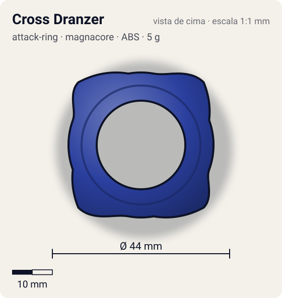
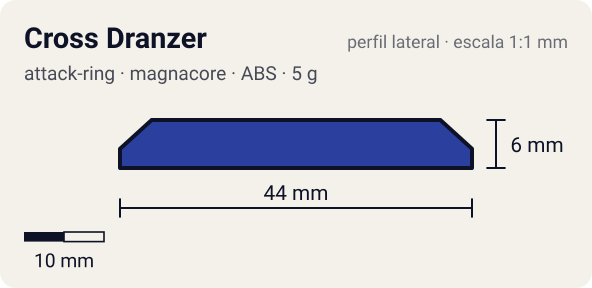

# Cross Dranzer (クロスドランザー)

<!-- auto:inicio (gerado por npm run build:research; não edite este bloco) -->
 

| Medidas e material | |
|---|---|
| Diâmetro | 44 estimado mm |
| Altura / espessura | 6 estimado mm |
| Peso | 5 wiki g |
| Material | ABS (opaco) |
| Estrelas Takara (A / D / S) | 2 / 2 / 1 |
| Usada em | [Dranzer V2](../../../personagens/kai-hiwatari/beyblades/dranzer-v2/) |
<!-- auto:fim -->

| Campo | Valor |
|---|---|
| Id | `attack-ring/cross-dranzer` |
| Categoria | Attack Ring |
| Sistema | Magnacore System |
| Material | ABS |
| Acabamento | opaco |
| Cores (primária / secundária / detalhe) | `#2a3f9e` / `#d8262c` / `#f2c230` |

## Beys que usam

- `kai-hiwatari/dranzer-v2` ([ficha](../../../personagens/kai-hiwatari/beyblades/dranzer-v2/README.md))

## Formato

Oval de simetria 2. Em cada metade, **duas asas triangulares curtas** (~22 mm) com as rampas descendo para longe uma da outra; no vão entre elas fica o "V" em relevo. Como cada par é espelhado, uma rampa serve para cada sentido.

Totalmente simétrico, oval, com 2 asas em triângulo retângulo curto e a letra "V" entre elas dos dois lados.

## Função em batalha

Upper leve nas duas rotações (rampas curtas).

## Reação por sentido de rotação

- **Direita (horário visto de cima):** Uma das rampas de cada par lidera: upper leve.
- **Esquerda (anti-horário):** A outra rampa lidera: upper leve, igual.
- Sentido ótimo: **ambos**. Tipo de contato: **upper**, 4 contato(s), recoil 0,35 (0–1, estimado).

## Combos conhecidos

- Wiki: Cross Dranzer, Wide Defense, Neo SG (Heavy Metal Core), Storm Grip Base: upper contra survival e balance.

## Medidas, material e stats

| Item | Valor | Fonte |
|---|---|---|
| Diâmetro | 44 mm | estimado (2 × maior raio da `forma`) |
| Altura | 6 mm | estimado |
| Peso | 5 g | wiki |
| Material | ABS | — |
| Ataque / Defesa / Stamina | 2 / 2 / 1 | Beyblade Wiki, Part Infobox |
| Raio de contato | 22 mm | estimado |

## Forma (parâmetros do gerador de SVG)

Convenção: ângulos em graus, sentido horário visto de cima, 0° = topo; o setor (0 a 180°) se repete 2 vezes. Na rotação **direita** a face em `fim` é a que bate; na **esquerda**, a face em `inicio`. Anel base com raio 18 mm, furo central 11 mm, espessura 6 mm.

| início | pico | fim | raio (mm) | borda | altura (mm) | material |
|---|---|---|---|---|---|---|
| 10° | 45° | 70° | 22 | rampa | 6 | ABS/PC |
| 110° | 135° | 170° | 22 | rampa | 6 | ABS/PC |

## Observações

Cores aproximadas (sem foto local).

## Referências locais

- Nenhuma foto local desta peça no repositório.

## Fontes

- https://beyblade.fandom.com/wiki/Attack_Ring_-_Cross_Dranzer
- https://beyblade.fandom.com/wiki/Dranzer_V2
