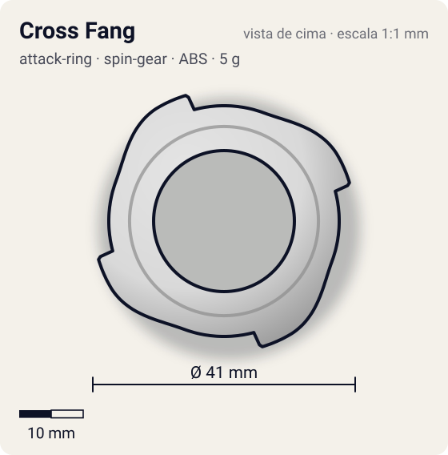
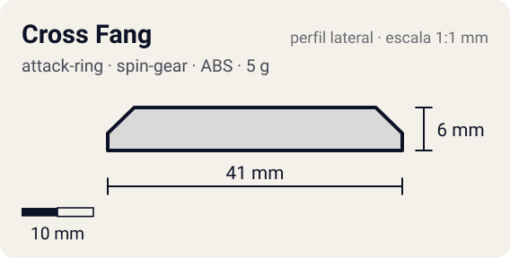

# Cross Fang

<!-- auto:inicio (gerado por npm run build:research; não edite este bloco) -->
 

| Medidas e material | |
|---|---|
| Diâmetro | 41 estimado mm |
| Altura / espessura | 6 estimado mm |
| Peso | 5 wiki g |
| Material | ABS (opaco) |
| Estrelas Takara (A / D / S) | 2,5 / 2,5 / 1,5 |
| Usada em | [Driger F](../../../personagens/ray-kon/beyblades/driger-f/) |
<!-- auto:fim -->

| Campo | Valor |
|---|---|
| Id | `attack-ring/cross-fang` |
| Categoria | Attack Ring |
| Sistema | Spin Gear System |
| Material | ABS |
| Acabamento | opaco |
| Cores (primária / secundária / detalhe) | `#d9d9d9` / `#2aa84a` / `#f2c230` |

## Beys que usam

- `ray-kon/driger-f` ([ficha](../../../personagens/ray-kon/beyblades/driger-f/README.md))

## Formato

Simetria 4. Cada **tigre** é uma projeção baixa que cresce em rampa por ~40° e termina numa face reta curta (~20,5 mm). Pouca diferença entre o anel e as pontas: silhueta quase redonda com 4 "dentes" rasos.

4 tigres simétricos; os corpos formam projeções curtas e pouco afiadas.

## Função em batalha

Smash leve em rotação direita; não competitivo.

## Reação por sentido de rotação

- **Direita (horário visto de cima):** Faces retas lideram: smash leve.
- **Esquerda (anti-horário):** Rampas lideram: quase nenhum efeito.
- Sentido ótimo: **direita**. Tipo de contato: **smash**, 4 contato(s), recoil 0,45 (0–1, estimado).

## Combos conhecidos

- Nenhum combo documentado nas fontes.

## Medidas, material e stats

| Item | Valor | Fonte |
|---|---|---|
| Diâmetro | 41 mm | estimado (2 × maior raio da `forma`) |
| Altura | 6 mm | estimado |
| Peso | 5 g | wiki |
| Material | ABS | — |
| Ataque / Defesa / Stamina | — (não publicados) | — |
| Raio de contato | 20,5 mm | estimado |

## Forma (parâmetros do gerador de SVG)

Convenção: ângulos em graus, sentido horário visto de cima, 0° = topo; o setor (0 a 90°) se repete 4 vezes. Na rotação **direita** a face em `fim` é a que bate; na **esquerda**, a face em `inicio`. Anel base com raio 18 mm, furo central 11 mm, espessura 6 mm.

| início | pico | fim | raio (mm) | borda | altura (mm) | material |
|---|---|---|---|---|---|---|
| 20° | 60° | 75° | 20,5 | reta | 6 | ABS/PC |

## Observações

Cores aproximadas (sem foto local).

## Referências locais

- Nenhuma foto local desta peça no repositório.

## Fontes

- https://beyblade.fandom.com/wiki/Attack_Ring_-_Cross_Fang
- https://beyblade.fandom.com/wiki/Driger_F
