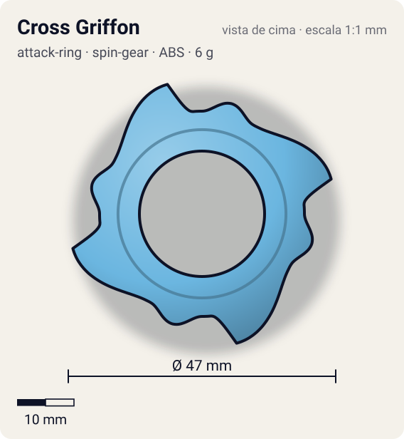
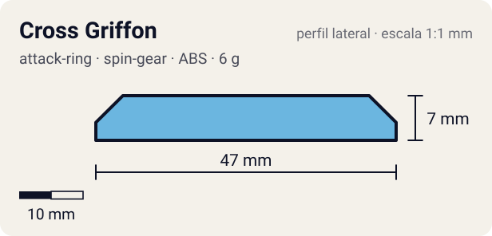

# Cross Griffon

<!-- auto:inicio (gerado por npm run build:research; não edite este bloco) -->
 

| Medidas e material | |
|---|---|
| Diâmetro | 47 estimado mm |
| Altura / espessura | 7 estimado mm |
| Peso | 6 wiki g |
| Material | ABS (opaco) |
| Estrelas Takara (A / D / S) | 3 / 2 / 2,5 |
| Usada em | [Griffolyon](../../../personagens/robert-jurgen/beyblades/griffolyon/) |
<!-- auto:fim -->

| Campo | Valor |
|---|---|
| Id | `attack-ring/cross-griffon` |
| Categoria | Attack Ring |
| Sistema | Spin Gear System |
| Material | ABS |
| Acabamento | opaco |
| Cores (primária / secundária / detalhe) | `#6bb6e0` / `#d8262c` / `#f2d22e` |

## Beys que usam

- `robert-jurgen/griffolyon` ([ficha](../../../personagens/robert-jurgen/beyblades/griffolyon/README.md))

## Formato

Cata-vento de **4 asas** azul-claro. Cada setor: **cabeça de grifo** arredondada (~20 mm) e uma **asa** que se abre em arco por ~55° até uma **ponta afiada** (~23,5 mm) virada no sentido horário, com recorte em gancho atrás dela. Adesivos vermelhos "GRIFFON" e amarelos nas asas.

4 conjuntos de cabeça + asa de grifo; AR grosso com 4 pontas de asa afiadas e bem espaçadas.

## Função em batalha

Smash fortíssimo em rotação direita (comparável ao Triple Wing), grande alcance e enorme "stopping power".

## Reação por sentido de rotação

- **Direita (horário visto de cima):** Pontas das asas lideram: smash muito forte, golpes que freiam a rotação do rival.
- **Esquerda (anti-horário):** Dorso curvo das asas lidera: pouco dano.
- Sentido ótimo: **direita**. Tipo de contato: **smash**, 4 contato(s), recoil 0,35 (0–1, estimado).

## Combos conhecidos

- Wiki: Cross Griffon, Wide Defense, Neo Right SG (Magnecore), SG Metal Flat Base: smash + outspin.

## Medidas, material e stats

| Item | Valor | Fonte |
|---|---|---|
| Diâmetro | 47 mm | estimado (2 × maior raio da `forma`) |
| Altura | 7 mm | estimado |
| Peso | 6 g | wiki |
| Material | ABS | Grosso e difícil de quebrar. Hasbro: pinos para a figura no topo (mais recoil). |
| Ataque / Defesa / Stamina | 3 / 2 / 3 | Beyblade Wiki, Part Infobox |
| Raio de contato | 23,5 mm | estimado |

## Forma (parâmetros do gerador de SVG)

Convenção: ângulos em graus, sentido horário visto de cima, 0° = topo; o setor (0 a 90°) se repete 4 vezes. Na rotação **direita** a face em `fim` é a que bate; na **esquerda**, a face em `inicio`. Anel base com raio 18 mm, furo central 11 mm, espessura 7 mm.

| início | pico | fim | raio (mm) | borda | altura (mm) | material |
|---|---|---|---|---|---|---|
| 0° | 15° | 30° | 20 | curva | 7 | ABS/PC |
| 30° | 75° | 85° | 23,5 | ponta | 7 | ABS/PC |

## Referências locais

- [referencia/griffolyon-attack-ring.jpg](referencia/griffolyon-attack-ring.jpg) (cópia de `personagens/robert-jurgen/beyblades/griffolyon/pecas/attack-ring.jpg`)
- [referencia/griffolyon-pecas-desmontadas.jpg](referencia/griffolyon-pecas-desmontadas.jpg) (cópia de `personagens/robert-jurgen/beyblades/griffolyon/pecas/pecas-desmontadas.jpg`)

## Fontes

- https://beyblade.fandom.com/wiki/Attack_Ring_-_Cross_Griffon
- https://beyblade.fandom.com/wiki/Griffolyon
