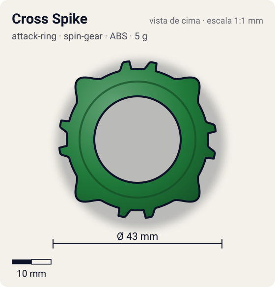
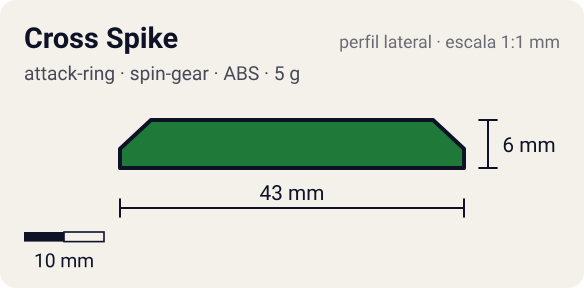

# Cross Spike

<!-- auto:inicio (gerado por npm run build:research; não edite este bloco) -->
 

| Medidas e material | |
|---|---|
| Diâmetro | 43 estimado mm |
| Altura / espessura | 6 estimado mm |
| Peso | 5 wiki g |
| Material | ABS (opaco) |
| Estrelas Takara (A / D / S) | 3 / 2 / 1 |
| Usada em | [Draciel S](../../../personagens/max-tate/beyblades/draciel-s/) |
<!-- auto:fim -->

| Campo | Valor |
|---|---|
| Id | `attack-ring/cross-spike` |
| Categoria | Attack Ring |
| Sistema | Spin Gear System |
| Material | ABS |
| Acabamento | opaco |
| Cores (primária / secundária / detalhe) | `#1f7a3a` / `#0f4a22` / `#f2c230` |

## Beys que usam

- `max-tate/draciel-s` ([ficha](../../../personagens/max-tate/beyblades/draciel-s/README.md))

## Formato

Contorno **quadrado** de simetria 4. No meio de cada lado, uma **cabeça de tartaruga** arredondada (~21,5 mm); ladeando cada cabeça, **pontas planas** curtas (~20 mm) junto aos cantos.

Formato quadrado com 4 cabeças de tartaruga projetadas e várias pontas planas.

## Função em batalha

Pouco útil: as pontas planas tiram o equilíbrio e geram recoil.

## Reação por sentido de rotação

- **Direita (horário visto de cima):** Simétrico: igual.
- **Esquerda (anti-horário):** Igual.
- Sentido ótimo: **ambos**. Tipo de contato: **spike**, 12 contato(s), recoil 0,65 (0–1, estimado).

## Combos conhecidos

- Nenhum combo documentado nas fontes.

## Medidas, material e stats

| Item | Valor | Fonte |
|---|---|---|
| Diâmetro | 43 mm | estimado (2 × maior raio da `forma`) |
| Altura | 6 mm | estimado |
| Peso | 5 g | wiki |
| Material | ABS | — |
| Ataque / Defesa / Stamina | 3 / 2 / 1 | Beyblade Wiki, Part Infobox |
| Raio de contato | 21,5 mm | estimado |

## Forma (parâmetros do gerador de SVG)

Convenção: ângulos em graus, sentido horário visto de cima, 0° = topo; o setor (0 a 90°) se repete 4 vezes. Na rotação **direita** a face em `fim` é a que bate; na **esquerda**, a face em `inicio`. Anel base com raio 18 mm, furo central 11 mm, espessura 6 mm.

| início | pico | fim | raio (mm) | borda | altura (mm) | material |
|---|---|---|---|---|---|---|
| 5° | 10° | 15° | 20 | reta | 6 | ABS/PC |
| 30° | 45° | 60° | 21,5 | curva | 6 | ABS/PC |
| 75° | 80° | 85° | 20 | reta | 6 | ABS/PC |

## Referências locais

- [referencia/draciel-s-attack-ring.gif](referencia/draciel-s-attack-ring.gif) (cópia de `personagens/max-tate/beyblades/draciel-s/pecas/attack-ring.gif`)
- [referencia/draciel-s-pecas-desmontadas.jpg](referencia/draciel-s-pecas-desmontadas.jpg) (cópia de `personagens/max-tate/beyblades/draciel-s/pecas/pecas-desmontadas.jpg`)

## Fontes

- https://beyblade.fandom.com/wiki/Attack_Ring_-_Cross_Spike
- https://beyblade.fandom.com/wiki/Draciel_S
