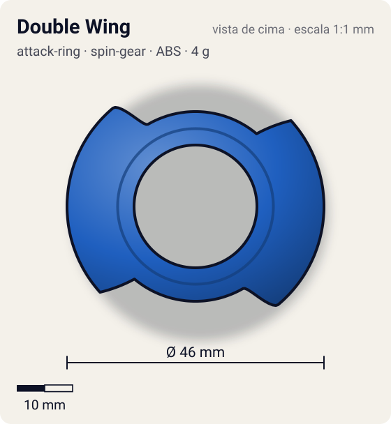
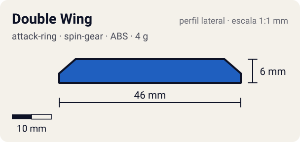

# Double Wing

<!-- auto:inicio (gerado por npm run build:research; não edite este bloco) -->
 

| Medidas e material | |
|---|---|
| Diâmetro | 46 estimado mm |
| Altura / espessura | 6 estimado mm |
| Peso | 4 wiki g |
| Material | ABS (opaco) |
| Estrelas Takara (A / D / S) | 2 / 2 / 2 |
| Usada em | [Dranzer S](../../../personagens/kai-hiwatari/beyblades/dranzer-s/) |
<!-- auto:fim -->

| Campo | Valor |
|---|---|
| Id | `attack-ring/double-wing` |
| Categoria | Attack Ring |
| Sistema | Spin Gear System |
| Material | ABS |
| Acabamento | opaco |
| Cores (primária / secundária / detalhe) | `#1f5fbf` / `#d8262c` / `#f2c230` |

## Beys que usam

- `kai-hiwatari/dranzer-s` ([ficha](../../../personagens/kai-hiwatari/beyblades/dranzer-s/README.md))

## Formato

Simetria 2. Cada **asa** começa numa face reta e alta (~23 mm) e se afina num arco longo (~100°) até encostar no anel, como uma lâmina de foice. Vista de cima: oval com 2 "ombros" retos opostos.

Duas asas, uma de cada lado, feitas para smash em rotação esquerda.

## Função em batalha

Smash com muito recoil; superado pelo Eight Spiker.

## Reação por sentido de rotação

- **Direita (horário visto de cima):** Sentido de fábrica da Dranzer S, mas aqui lidera a cauda afinada da asa: contato fraco.
- **Esquerda (anti-horário):** Sentido ótimo (wiki): a face reta lidera: smash forte com recoil alto.
- Sentido ótimo: **esquerda**. Tipo de contato: **smash**, 2 contato(s), recoil 0,7 (0–1, estimado).

## Combos conhecidos

- Wiki (Draciel V2): Double Wing, Wide Defense, Left SG (Bearing Ver. 2), Fin Tector em modo ataque: smash.

## Medidas, material e stats

| Item | Valor | Fonte |
|---|---|---|
| Diâmetro | 46 mm | estimado (2 × maior raio da `forma`) |
| Altura | 6 mm | estimado |
| Peso | 4 g | wiki |
| Material | ABS | — |
| Ataque / Defesa / Stamina | — (não publicados) | — |
| Raio de contato | 23 mm | estimado |

## Forma (parâmetros do gerador de SVG)

Convenção: ângulos em graus, sentido horário visto de cima, 0° = topo; o setor (0 a 180°) se repete 2 vezes. Na rotação **direita** a face em `fim` é a que bate; na **esquerda**, a face em `inicio`. Anel base com raio 17 mm, furo central 11 mm, espessura 5 mm.

| início | pico | fim | raio (mm) | borda | altura (mm) | material |
|---|---|---|---|---|---|---|
| 30° | 40° | 140° | 23 | reta | 6 | ABS/PC |

## Observações

Cores aproximadas. A wiki diz "smash em rotação esquerda" embora a Dranzer S gire para a direita.

## Referências locais

- Nenhuma foto local desta peça no repositório.

## Fontes

- https://beyblade.fandom.com/wiki/Attack_Ring_-_Double_Wing
- https://beyblade.fandom.com/wiki/Dranzer_S
