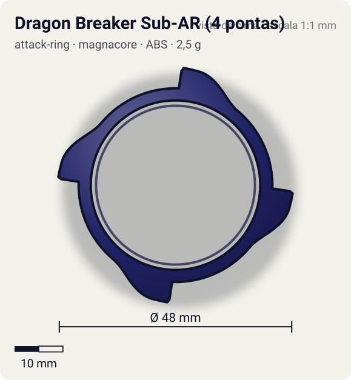
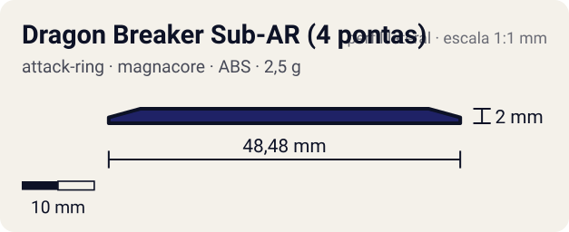

# Dragon Breaker Sub-AR (4 pontas)

<!-- auto:inicio (gerado por npm run build:research; não edite este bloco) -->
 

| Medidas e material | |
|---|---|
| Diâmetro | 48 estimado mm |
| Altura / espessura | 2 estimado mm |
| Peso | 2,5 estimado g |
| Material | ABS (opaco) |
| Estrelas Takara (A / D / S) | — |
| Usada em | [Gaia Dragoon V (Strata Dragoon V / Vast)](../../../personagens/daichi-sumeragi/beyblades/gaia-dragoon-v/) |
<!-- auto:fim -->

| Campo | Valor |
|---|---|
| Id | `attack-ring/dragon-breaker-sub-ar` |
| Categoria | Attack Ring |
| Sistema | Magnacore System |
| Material | ABS |
| Acabamento | opaco |
| Cores (primária / secundária / detalhe) | `#1f2266` / `#f2a12e` / `#f7d23a` |

## Beys que usam

- `daichi-sumeragi/gaia-dragoon-v` ([ficha](../../../personagens/daichi-sumeragi/beyblades/gaia-dragoon-v/README.md))

## Formato

Aro fino (raio ~20 mm) com **4 pontas em gancho** igualmente espaçadas que crescem em arco por ~30° e terminam numa garra curva (~24 mm). Adesivo laranja com faixas amarelas cobre o aro e as garras.

Aro azul-marinho livre com 4 pontas curvas em gancho, decoradas com adesivo laranja/amarelo.

## Função em batalha

Algum smash em rotação esquerda; por ser grande, trava no contato e atrapalha a bey em vez de girar livre (wiki).

## Reação por sentido de rotação

- **Direita (horário visto de cima):** Dorso das garras na frente: contato raspado.
- **Esquerda (anti-horário):** Garras lideram: smash leve; o anel tende a travar.
- Sentido ótimo: **esquerda**. Tipo de contato: **smash**, 4 contato(s), recoil 0,5 (0–1, estimado).

## Combos conhecidos

- Nenhum combo documentado nas fontes.

## Medidas, material e stats

| Item | Valor | Fonte |
|---|---|---|
| Diâmetro | 48 mm | estimado (2 × maior raio da `forma`) |
| Altura | 2 mm | estimado |
| Peso | 2,5 g | estimado |
| Material | ABS | Anel livre sob o anel central. |
| Ataque / Defesa / Stamina | — (não publicados) | — |
| Raio de contato | 24 mm | estimado |

## Forma (parâmetros do gerador de SVG)

Convenção: ângulos em graus, sentido horário visto de cima, 0° = topo; o setor (0 a 90°) se repete 4 vezes. Na rotação **direita** a face em `fim` é a que bate; na **esquerda**, a face em `inicio`. Anel base com raio 20 mm, furo central 17,5 mm, espessura 2 mm.

| início | pico | fim | raio (mm) | borda | altura (mm) | material |
|---|---|---|---|---|---|---|
| 50° | 80° | 88° | 24 | gancho | 2 | ABS/PC |

## Referências locais

- [referencia/gaia-dragoon-v-attack-ring.jpg](referencia/gaia-dragoon-v-attack-ring.jpg) (cópia de `personagens/daichi-sumeragi/beyblades/gaia-dragoon-v/pecas/attack-ring.jpg`)

## Fontes

- https://beyblade.fandom.com/wiki/Attack_Ring_-_Dragon_Breaker
- https://beyblade.fandom.com/wiki/Strata_Dragoon_V
