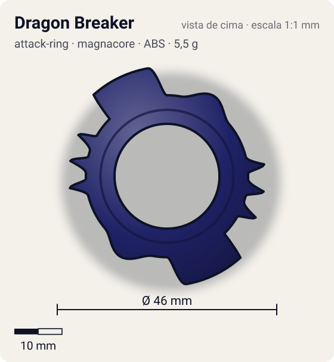
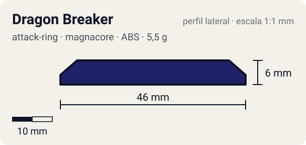

# Dragon Breaker

<!-- auto:inicio (gerado por npm run build:research; não edite este bloco) -->
 

| Medidas e material | |
|---|---|
| Diâmetro | 46 estimado mm |
| Altura / espessura | 6 estimado mm |
| Peso | 5,5 estimado g |
| Material | ABS (opaco) |
| Estrelas Takara (A / D / S) | 3 / 2,5 / 2,5 |
| Usada em | [Gaia Dragoon V (Strata Dragoon V / Vast)](../../../personagens/daichi-sumeragi/beyblades/gaia-dragoon-v/) |
<!-- auto:fim -->

| Campo | Valor |
|---|---|
| Id | `attack-ring/dragon-breaker` |
| Categoria | Attack Ring |
| Sistema | Magnacore System |
| Material | ABS |
| Acabamento | opaco |
| Cores (primária / secundária / detalhe) | `#1f2266` / `#e2452a` / `#f2b72e` |

## Beys que usam

- `daichi-sumeragi/gaia-dragoon-v` ([ficha](../../../personagens/daichi-sumeragi/beyblades/gaia-dragoon-v/README.md))

## Formato

Silhueta **oval** de simetria 2. Em cada lado, uma **ponta grande** com face reta de ataque virada para o sentido anti-horário, que se afina em rampa até o anel (~45°, até ~23 mm). Depois dela, uma **fileira de 3 pontas pequenas** em serra (~20,5 mm). Do lado oposto ao serrilhado, uma bossa arredondada com parafusos em relevo. Adesivos vermelho/laranja/azul "GAIA DRAGOON".

AR oval azul-marinho com 2 conjuntos de pontas: uma ponta grande inclinada e uma fileira de pontas menores; Sub-AR livre de 4 pontas embaixo.

## Função em batalha

Smash pesado em rotação esquerda, com muito recoil (peso agressivo e contatos grandes).

## Reação por sentido de rotação

- **Direita (horário visto de cima):** Sentido de fábrica (Gaia Dragoon V gira à direita), mas nesse sentido lideram as rampas: pouco dano.
- **Esquerda (anti-horário):** Sentido ótimo segundo a wiki: as faces retas das pontas grandes lideram, golpes fortes com recoil alto.
- Sentido ótimo: **esquerda**. Tipo de contato: **smash**, 2 contato(s), recoil 0,7 (0–1, estimado).

## Combos conhecidos

- Wiki (Triple Tiger): Dragon Breaker + S-AR do War Bear é melhor em smash puro que o Triple Tiger.

## Medidas, material e stats

| Item | Valor | Fonte |
|---|---|---|
| Diâmetro | 46 mm | estimado (2 × maior raio da `forma`) |
| Altura | 6 mm | estimado |
| Peso | 5,5 g | estimado |
| Material | ABS | Wiki: 8 g para o conjunto (anel central fixo + Sub-AR livre embaixo); aqui 5,5 g + 2,5 g, divisão estimada. |
| Ataque / Defesa / Stamina | 3 / 3 / 3 | Beyblade Wiki, Part Infobox |
| Raio de contato | 23 mm | estimado |

## Forma (parâmetros do gerador de SVG)

Convenção: ângulos em graus, sentido horário visto de cima, 0° = topo; o setor (0 a 180°) se repete 2 vezes. Na rotação **direita** a face em `fim` é a que bate; na **esquerda**, a face em `inicio`. Anel base com raio 17 mm, furo central 11 mm, espessura 6 mm.

| início | pico | fim | raio (mm) | borda | altura (mm) | material |
|---|---|---|---|---|---|---|
| 0° | 10° | 45° | 23 | reta | 6 | ABS/PC |
| 60° | 65° | 72° | 20,5 | ponta | 5 | ABS/PC |
| 76° | 81° | 88° | 20,5 | ponta | 5 | ABS/PC |
| 92° | 97° | 104° | 20,5 | ponta | 5 | ABS/PC |
| 130° | 150° | 170° | 19,5 | curva | 6 | ABS/PC |

## Observações

Decisão: Sub-AR livre em ficha separada.

## Referências locais

- [referencia/gaia-dragoon-v-attack-ring.jpg](referencia/gaia-dragoon-v-attack-ring.jpg) (cópia de `personagens/daichi-sumeragi/beyblades/gaia-dragoon-v/pecas/attack-ring.jpg`)

## Fontes

- https://beyblade.fandom.com/wiki/Attack_Ring_-_Dragon_Breaker
- https://beyblade.fandom.com/wiki/Strata_Dragoon_V
