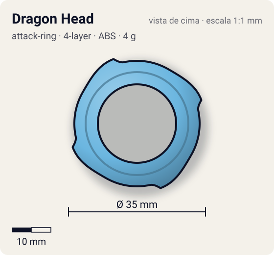
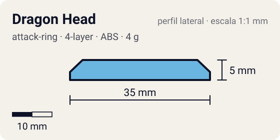

# Dragon Head

<!-- auto:inicio (gerado por npm run build:research; não edite este bloco) -->
 

| Medidas e material | |
|---|---|
| Diâmetro | 35 estimado mm |
| Altura / espessura | 5 estimado mm |
| Peso | 4 wiki g |
| Material | ABS (opaco) |
| Estrelas Takara (A / D / S) | 2 / 1 / 2 |
| Usada em | [Dragoon Grip Attacker](../../../personagens/tyson-granger/beyblades/dragoon-grip-attacker/) |
<!-- auto:fim -->

| Campo | Valor |
|---|---|
| Id | `attack-ring/dragon-head` |
| Categoria | Attack Ring |
| Sistema | 4 camadas (4-Layer System) |
| Material | ABS |
| Acabamento | opaco |
| Cores (primária / secundária / detalhe) | `#6bb6e0` / `#f0f0f0` / `#d8262c` |

## Beys que usam

- `tyson-granger/dragoon-grip-attacker` ([ficha](../../../personagens/tyson-granger/beyblades/dragoon-grip-attacker/README.md))

## Formato

Anel quase redondo e **pequeno** (~35 mm) com **4 pontinhas** que mal saem do anel (~1,5 mm), viradas no sentido horário.

Um dos menores ARs já feitos, com 4 protuberâncias minúsculas para rotação direita.

## Função em batalha

Quase não faz contato: o dano vem do Weight Disk (weight disk attack).

## Reação por sentido de rotação

- **Direita (horário visto de cima):** Única rotação possível: contato mínimo.
- **Esquerda (anti-horário):** Não se aplica (4 camadas, só direita).
- Sentido ótimo: **direita**. Tipo de contato: **smash**, 4 contato(s), recoil 0,3 (0–1, estimado).

## Combos conhecidos

- Uso: weight disk attack (o WD fica exposto).

## Medidas, material e stats

| Item | Valor | Fonte |
|---|---|---|
| Diâmetro | 35 mm | estimado (2 × maior raio da `forma`) |
| Altura | 5 mm | estimado |
| Peso | 4 g | wiki |
| Material | ABS | Frágil. A wiki o lista no Spin Gear System, mas a bey é de 4 camadas (só gira à direita). |
| Ataque / Defesa / Stamina | — (não publicados) | — |
| Raio de contato | 17,5 mm | estimado |

## Forma (parâmetros do gerador de SVG)

Convenção: ângulos em graus, sentido horário visto de cima, 0° = topo; o setor (0 a 90°) se repete 4 vezes. Na rotação **direita** a face em `fim` é a que bate; na **esquerda**, a face em `inicio`. Anel base com raio 16 mm, furo central 10 mm, espessura 5 mm.

| início | pico | fim | raio (mm) | borda | altura (mm) | material |
|---|---|---|---|---|---|---|
| 30° | 70° | 78° | 17,5 | ponta | 5 | ABS/PC |

## Observações

Cores aproximadas.

## Referências locais

- Nenhuma foto local desta peça no repositório.

## Fontes

- https://beyblade.fandom.com/wiki/Attack_Ring_-_Dragon_Head
- https://beyblade.fandom.com/wiki/Dragoon_Grip_Attacker
