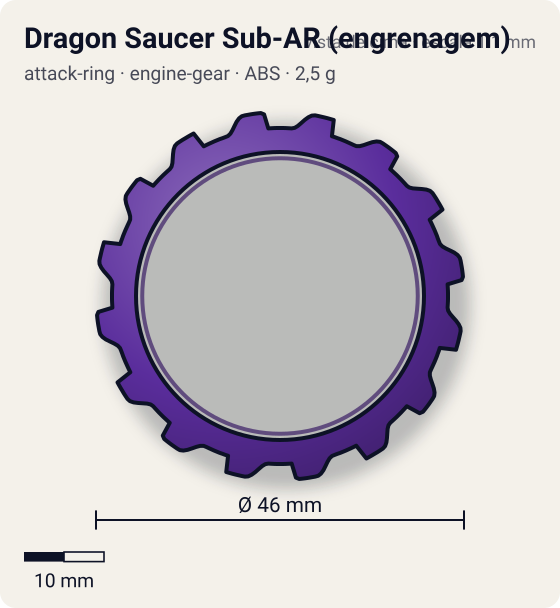
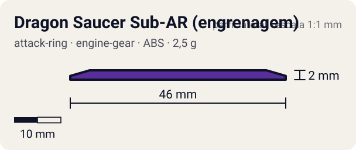

# Dragon Saucer Sub-AR (engrenagem)

<!-- auto:inicio (gerado por npm run build:research; não edite este bloco) -->
 

| Medidas e material | |
|---|---|
| Diâmetro | 46 estimado mm |
| Altura / espessura | 2 estimado mm |
| Peso | 2,5 estimado g |
| Material | ABS (opaco) |
| Estrelas Takara (A / D / S) | — |
| Usada em | [Gaia Dragoon G (Strata Dragoon G / Great)](../../../personagens/daichi-sumeragi/beyblades/gaia-dragoon-g/) |
<!-- auto:fim -->

| Campo | Valor |
|---|---|
| Id | `attack-ring/dragon-saucer-sub-ar` |
| Categoria | Attack Ring |
| Sistema | Engine Gear System |
| Material | ABS |
| Acabamento | opaco |
| Cores (primária / secundária / detalhe) | `#5a2d9c` / `#f2d22e` / `#3a1b6b` |

## Beys que usam

- `daichi-sumeragi/gaia-dragoon-g` ([ficha](../../../personagens/daichi-sumeragi/beyblades/gaia-dragoon-g/README.md))

## Formato

Aro fino e largo (raio interno ~18 mm) com **16 dentes retangulares** de cantos arredondados igualmente espaçados (~2 mm de altura radial, até ~23 mm). No topo, um adesivo amarelo em 4 arcos acompanha o aro. É a "serra" do Great Cutter no anime.

Aro roxo em forma de engrenagem com 16 dentes retangulares e faixa amarela no topo.

## Função em batalha

Livre: amortece golpes. Travado: os entalhes "engatam" no adversário e roubam rotação (zombie).

## Reação por sentido de rotação

- **Direita (horário visto de cima):** Gira livre; dentes simétricos, sem sentido preferido.
- **Esquerda (anti-horário):** Igual.
- Sentido ótimo: **ambos**. Tipo de contato: **survival**, 16 contato(s), recoil 0,3 (0–1, estimado).

## Combos conhecidos

- Ver Dragon Saucer (uso como Sub-AR em zombie com Twin Horn).

## Medidas, material e stats

| Item | Valor | Fonte |
|---|---|---|
| Diâmetro | 46 mm | estimado (2 × maior raio da `forma`) |
| Altura | 2 mm | estimado |
| Peso | 2,5 g | estimado |
| Material | ABS | Sub-AR livre em forma de engrenagem; pode ser travado para spin steal. |
| Ataque / Defesa / Stamina | — (não publicados) | — |
| Raio de contato | 23 mm | estimado |

## Forma (parâmetros do gerador de SVG)

Convenção: ângulos em graus, sentido horário visto de cima, 0° = topo; o setor (0 a 22,5°) se repete 16 vezes. Na rotação **direita** a face em `fim` é a que bate; na **esquerda**, a face em `inicio`. Anel base com raio 21 mm, furo central 18 mm, espessura 2 mm.

| início | pico | fim | raio (mm) | borda | altura (mm) | material |
|---|---|---|---|---|---|---|
| 4° | 11° | 18° | 23 | reta | 2 | ABS/PC |

## Observações

Número de dentes conferido na foto local (16).

## Referências locais

- [referencia/gaia-dragoon-g-sub-attack-ring.jpg](referencia/gaia-dragoon-g-sub-attack-ring.jpg) (cópia de `personagens/daichi-sumeragi/beyblades/gaia-dragoon-g/pecas/sub-attack-ring.jpg`)

## Fontes

- https://beyblade.fandom.com/wiki/Attack_Ring_-_Dragon_Saucer
