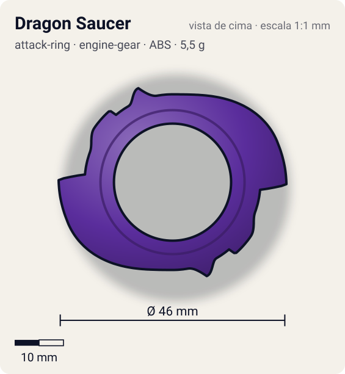
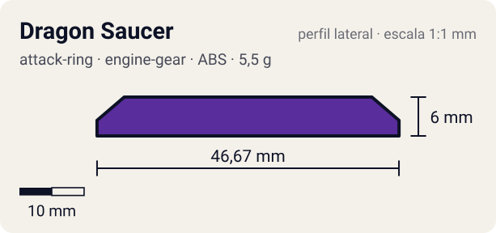

# Dragon Saucer

<!-- auto:inicio (gerado por npm run build:research; não edite este bloco) -->
 

| Medidas e material | |
|---|---|
| Diâmetro | 46 estimado mm |
| Altura / espessura | 6 estimado mm |
| Peso | 5,5 estimado g |
| Material | ABS (opaco) |
| Estrelas Takara (A / D / S) | 3 / 3 / 2 |
| Usada em | [Gaia Dragoon G (Strata Dragoon G / Great)](../../../personagens/daichi-sumeragi/beyblades/gaia-dragoon-g/) |
<!-- auto:fim -->

| Campo | Valor |
|---|---|
| Id | `attack-ring/dragon-saucer` |
| Categoria | Attack Ring |
| Sistema | Engine Gear System |
| Material | ABS |
| Acabamento | opaco |
| Cores (primária / secundária / detalhe) | `#5a2d9c` / `#d8262c` / `#f2d22e` |

## Beys que usam

- `daichi-sumeragi/gaia-dragoon-g` ([ficha](../../../personagens/daichi-sumeragi/beyblades/gaia-dragoon-g/README.md))

## Formato

Anel roxo com abertura central grande. Duas **asas curvas** (adesivos vermelho/amarelo "GAIA DRAGOON-G") nascem no anel e varrem ~95° em espiral até ~23 mm, terminando em **gancho** com uma ponta em V. Entre as asas, blocos com parafusos em relevo e pequenas pontas (~20 mm). Silhueta de "S" duplo.

AR roxo com 2 dragões em lados opostos, em asas que varrem em arco com ponta em gancho; segura o Sub-AR em engrenagem.

## Função em batalha

Smash nas pontas das asas; o Sub-AR serrilhado faz o contato contínuo.

## Reação por sentido de rotação

- **Direita (horário visto de cima):** Sentido de fábrica: os ganchos das asas lideram (smash).
- **Esquerda (anti-horário):** O dorso das asas lidera: rampa leve, pouco efeito.
- Sentido ótimo: **direita**. Tipo de contato: **smash**, 2 contato(s), recoil 0,55 (0–1, estimado).

## Combos conhecidos

- Wiki: Dragon Saucer + Screw Zeus (Sub-AR travado), Wide Defense, Neo SG (Heavy Metal Core), Defense Grip Base invertida: ataque.
- Wiki: Twin Horn + Sub-AR do Dragon Saucer, Wide Survivor, Neo Left SG (Double Bearing) + eixo SG (Wolborg 2), Defense Ring, Customize Grip Base: zombie / spin steal.

## Medidas, material e stats

| Item | Valor | Fonte |
|---|---|---|
| Diâmetro | 46 mm | estimado (2 × maior raio da `forma`) |
| Altura | 6 mm | estimado |
| Peso | 5,5 g | estimado |
| Material | ABS | A wiki dá 8 g para o conjunto AR + Sub-AR; aqui 5,5 g (AR) + 2,5 g (Sub-AR), divisão estimada. |
| Ataque / Defesa / Stamina | 3 / 2 / 2 | Beyblade Wiki, Part Infobox |
| Raio de contato | 23 mm | estimado |

## Forma (parâmetros do gerador de SVG)

Convenção: ângulos em graus, sentido horário visto de cima, 0° = topo; o setor (0 a 180°) se repete 2 vezes. Na rotação **direita** a face em `fim` é a que bate; na **esquerda**, a face em `inicio`. Anel base com raio 18 mm, furo central 12 mm, espessura 5 mm.

| início | pico | fim | raio (mm) | borda | altura (mm) | material |
|---|---|---|---|---|---|---|
| 0° | 70° | 95° | 23 | gancho | 6 | ABS/PC |
| 110° | 125° | 140° | 19,5 | reta | 5 | ABS/PC |
| 150° | 160° | 170° | 20,5 | ponta | 5 | ABS/PC |

## Referências locais

- [referencia/gaia-dragoon-g-attack-ring.jpg](referencia/gaia-dragoon-g-attack-ring.jpg) (cópia de `personagens/daichi-sumeragi/beyblades/gaia-dragoon-g/pecas/attack-ring.jpg`)

## Fontes

- https://beyblade.fandom.com/wiki/Attack_Ring_-_Dragon_Saucer
- https://beyblade.fandom.com/wiki/Strata_Dragoon_G
