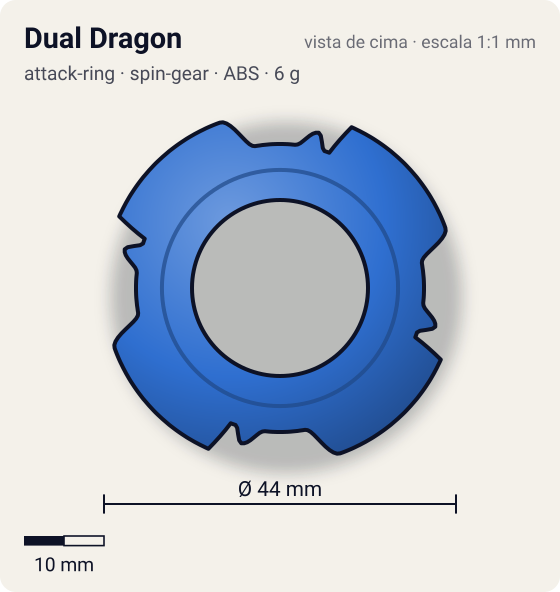
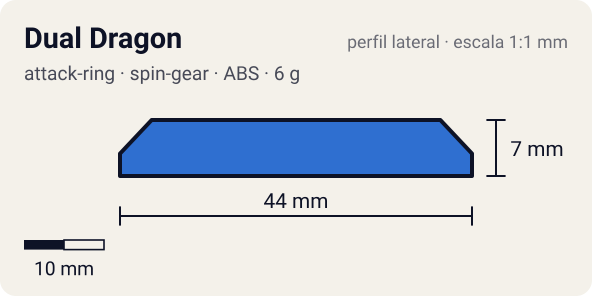

# Dual Dragon (デュアルドラゴン)

<!-- auto:inicio (gerado por npm run build:research; não edite este bloco) -->
 

| Medidas e material | |
|---|---|
| Diâmetro | 44 estimado mm |
| Altura / espessura | 7 estimado mm |
| Peso | 6 wiki g |
| Material | ABS + PC translúcido (opaco) |
| Estrelas Takara (A / D / S) | 3 / 3 / 3 |
| Usada em | [Dragoon F (Dragoon Fantom)](../../../personagens/tyson-granger/beyblades/dragoon-f/) |
<!-- auto:fim -->

| Campo | Valor |
|---|---|
| Id | `attack-ring/dual-dragon` |
| Categoria | Attack Ring |
| Sistema | Spin Gear System |
| Material | ABS + PC translúcido |
| Acabamento | opaco |
| Cores (primária / secundária / detalhe) | `#2f6fd0` / `#d8262c` / `#f0f0f0` |

## Beys que usam

- `tyson-granger/dragoon-f` ([ficha](../../../personagens/tyson-granger/beyblades/dragoon-f/README.md))

## Formato

Simetria 4. **Cabeças de dragão** com face reta de ataque virada para o sentido anti-horário (~22 mm), afinando por ~50° até o anel. Embaixo e entre elas, as **lâminas vermelhas** da camada de PC aparecem como abas baixas (~20 mm).

AR de duas camadas: em cima, 4 cabeças de dragão com projeções para a esquerda; embaixo, anel de 4 lâminas em policarbonato vermelho.

## Função em batalha

Smash esquerdo; versão mais durável do Reverse Dragon.

## Reação por sentido de rotação

- **Direita (horário visto de cima):** Lideram as caudas afinadas: pouco dano.
- **Esquerda (anti-horário):** Sentido de fábrica: as faces retas lideram, smash.
- Sentido ótimo: **esquerda**. Tipo de contato: **smash**, 4 contato(s), recoil 0,5 (0–1, estimado).

## Combos conhecidos

- Nenhum combo documentado nas fontes.

## Medidas, material e stats

| Item | Valor | Fonte |
|---|---|---|
| Diâmetro | 44 mm | estimado (2 × maior raio da `forma`) |
| Altura | 7 mm | estimado |
| Peso | 6 g | wiki |
| Material | ABS + PC translúcido | Camada inferior vermelha em "Dual Carbonate" (policarbonato) que absorve choque. |
| Ataque / Defesa / Stamina | — (não publicados) | — |
| Raio de contato | 22 mm | estimado |

## Forma (parâmetros do gerador de SVG)

Convenção: ângulos em graus, sentido horário visto de cima, 0° = topo; o setor (0 a 90°) se repete 4 vezes. Na rotação **direita** a face em `fim` é a que bate; na **esquerda**, a face em `inicio`. Anel base com raio 18 mm, furo central 11 mm, espessura 7 mm.

| início | pico | fim | raio (mm) | borda | altura (mm) | material |
|---|---|---|---|---|---|---|
| 10° | 20° | 70° | 22 | reta | 7 | ABS/PC |
| 72° | 76° | 84° | 20 | curva | 3 | ABS/PC |

## Observações

Nome JP da página da Dragoon F. Cores aproximadas.

## Referências locais

- Nenhuma foto local desta peça no repositório.

## Fontes

- https://beyblade.fandom.com/wiki/Attack_Ring_-_Dual_Dragon
- https://beyblade.fandom.com/wiki/Dragoon_F
