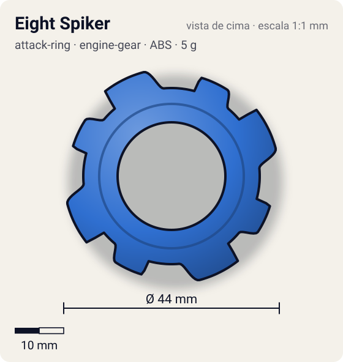
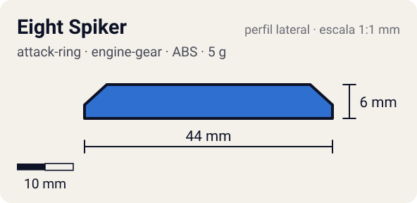

# Eight Spiker

<!-- auto:inicio (gerado por npm run build:research; não edite este bloco) -->
 

| Medidas e material | |
|---|---|
| Diâmetro | 44 estimado mm |
| Altura / espessura | 6 estimado mm |
| Peso | 5 wiki g |
| Material | ABS (opaco) |
| Estrelas Takara (A / D / S) | 3 / 2 / 2 |
| Usada em | [Dragoon G (Dragoon Galaxy)](../../../personagens/tyson-granger/beyblades/dragoon-g/) |
<!-- auto:fim -->

| Campo | Valor |
|---|---|
| Id | `attack-ring/eight-spiker` |
| Categoria | Attack Ring |
| Sistema | Engine Gear System |
| Material | ABS |
| Acabamento | opaco |
| Cores (primária / secundária / detalhe) | `#2f6fd0` / `#f0f0f0` / `#f2c230` |

## Beys que usam

- `tyson-granger/dragoon-g` ([ficha](../../../personagens/tyson-granger/beyblades/dragoon-g/README.md))

## Formato

Simetria 4. Cada setor: **cabeça de dragão** com face de ataque reta e serrilhada virada para o sentido anti-horário (~22 mm), afinando para trás; depois, uma **barbatana** menor com o mesmo perfil (~21 mm). 8 contatos bem espaçados.

4 cabeças de dragão seguidas de 4 barbatanas menores (8 contatos), cada uma com pequenos espinhos.

## Função em batalha

Smash esquerdo forte, consistente e com pouco recoil.

## Reação por sentido de rotação

- **Direita (horário visto de cima):** Lideram as costas inclinadas: sem contato especializado.
- **Esquerda (anti-horário):** Sentido de fábrica: faces serrilhadas lideram, smash + spike.
- Sentido ótimo: **esquerda**. Tipo de contato: **smash**, 8 contato(s), recoil 0,3 (0–1, estimado).

## Combos conhecidos

- Wiki: Eight Spiker, Wide Defense, Neo Right SG (Normal Core), SG Metal Flat 2: smash.

## Medidas, material e stats

| Item | Valor | Fonte |
|---|---|---|
| Diâmetro | 44 mm | estimado (2 × maior raio da `forma`) |
| Altura | 6 mm | estimado |
| Peso | 5 g | wiki |
| Material | ABS | — |
| Ataque / Defesa / Stamina | 3 / 2 / 2 | Beyblade Wiki, Part Infobox |
| Raio de contato | 22 mm | estimado |

## Forma (parâmetros do gerador de SVG)

Convenção: ângulos em graus, sentido horário visto de cima, 0° = topo; o setor (0 a 90°) se repete 4 vezes. Na rotação **direita** a face em `fim` é a que bate; na **esquerda**, a face em `inicio`. Anel base com raio 18 mm, furo central 11 mm, espessura 6 mm.

| início | pico | fim | raio (mm) | borda | altura (mm) | material |
|---|---|---|---|---|---|---|
| 5° | 15° | 40° | 22 | reta | 6 | ABS/PC |
| 50° | 57° | 75° | 21 | reta | 6 | ABS/PC |

## Observações

Cores aproximadas (sem foto local).

## Referências locais

- Nenhuma foto local desta peça no repositório.

## Fontes

- https://beyblade.fandom.com/wiki/Attack_Ring_-_Eight_Spiker
- https://beyblade.fandom.com/wiki/Dragoon_G
