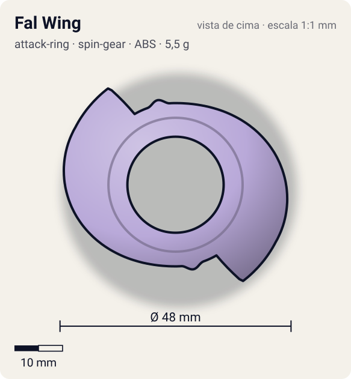
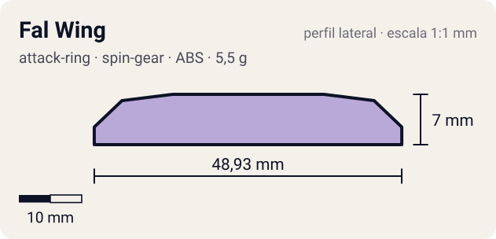

# Fal Wing

<!-- auto:inicio (gerado por npm run build:research; não edite este bloco) -->
 

| Medidas e material | |
|---|---|
| Diâmetro | 48 estimado mm |
| Altura / espessura | 7 estimado mm |
| Peso | 5,5 estimado g |
| Material | ABS (opaco) |
| Estrelas Takara (A / D / S) | — |
| Usada em | [Falborg](../../../personagens/bryan-kuznetsov/beyblades/falborg/) |
<!-- auto:fim -->

| Campo | Valor |
|---|---|
| Id | `attack-ring/fal-wing` |
| Categoria | Attack Ring |
| Sistema | Spin Gear System |
| Material | ABS |
| Acabamento | opaco |
| Cores (primária / secundária / detalhe) | `#b9a9d9` / `#d23a2a` / `#f2c230` |

## Beys que usam

- `bryan-kuznetsov/falborg` ([ficha](../../../personagens/bryan-kuznetsov/beyblades/falborg/README.md))

## Formato

Silhueta oval-alongada de simetria 2. Cada asa começa colada ao anel e vai abrindo em espiral por ~150°, chegando a ~24 mm do centro, onde termina num **gancho** (ponta dobrada para trás). As asas têm faixas vermelhas em degraus e um losango verde perto da raiz. Perto do centro, 2 pinos cilíndricos amarelos (~18 mm) sobressaem para cima.

Duas grandes asas em crescente (lilás com faixas vermelhas e detalhe verde) que terminam em gancho, e 2 pinos amarelos junto ao centro.

## Função em batalha

Smash de longo alcance: as asas longas tocam cedo no adversário; com só 2 contatos, o recoil tende a ser alto (estimativa).

## Reação por sentido de rotação

- **Direita (horário visto de cima):** Sentido de Falborg. A ponta em gancho lidera e bate em cheio (smash).
- **Esquerda (anti-horário):** O dorso liso da asa lidera: contato raspado, pouco dano.
- Sentido ótimo: **direita**. Tipo de contato: **smash**, 2 contato(s), recoil 0,6 (0–1, estimado).

## Combos conhecidos

- Nenhum combo documentado nas fontes.

## Medidas, material e stats

| Item | Valor | Fonte |
|---|---|---|
| Diâmetro | 48 mm | estimado (2 × maior raio da `forma`) |
| Altura | 7 mm | estimado |
| Peso | 5,5 g | estimado |
| Material | ABS | Peça só do anime/jogo de GBA (Falborg nunca foi lançada como brinquedo). |
| Ataque / Defesa / Stamina | — (não publicados) | — |
| Raio de contato | 24 mm | estimado |

## Forma (parâmetros do gerador de SVG)

Convenção: ângulos em graus, sentido horário visto de cima, 0° = topo; o setor (0 a 180°) se repete 2 vezes. Na rotação **direita** a face em `fim` é a que bate; na **esquerda**, a face em `inicio`. Anel base com raio 17 mm, furo central 10 mm, espessura 6 mm.

| início | pico | fim | raio (mm) | borda | altura (mm) | material |
|---|---|---|---|---|---|---|
| 0° | 120° | 150° | 24 | gancho | 7 | ABS/PC |
| 160° | 168° | 176° | 18 | curva | 8 | ABS/PC |

## Observações

Sem página na wiki e sem brinquedo. Forma tirada da arte oficial do anime e da ficha do GBA (fotos em referencia/). Peso e medidas estimados.

## Referências locais

- [referencia/falborg-arte.png](referencia/falborg-arte.png) (cópia de `personagens/bryan-kuznetsov/beyblades/falborg/imagem.png`)
- [referencia/falborg-gba-pecas-e-stats.png](referencia/falborg-gba-pecas-e-stats.png) (cópia de `personagens/bryan-kuznetsov/beyblades/falborg/pecas/gba-pecas-e-stats.png`)

## Fontes

- https://beyblade.fandom.com/wiki/Falborg
- Bakuten Shoot Beyblade 2002 (GBA), tela de peças (foto local)
