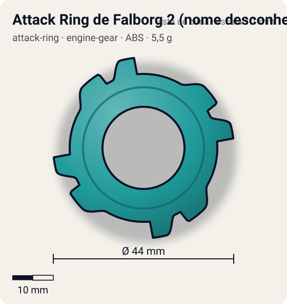
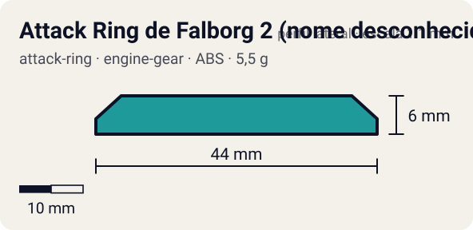

# Attack Ring de Falborg 2 (nome desconhecido)

<!-- auto:inicio (gerado por npm run build:research; não edite este bloco) -->
 

| Medidas e material | |
|---|---|
| Diâmetro | 44 estimado mm |
| Altura / espessura | 6 estimado mm |
| Peso | 5,5 estimado g |
| Material | ABS (opaco) |
| Estrelas Takara (A / D / S) | — |
| Usada em | [Falborg 2](../../../personagens/bryan-kuznetsov/beyblades/falborg-2/) |
<!-- auto:fim -->

> **Ficha HIPOTÉTICA.** A peça não tem nome nem dados confirmados; tudo aqui é estimativa para o jogo ter uma silhueta.

| Campo | Valor |
|---|---|
| Id | `attack-ring/falborg-2-ar-hipotetico` |
| Categoria | Attack Ring |
| Sistema | Engine Gear System |
| Material | ABS |
| Acabamento | opaco |
| Cores (primária / secundária / detalhe) | `#1f9a9a` / `#c8252c` / `#f2c230` |

## Beys que usam

- `bryan-kuznetsov/falborg-2` ([ficha](../../../personagens/bryan-kuznetsov/beyblades/falborg-2/README.md))

## Formato

Contorno quase **quadrado** com cantos chanfrados (raio ~21 mm nos cantos). Em cada lado, logo depois do canto, um **bloco/garra** retangular vermelho e amarelo sobressai até ~22 mm, com face reta virada no sentido horário. Cor base teal.

Ficha hipotética montada a partir do frame do anime: anel quadrangular verde-azulado com 4 blocos/garras laterais vermelhos e amarelos e cantos chanfrados.

## Função em batalha

Smash de 4 contatos (estimativa visual), coerente com o tipo Attack da bey.

## Reação por sentido de rotação

- **Direita (horário visto de cima):** Sentido presumido (Falborg gira para a direita). As faces retas dos blocos lideram: smash com recoil médio.
- **Esquerda (anti-horário):** Os chanfros dos cantos lideram: pouco dano.
- Sentido ótimo: **direita**. Tipo de contato: **smash**, 4 contato(s), recoil 0,5 (0–1, estimado).

## Combos conhecidos

- Nenhum combo documentado nas fontes.

## Medidas, material e stats

| Item | Valor | Fonte |
|---|---|---|
| Diâmetro | 44 mm | estimado (2 × maior raio da `forma`) |
| Altura | 6 mm | estimado |
| Peso | 5,5 g | estimado |
| Material | ABS | HIPOTÉTICO: peça só do anime, sem nome nem dados confirmados. |
| Ataque / Defesa / Stamina | — (não publicados) | — |
| Raio de contato | 22 mm | estimado |

## Forma (parâmetros do gerador de SVG)

Convenção: ângulos em graus, sentido horário visto de cima, 0° = topo; o setor (0 a 90°) se repete 4 vezes. Na rotação **direita** a face em `fim` é a que bate; na **esquerda**, a face em `inicio`. Anel base com raio 18 mm, furo central 10 mm, espessura 6 mm.

| início | pico | fim | raio (mm) | borda | altura (mm) | material |
|---|---|---|---|---|---|---|
| 30° | 45° | 60° | 21 | reta | 6 | ABS/PC |
| 65° | 75° | 85° | 22 | reta | 6 | ABS/PC |

## Observações

Criada para o jogo ter uma silhueta para a Falborg 2; tudo aqui é **estimado**. A wiki deixa o AR em branco. Se aparecer fonte melhor, substituir.

## Referências locais

- [referencia/falborg-2-anime-frame.jpg](referencia/falborg-2-anime-frame.jpg) (cópia de `personagens/bryan-kuznetsov/beyblades/falborg-2/imagem.jpg`)
- [referencia/falborg-2-anime.jpg](referencia/falborg-2-anime.jpg) (cópia de `personagens/bryan-kuznetsov/beyblades/falborg-2/anime.jpg`)

## Fontes

- https://beyblade.fandom.com/wiki/Falborg_2
