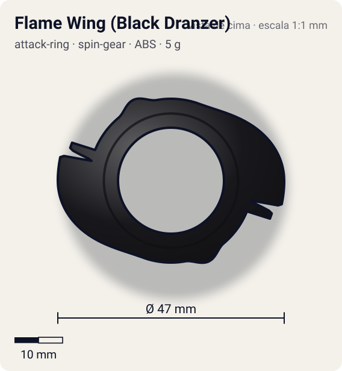
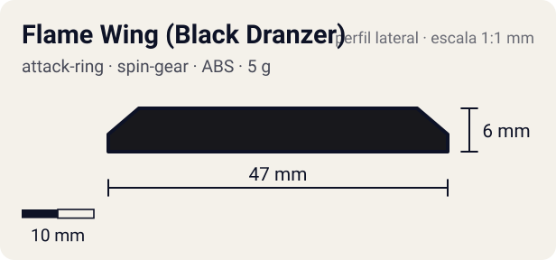

# Flame Wing (Black Dranzer)

<!-- auto:inicio (gerado por npm run build:research; não edite este bloco) -->
 

| Medidas e material | |
|---|---|
| Diâmetro | 47 estimado mm |
| Altura / espessura | 6 estimado mm |
| Peso | 5 wiki g |
| Material | ABS (opaco) |
| Estrelas Takara (A / D / S) | 1,5 / 3 / 1,5 |
| Usada em | [Black Dranzer](../../../personagens/kai-hiwatari/beyblades/black-dranzer/) |
<!-- auto:fim -->

| Campo | Valor |
|---|---|
| Id | `attack-ring/flame-wing-black-dranzer` |
| Categoria | Attack Ring |
| Sistema | Spin Gear System |
| Material | ABS |
| Acabamento | opaco |
| Cores (primária / secundária / detalhe) | `#18181c` / `#8a8f99` / `#c8202a` |

## Beys que usam

- `kai-hiwatari/black-dranzer` ([ficha](../../../personagens/kai-hiwatari/beyblades/black-dranzer/README.md))

## Formato

Idêntico ao Flame Wing (ver attack-ring/flame-wing): 2 espinhos longos em rampa com ponta em degrau duplo, bossa arredondada oposta. Corpo preto com adesivos cinza/vermelho.

Variação de cor do Flame Wing: preto. Mesmos 2 espinhos com entalhes rombos e rampa de ~10°.

## Função em batalha

Smash na rotação direita + upper fraco, igual ao Flame Wing.

## Reação por sentido de rotação

- **Direita (horário visto de cima):** Entalhes lideram: smash; upper fraco.
- **Esquerda (anti-horário):** Só a rampa: upper fraco.
- Sentido ótimo: **direita**. Tipo de contato: **smash**, 2 contato(s), recoil 0,55 (0–1, estimado).

## Combos conhecidos

- Mesmos do Flame Wing.

## Medidas, material e stats

| Item | Valor | Fonte |
|---|---|---|
| Diâmetro | 47 mm | estimado (2 × maior raio da `forma`) |
| Altura | 6 mm | estimado |
| Peso | 5 g | wiki |
| Material | ABS | Mesmo molde do Flame Wing da Dranzer F, em preto. |
| Ataque / Defesa / Stamina | — (não publicados) | — |
| Raio de contato | 23,5 mm | estimado |

## Forma (parâmetros do gerador de SVG)

Convenção: ângulos em graus, sentido horário visto de cima, 0° = topo; o setor (0 a 180°) se repete 2 vezes. Na rotação **direita** a face em `fim` é a que bate; na **esquerda**, a face em `inicio`. Anel base com raio 17 mm, furo central 11 mm, espessura 6 mm.

| início | pico | fim | raio (mm) | borda | altura (mm) | material |
|---|---|---|---|---|---|---|
| 20° | 90° | 104° | 23,5 | reta | 6 | ABS/PC |
| 104° | 108° | 112° | 22 | reta | 6 | ABS/PC |
| 140° | 155° | 170° | 18,5 | curva | 6 | ABS/PC |

## Observações

Ficha separada só pela cor (regra de sufixo por bey). Cores aproximadas.

## Referências locais

- Nenhuma foto local desta peça no repositório.

## Fontes

- https://beyblade.fandom.com/wiki/Black_Dranzer
- https://beyblade.fandom.com/wiki/Attack_Ring_-_Flame_Wing
