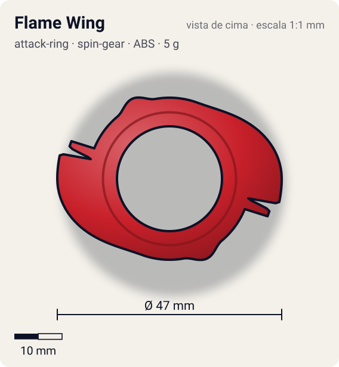
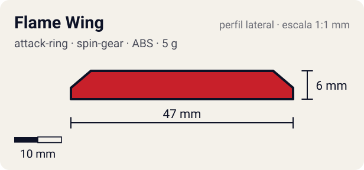

# Flame Wing

<!-- auto:inicio (gerado por npm run build:research; não edite este bloco) -->
 

| Medidas e material | |
|---|---|
| Diâmetro | 47 estimado mm |
| Altura / espessura | 6 estimado mm |
| Peso | 5 wiki g |
| Material | ABS (opaco) |
| Estrelas Takara (A / D / S) | 1,5 / 3 / 1,5 |
| Usada em | [Dranzer F (Dranzer Flame) - emprestada](../../../personagens/tyson-granger/beyblades/dranzer-f/), [Dranzer F](../../../personagens/kai-hiwatari/beyblades/dranzer-f/) |
<!-- auto:fim -->

| Campo | Valor |
|---|---|
| Id | `attack-ring/flame-wing` |
| Categoria | Attack Ring |
| Sistema | Spin Gear System |
| Material | ABS |
| Acabamento | opaco |
| Cores (primária / secundária / detalhe) | `#c8202a` / `#f2c230` / `#f5f5f5` |

## Beys que usam

- `kai-hiwatari/dranzer-f` ([ficha](../../../personagens/kai-hiwatari/beyblades/dranzer-f/README.md))
- `tyson-granger/dranzer-f` ([ficha](../../../personagens/tyson-granger/beyblades/dranzer-f/README.md))

## Formato

Simetria 2. De cada lado, um **espinho longo** nasce rente ao anel e cresce em rampa por ~70° até ~23,5 mm; a ponta é cortada reta com um **segundo degrau** logo atrás (os dois entalhes rombos). Do lado oposto ao espinho, uma bossa baixa e arredondada. Asas de fênix nos adesivos.

AR "multiuso" com 2 espinhos longos inclinados para cima (rampa de ~10°) e dois entalhes rombos na ponta de cada espinho.

## Função em batalha

Smash na rotação direita (entalhes) e upper fraco (rampa de ~10°, contra ~15° do Upper Dragoon).

## Reação por sentido de rotação

- **Direita (horário visto de cima):** Sentido de fábrica: os entalhes lideram e batem (smash); a rampa por trás dá um upper fraco.
- **Esquerda (anti-horário):** A rampa lidera: só upper fraco, sem smash.
- Sentido ótimo: **direita**. Tipo de contato: **smash**, 2 contato(s), recoil 0,55 (0–1, estimado).

## Combos conhecidos

- Wiki: Flame Wing, 10 Wide, Grip Base (Dragoon Grip Attacker): smash leve e rápido.
- Wiki: Flame Wing, 10 Heavy, Neo Right SG (Heavy Metal Core), Storm Grip Base: upper.

## Medidas, material e stats

| Item | Valor | Fonte |
|---|---|---|
| Diâmetro | 47 mm | estimado (2 × maior raio da `forma`) |
| Altura | 6 mm | estimado |
| Peso | 5 g | wiki |
| Material | ABS | Os entalhes das pontas quebram com o uso. |
| Ataque / Defesa / Stamina | — (não publicados) | — |
| Raio de contato | 23,5 mm | estimado |

## Forma (parâmetros do gerador de SVG)

Convenção: ângulos em graus, sentido horário visto de cima, 0° = topo; o setor (0 a 180°) se repete 2 vezes. Na rotação **direita** a face em `fim` é a que bate; na **esquerda**, a face em `inicio`. Anel base com raio 17 mm, furo central 11 mm, espessura 6 mm.

| início | pico | fim | raio (mm) | borda | altura (mm) | material |
|---|---|---|---|---|---|---|
| 20° | 90° | 104° | 23,5 | reta | 6 | ABS/PC |
| 104° | 108° | 112° | 22 | reta | 6 | ABS/PC |
| 140° | 155° | 170° | 18,5 | curva | 6 | ABS/PC |

## Observações

Cores aproximadas (sem foto local da peça da Dranzer F). A Black Dranzer usa o mesmo molde em preto: ver flame-wing-black-dranzer.

## Referências locais

- Nenhuma foto local desta peça no repositório.

## Fontes

- https://beyblade.fandom.com/wiki/Attack_Ring_-_Flame_Wing
- https://beyblade.fandom.com/wiki/Dranzer_F
