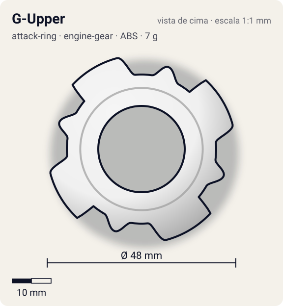
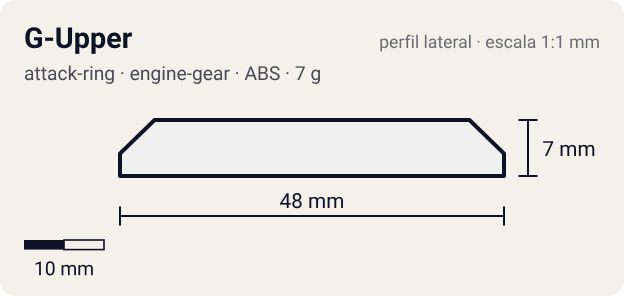

# G-Upper

<!-- auto:inicio (gerado por npm run build:research; não edite este bloco) -->
 

| Medidas e material | |
|---|---|
| Diâmetro | 48 estimado mm |
| Altura / espessura | 7 estimado mm |
| Peso | 7 wiki g |
| Material | ABS (opaco) |
| Estrelas Takara (A / D / S) | 4 / 3 / 2 |
| Usada em | [Dragoon GT (Dragoon Galaxy Turbo)](../../../personagens/tyson-granger/beyblades/dragoon-gt/) |
<!-- auto:fim -->

| Campo | Valor |
|---|---|
| Id | `attack-ring/g-upper` |
| Categoria | Attack Ring |
| Sistema | Engine Gear System |
| Material | ABS |
| Acabamento | opaco |
| Cores (primária / secundária / detalhe) | `#f0f0f0` / `#2457c5` / `#d8262c` |

## Beys que usam

- `tyson-granger/dragoon-gt` ([ficha](../../../personagens/tyson-granger/beyblades/dragoon-gt/README.md))

## Formato

Um dos ARs mais **largos** (~48 mm). Simetria 4: **lâminas curvas** com face de ataque virada para o sentido anti-horário (~24 mm) que se afinam em rampa curta para trás; entre elas, **cabeças de dragão** com focinho saliente (~22 mm) e olho verde triangular. Peso concentrado logo atrás dos contatos.

4 lâminas curvas (adesivos azuis "G") com 4 cabeças de dragão de focinho saliente entre elas. Um dos ARs mais largos.

## Função em batalha

Smash esquerdo excelente e de grande alcance; rampas curtas dão upper leve e outspin.

## Reação por sentido de rotação

- **Direita (horário visto de cima):** Lideram as rampas e o dorso das lâminas: upper leve.
- **Esquerda (anti-horário):** Sentido de fábrica: faces das lâminas lideram, smash forte com pouco recoil.
- Sentido ótimo: **esquerda**. Tipo de contato: **smash**, 4 contato(s), recoil 0,3 (0–1, estimado).

## Combos conhecidos

- Wiki: G-Upper, Wide Defense, Neo Left SG (Normal), Storm Grip Base: smash + outspin.

## Medidas, material e stats

| Item | Valor | Fonte |
|---|---|---|
| Diâmetro | 48 mm | estimado (2 × maior raio da `forma`) |
| Altura | 7 mm | estimado |
| Peso | 7 g | wiki |
| Material | ABS | — |
| Ataque / Defesa / Stamina | 4 / 3 / 2 | Beyblade Wiki, Part Infobox |
| Raio de contato | 24 mm | estimado |

## Forma (parâmetros do gerador de SVG)

Convenção: ângulos em graus, sentido horário visto de cima, 0° = topo; o setor (0 a 90°) se repete 4 vezes. Na rotação **direita** a face em `fim` é a que bate; na **esquerda**, a face em `inicio`. Anel base com raio 19 mm, furo central 11 mm, espessura 6 mm.

| início | pico | fim | raio (mm) | borda | altura (mm) | material |
|---|---|---|---|---|---|---|
| 5° | 15° | 50° | 24 | reta | 7 | ABS/PC |
| 60° | 72° | 82° | 22 | curva | 7 | ABS/PC |

## Observações

Cores: adesivos descritos na página da Dragoon GT; corpo aproximado.

## Referências locais

- Nenhuma foto local desta peça no repositório.

## Fontes

- https://beyblade.fandom.com/wiki/Attack_Ring_-_G-Upper
- https://beyblade.fandom.com/wiki/Dragoon_GT
