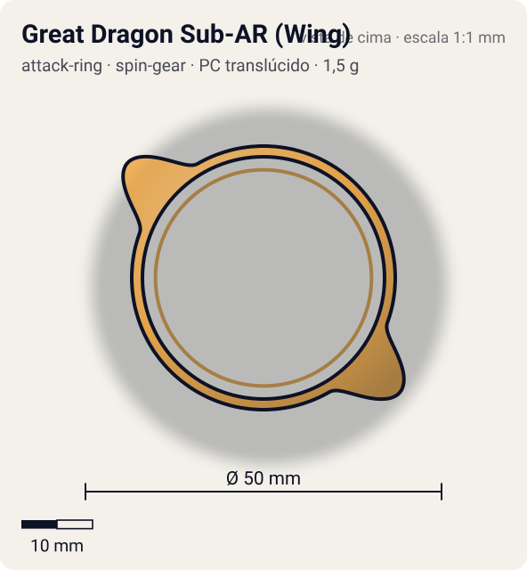
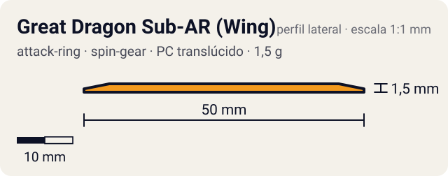

# Great Dragon Sub-AR (Wing)

<!-- auto:inicio (gerado por npm run build:research; não edite este bloco) -->
 

| Medidas e material | |
|---|---|
| Diâmetro | 50 estimado mm |
| Altura / espessura | 1,5 estimado mm |
| Peso | 1,5 estimado g |
| Material | PC translúcido (translucido) |
| Estrelas Takara (A / D / S) | — |
| Usada em | [Gaia Dragoon (Strata Dragoon)](../../../personagens/daichi-sumeragi/beyblades/gaia-dragoon/) |
<!-- auto:fim -->

| Campo | Valor |
|---|---|
| Id | `attack-ring/great-dragon-sub-ar` |
| Categoria | Attack Ring |
| Sistema | Spin Gear System |
| Material | PC translúcido |
| Acabamento | translucido |
| Cores (primária / secundária / detalhe) | `#f39a1e` / `#f7c35a` / `#b35f00` |

## Beys que usam

- `daichi-sumeragi/gaia-dragoon` ([ficha](../../../personagens/daichi-sumeragi/beyblades/gaia-dragoon/README.md))

## Formato

Aro fino (raio ~18 mm) quase escondido sob o Great Dragon. Em dois pontos opostos sai uma **lâmina chata arredondada** que ultrapassa o AR até ~25 mm; visto de cima aparece só a ponta laranja translúcida entre as cabeças do dragão.

Anel fino livre, laranja translúcido, com 2 lâminas ("wings") que passam da borda do AR.

## Função em batalha

Recebe golpes e gira solto, amortecendo parte do impacto.

## Reação por sentido de rotação

- **Direita (horário visto de cima):** Gira livre: sem sentido preferido.
- **Esquerda (anti-horário):** Igual: livre.
- Sentido ótimo: **ambos**. Tipo de contato: **survival**, 2 contato(s), recoil 0,2 (0–1, estimado).

## Combos conhecidos

- Nenhum combo documentado nas fontes.

## Medidas, material e stats

| Item | Valor | Fonte |
|---|---|---|
| Diâmetro | 50 mm | estimado (2 × maior raio da `forma`) |
| Altura | 1,5 mm | estimado |
| Peso | 1,5 g | estimado |
| Material | PC translúcido | Sub-Attack Ring livre ("wing"), laranja translúcido. |
| Ataque / Defesa / Stamina | — (não publicados) | — |
| Raio de contato | 25 mm | estimado |

## Forma (parâmetros do gerador de SVG)

Convenção: ângulos em graus, sentido horário visto de cima, 0° = topo; o setor (0 a 180°) se repete 2 vezes. Na rotação **direita** a face em `fim` é a que bate; na **esquerda**, a face em `inicio`. Anel base com raio 18,5 mm, furo central 17 mm, espessura 1,5 mm.

| início | pico | fim | raio (mm) | borda | altura (mm) | material |
|---|---|---|---|---|---|---|
| 110° | 130° | 150° | 25 | curva | 1,5 | ABS/PC |

## Observações

Peso e medidas estimados pela foto.

## Referências locais

- [referencia/gaia-dragoon-attack-ring.jpg](referencia/gaia-dragoon-attack-ring.jpg) (cópia de `personagens/daichi-sumeragi/beyblades/gaia-dragoon/pecas/attack-ring.jpg`)

## Fontes

- https://beyblade.fandom.com/wiki/Attack_Ring_-_Great_Dragon
- https://beyblade.fandom.com/wiki/Sub-Attack_Rings
