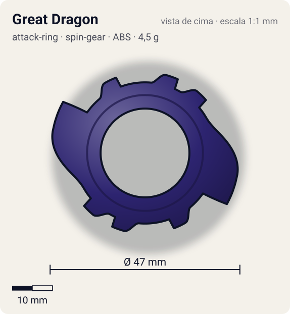
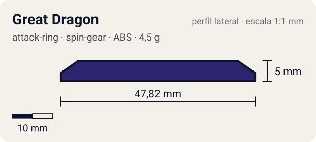

# Great Dragon

<!-- auto:inicio (gerado por npm run build:research; não edite este bloco) -->
 

| Medidas e material | |
|---|---|
| Diâmetro | 47 estimado mm |
| Altura / espessura | 5 estimado mm |
| Peso | 4,5 estimado g |
| Material | ABS (opaco) |
| Estrelas Takara (A / D / S) | 3,5 / 2 / 1,5 |
| Usada em | [Gaia Dragoon (Strata Dragoon)](../../../personagens/daichi-sumeragi/beyblades/gaia-dragoon/) |
<!-- auto:fim -->

| Campo | Valor |
|---|---|
| Id | `attack-ring/great-dragon` |
| Categoria | Attack Ring |
| Sistema | Spin Gear System |
| Material | ABS |
| Acabamento | opaco |
| Cores (primária / secundária / detalhe) | `#2d2470` / `#3aa7e0` / `#e9e23a` |

## Beys que usam

- `daichi-sumeragi/gaia-dragoon` ([ficha](../../../personagens/daichi-sumeragi/beyblades/gaia-dragoon/README.md))

## Formato

Anel roxo-escuro com aberturas grandes. Em volta dele, **blocos octogonais** salientes (com pinos em relevo) a cada ~25°. Em dois lados opostos, uma **cabeça de dragão em asa** se projeta em arco por ~65° até ~23,5 mm, terminando em gancho; adesivos azuis/amarelos "G-DRAGOON" cobrem essas asas. Por baixo aparecem as pontas laranja translúcidas do Sub-AR.

AR roxo-escuro com 2 grandes cabeças/asas de dragão em lados opostos (silhueta oval) e blocos octogonais ao redor; segura o Sub-AR "wing" laranja translúcido.

## Função em batalha

Smash com muito recoil: as cabeças saem demais do anel. Fino e frágil.

## Reação por sentido de rotação

- **Direita (horário visto de cima):** Sentido de fábrica: o gancho da cabeça lidera; golpes fortes, porém com recoil alto.
- **Esquerda (anti-horário):** Os blocos octogonais lideram: contatos retos e curtos, recoil sem dano.
- Sentido ótimo: **direita**. Tipo de contato: **smash**, 2 contato(s), recoil 0,75 (0–1, estimado).

## Combos conhecidos

- Nenhum combo documentado nas fontes.

## Medidas, material e stats

| Item | Valor | Fonte |
|---|---|---|
| Diâmetro | 47 mm | estimado (2 × maior raio da `forma`) |
| Altura | 5 mm | estimado |
| Peso | 4,5 g | estimado |
| Material | ABS | Fino, propenso a quebrar (wiki). Exige o Sub-AR para ser usado. |
| Ataque / Defesa / Stamina | — (não publicados) | — |
| Raio de contato | 23,5 mm | estimado |

## Forma (parâmetros do gerador de SVG)

Convenção: ângulos em graus, sentido horário visto de cima, 0° = topo; o setor (0 a 180°) se repete 2 vezes. Na rotação **direita** a face em `fim` é a que bate; na **esquerda**, a face em `inicio`. Anel base com raio 17,5 mm, furo central 11 mm, espessura 5 mm.

| início | pico | fim | raio (mm) | borda | altura (mm) | material |
|---|---|---|---|---|---|---|
| 5° | 15° | 25° | 20 | reta | 5 | ABS/PC |
| 30° | 40° | 50° | 20 | reta | 5 | ABS/PC |
| 60° | 105° | 125° | 23,5 | gancho | 5 | ABS/PC |
| 140° | 150° | 160° | 20 | reta | 5 | ABS/PC |

## Observações

Peso não publicado: estimado. Decisão: o Sub-AR wing é uma ficha separada (gira livre e tem forma própria).

## Referências locais

- [referencia/gaia-dragoon-attack-ring.jpg](referencia/gaia-dragoon-attack-ring.jpg) (cópia de `personagens/daichi-sumeragi/beyblades/gaia-dragoon/pecas/attack-ring.jpg`)

## Fontes

- https://beyblade.fandom.com/wiki/Attack_Ring_-_Great_Dragon
- https://beyblade.fandom.com/wiki/Gaia_Dragoon
