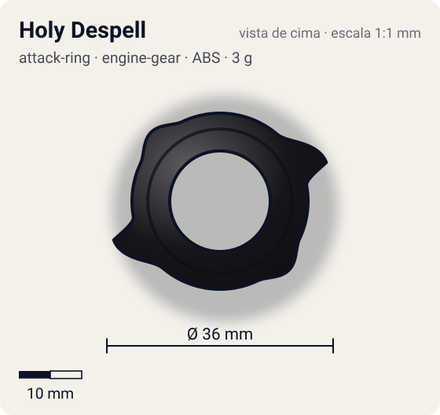
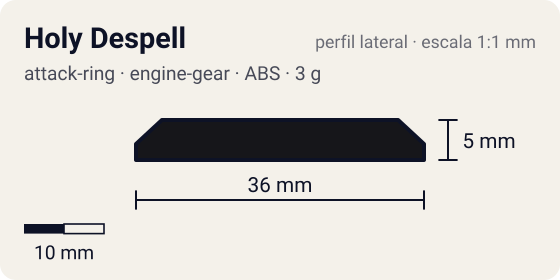

# Holy Despell (ホーリーデスペル)

<!-- auto:inicio (gerado por npm run build:research; não edite este bloco) -->
 

| Medidas e material | |
|---|---|
| Diâmetro | 36 estimado mm |
| Altura / espessura | 5 estimado mm |
| Peso | 3 estimado g |
| Material | ABS (opaco) |
| Estrelas Takara (A / D / S) | 0 / 1 / 0 |
| Usada em | [Zeus](../../../personagens/brooklyn-masefield/beyblades/zeus/) |
<!-- auto:fim -->

| Campo | Valor |
|---|---|
| Id | `attack-ring/holy-despell` |
| Categoria | Attack Ring |
| Sistema | Engine Gear System |
| Material | ABS |
| Acabamento | opaco |
| Cores (primária / secundária / detalhe) | `#16161a` / `#2457c5` / `#2e9e44` |

## Beys que usam

- `brooklyn-masefield/zeus` ([ficha](../../../personagens/brooklyn-masefield/beyblades/zeus/README.md))

## Formato

Visto de cima é um anel pequeno e quase circular (raio ~14 mm), preto, com adesivo azul "BEYBLADE ZEUS" em arco dos dois lados. Em lados opostos saem **2 protuberâncias triangulares** curtas (~4 mm além do anel) com a face mais íngreme virada no sentido horário; entre elas, pequenos parafusos decorativos fazem bossas arredondadas. Os triângulos verdes do adesivo ficam na base das protuberâncias.

Anel compacto (Attack Ring Supporter) com 2 protuberâncias triangulares opostas; fica por dentro do Screw Zeus e o mantém preso à bey deixando-o girar livre.

## Função em batalha

Suporte do anel livre; os dois triângulos só tocam o adversário quando o Screw Zeus é empurrado.

## Reação por sentido de rotação

- **Direita (horário visto de cima):** Sentido de fábrica (Zeus gira para a direita). A face íngreme dos triângulos fica na frente; como a peça é interna, o contato é raro.
- **Esquerda (anti-horário):** Os triângulos batem com a rampa; sem efeito prático porque quem recebe os golpes é o Screw Zeus.
- Sentido ótimo: **direita**. Tipo de contato: **smash**, 2 contato(s), recoil 0,4 (0–1, estimado).

## Combos conhecidos

- Holy Despell + Screw Zeus (Zeus de fábrica): defesa por anel livre.

## Medidas, material e stats

| Item | Valor | Fonte |
|---|---|---|
| Diâmetro | 36 mm | estimado (2 × maior raio da `forma`) |
| Altura | 5 mm | estimado |
| Peso | 3 g | estimado |
| Material | ABS | Anel interno fixo (Attack Ring Supporter) que prende o Screw Zeus livre à bey. |
| Ataque / Defesa / Stamina | — / 1 / — | Beyblade Wiki, Part Infobox (só DefenseStat preenchido) |
| Raio de contato | 18 mm | estimado |

## Forma (parâmetros do gerador de SVG)

Convenção: ângulos em graus, sentido horário visto de cima, 0° = topo; o setor (0 a 180°) se repete 2 vezes. Na rotação **direita** a face em `fim` é a que bate; na **esquerda**, a face em `inicio`. Anel base com raio 14 mm, furo central 8 mm, espessura 5 mm.

| início | pico | fim | raio (mm) | borda | altura (mm) | material |
|---|---|---|---|---|---|---|
| 40° | 70° | 80° | 18 | ponta | 5 | ABS/PC |
| 115° | 135° | 155° | 15,5 | curva | 4 | ABS/PC |

## Observações

Peso não publicado: estimado. A caixa da Takara (foto em referencia/) dá estrelas para a peça, mas a imagem local é pequena demais para contar com segurança; ficou só o DefenseStat da wiki.

## Referências locais

- [referencia/zeus-caixa-verso-pecas.jpg](referencia/zeus-caixa-verso-pecas.jpg) (cópia de `personagens/brooklyn-masefield/beyblades/zeus/pecas/caixa-verso-pecas.jpg`)
- [referencia/zeus-montada.jpg](referencia/zeus-montada.jpg) (cópia de `personagens/brooklyn-masefield/beyblades/zeus/imagem.jpg`)

## Fontes

- https://beyblade.fandom.com/wiki/Attack_Ring_-_Holy_Despell
- https://beyblade.fandom.com/wiki/Zeus
- Caixa Takara A-129 (foto local)
