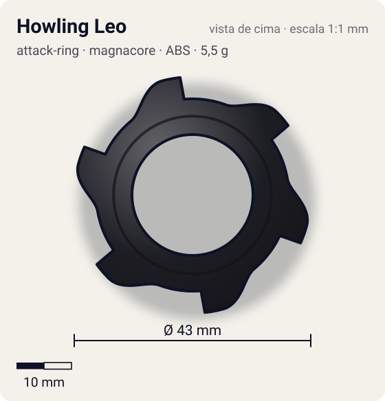
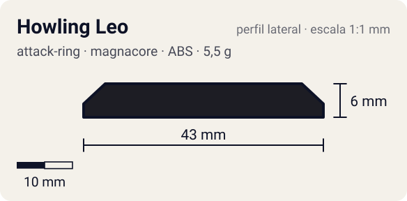

# Howling Leo

<!-- auto:inicio (gerado por npm run build:research; não edite este bloco) -->
 

| Medidas e material | |
|---|---|
| Diâmetro | 43 estimado mm |
| Altura / espessura | 6 estimado mm |
| Peso | 5,5 estimado g |
| Material | ABS (opaco) |
| Estrelas Takara (A / D / S) | 2,5 / 1 / 1,5 |
| Usada em | [Galeon 2](../../../personagens/lee/beyblades/galeon-2/), [Galeon 2 (Engine Gear)](../../../personagens/lee/beyblades/galeon-2-eg/) |
<!-- auto:fim -->

| Campo | Valor |
|---|---|
| Id | `attack-ring/howling-leo` |
| Categoria | Attack Ring |
| Sistema | Magnacore System |
| Material | ABS |
| Acabamento | opaco |
| Cores (primária / secundária / detalhe) | `#1d1d24` / `#2f6fd0` / `#f2c230` |

## Beys que usam

- `lee/galeon-2` ([ficha](../../../personagens/lee/beyblades/galeon-2/README.md))
- `lee/galeon-2-eg` ([ficha](../../../personagens/lee/beyblades/galeon-2-eg/README.md))

## Formato

Simetria 6: **6 garras** curtas iguais, cada uma subindo em rampa e terminando numa face reta (~21,5 mm), lembrando uma juba em serra.

AR com 6 pontas de ataque (juba/garras de leão).

## Função em batalha

Muitos contatos: golpes frequentes de smash leve.

## Reação por sentido de rotação

- **Direita (horário visto de cima):** Faces retas lideram: smash leve e frequente.
- **Esquerda (anti-horário):** Rampas lideram: contato raspado.
- Sentido ótimo: **direita**. Tipo de contato: **smash**, 6 contato(s), recoil 0,45 (0–1, estimado).

## Combos conhecidos

- Nenhum combo documentado nas fontes.

## Medidas, material e stats

| Item | Valor | Fonte |
|---|---|---|
| Diâmetro | 43 mm | estimado (2 × maior raio da `forma`) |
| Altura | 6 mm | estimado |
| Peso | 5,5 g | estimado |
| Material | ABS | — |
| Ataque / Defesa / Stamina | — (não publicados) | — |
| Raio de contato | 21,5 mm | estimado |

## Forma (parâmetros do gerador de SVG)

Convenção: ângulos em graus, sentido horário visto de cima, 0° = topo; o setor (0 a 60°) se repete 6 vezes. Na rotação **direita** a face em `fim` é a que bate; na **esquerda**, a face em `inicio`. Anel base com raio 17,5 mm, furo central 11 mm, espessura 6 mm.

| início | pico | fim | raio (mm) | borda | altura (mm) | material |
|---|---|---|---|---|---|---|
| 20° | 45° | 55° | 21,5 | reta | 6 | ABS/PC |

## Observações

A wiki só diz "6 attack points". Forma, peso e cores estimados. A Galeon 2 EG (anime) usa a mesma peça.

## Referências locais

- Nenhuma foto local desta peça no repositório.

## Fontes

- https://beyblade.fandom.com/wiki/Attack_Ring_-_Howling_Leo
- https://beyblade.fandom.com/wiki/Galeon_2
