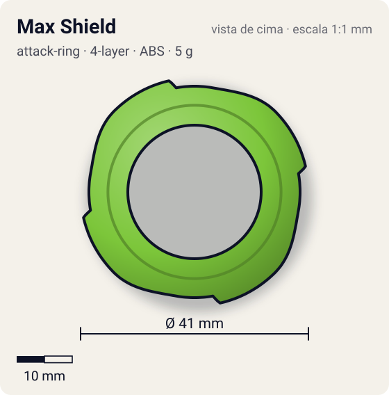
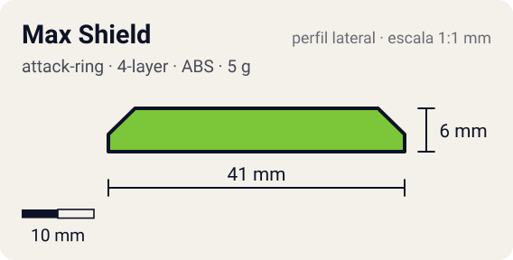

# Max Shield

<!-- auto:inicio (gerado por npm run build:research; não edite este bloco) -->
 

| Medidas e material | |
|---|---|
| Diâmetro | 41 estimado mm |
| Altura / espessura | 6 estimado mm |
| Peso | 5 wiki g |
| Material | ABS (opaco) |
| Estrelas Takara (A / D / S) | 2 / 2 / 1 |
| Usada em | [Draciel Metal Ball Defenser](../../../personagens/max-tate/beyblades/draciel-metal-ball-defenser/) |
<!-- auto:fim -->

| Campo | Valor |
|---|---|
| Id | `attack-ring/max-shield` |
| Categoria | Attack Ring |
| Sistema | 4 camadas (4-Layer System) |
| Material | ABS |
| Acabamento | opaco |
| Cores (primária / secundária / detalhe) | `#7cc63a` / `#3f7d1e` / `#f2c230` |

## Beys que usam

- `max-tate/draciel-metal-ball-defenser` ([ficha](../../../personagens/max-tate/beyblades/draciel-metal-ball-defenser/README.md))

## Formato

Contorno **octogonal/quadrado arredondado**: 4 **painéis largos de face plana** (~20,5 mm) unidos por cantos hexagonais. Verde-limão.

Pequeno, com 4 painéis quase retos ao redor (contorno octogonal).

## Função em batalha

Pouco eficiente em defesa (os painéis retos geram atrito/recoil); pequeno o bastante para weight disk attack.

## Reação por sentido de rotação

- **Direita (horário visto de cima):** Simétrico: igual.
- **Esquerda (anti-horário):** Igual.
- Sentido ótimo: **ambos**. Tipo de contato: **defesa**, 4 contato(s), recoil 0,45 (0–1, estimado).

## Combos conhecidos

- Wiki: weight disk attack, mas o Tri-Cutter faz melhor.

## Medidas, material e stats

| Item | Valor | Fonte |
|---|---|---|
| Diâmetro | 41 mm | estimado (2 × maior raio da `forma`) |
| Altura | 6 mm | estimado |
| Peso | 5 g | wiki |
| Material | ABS | A wiki lista como Spin Gear System, mas a bey é de 4 camadas. |
| Ataque / Defesa / Stamina | — (não publicados) | — |
| Raio de contato | 20,5 mm | estimado |

## Forma (parâmetros do gerador de SVG)

Convenção: ângulos em graus, sentido horário visto de cima, 0° = topo; o setor (0 a 90°) se repete 4 vezes. Na rotação **direita** a face em `fim` é a que bate; na **esquerda**, a face em `inicio`. Anel base com raio 19 mm, furo central 12 mm, espessura 6 mm.

| início | pico | fim | raio (mm) | borda | altura (mm) | material |
|---|---|---|---|---|---|---|
| 10° | 45° | 80° | 20,5 | reta | 6 | ABS/PC |

## Referências locais

- [referencia/draciel-mbd-attack-ring.gif](referencia/draciel-mbd-attack-ring.gif) (cópia de `personagens/max-tate/beyblades/draciel-metal-ball-defenser/pecas/attack-ring.gif`)
- [referencia/draciel-mbd-pecas-desmontadas.jpg](referencia/draciel-mbd-pecas-desmontadas.jpg) (cópia de `personagens/max-tate/beyblades/draciel-metal-ball-defenser/pecas/pecas-desmontadas.jpg`)

## Fontes

- https://beyblade.fandom.com/wiki/Attack_Ring_-_Max_Shield
- https://beyblade.fandom.com/wiki/Draciel_Metal_Ball_Defenser
