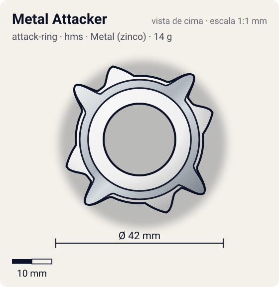
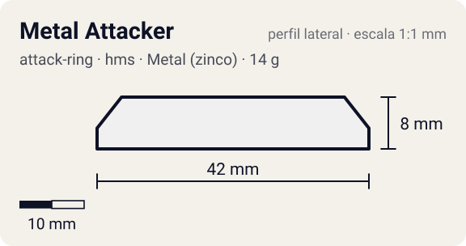

# Metal Attacker

<!-- auto:inicio (gerado por npm run build:research; não edite este bloco) -->
 

| Medidas e material | |
|---|---|
| Diâmetro | 42 estimado mm |
| Altura / espessura | 8 estimado mm |
| Peso | 14 wiki g |
| Material | Metal (zinco) + ABS (metalico) |
| Estrelas Takara (A / D / S) | 4 / 2 / 1 |
| Usada em | [Dragoon MS (Dragoon Metal Storm)](../../../personagens/tyson-granger/beyblades/dragoon-ms/) |
<!-- auto:fim -->

| Campo | Valor |
|---|---|
| Id | `attack-ring/metal-attacker` |
| Categoria | Attack Ring |
| Sistema | Hard Metal System (HMS) |
| Material | Metal (zinco) + ABS |
| Acabamento | metalico |
| Cores (primária / secundária / detalhe) | `#f0f0f0` / `#9ea3a8` / `#2457c5` |

## Beys que usam

- `tyson-granger/dragoon-ms` ([ficha](../../../personagens/tyson-granger/beyblades/dragoon-ms/README.md))

## Formato

Compacto (HMS). Simetria 4: **pontas metálicas** de ponta arredondada (~21 mm) saem entre as **asas** da capa ABS branca (~19,5 mm, em rampa).

4 pontas de metal expostas com pontas arredondadas, sob a capa ABS de 4 asas.

## Função em batalha

Smash razoável na época; depois superado.

## Reação por sentido de rotação

- **Direita (horário visto de cima):** Pontas arredondadas: smash parecido nos dois sentidos.
- **Esquerda (anti-horário):** Igual (Dragoon MS é dual-spin no brinquedo).
- Sentido ótimo: **ambos**. Tipo de contato: **smash**, 4 contato(s), recoil 0,45 (0–1, estimado).

## Combos conhecidos

- Nenhum combo documentado nas fontes.

## Medidas, material e stats

| Item | Valor | Fonte |
|---|---|---|
| Diâmetro | 42 mm | estimado (2 × maior raio da `forma`) |
| Altura | 8 mm | estimado |
| Peso | 14 g | wiki |
| Material | Metal (zinco) + ABS | Moldura metálica com 4 pontas expostas + ABS Caul "Cross Wings". |
| Ataque / Defesa / Stamina | 4 / 2 / 1 | Beyblade Wiki, Part Infobox |
| Raio de contato | 21 mm | estimado |

## Forma (parâmetros do gerador de SVG)

Convenção: ângulos em graus, sentido horário visto de cima, 0° = topo; o setor (0 a 90°) se repete 4 vezes. Na rotação **direita** a face em `fim` é a que bate; na **esquerda**, a face em `inicio`. Anel base com raio 16 mm, furo central 9 mm, espessura 7 mm. `forma.moldura` descreve só a moldura metálica (simetria 4).

| início | pico | fim | raio (mm) | borda | altura (mm) | material |
|---|---|---|---|---|---|---|
| 25° | 40° | 50° | 21 | curva | 8 | metal |
| 55° | 70° | 85° | 19,5 | rampa | 7 | ABS/PC |

## Observações

forma.moldura descreve o Metal Frame. Cores aproximadas.

## Referências locais

- Nenhuma foto local desta peça no repositório.

## Fontes

- https://beyblade.fandom.com/wiki/Attack_Ring_-_Metal_Attacker
- https://beyblade.fandom.com/wiki/Dragoon_MS
