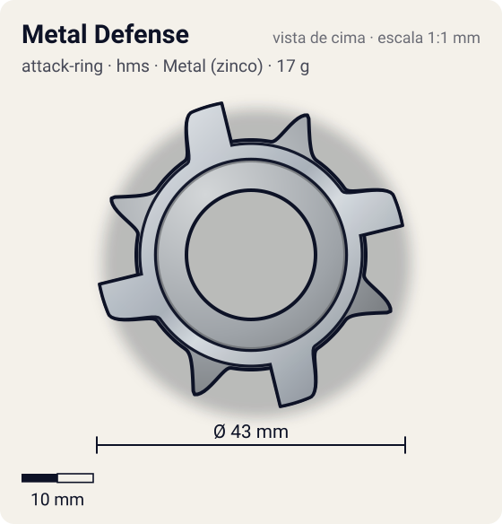
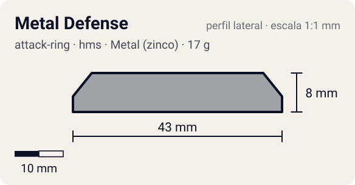

# Metal Defense

<!-- auto:inicio (gerado por npm run build:research; não edite este bloco) -->
 

| Medidas e material | |
|---|---|
| Diâmetro | 43 estimado mm |
| Altura / espessura | 8 estimado mm |
| Peso | 17 wiki g |
| Material | Metal (zinco) + ABS (metalico) |
| Estrelas Takara (A / D / S) | 2 / 3 / 2 |
| Usada em | [Draciel MS](../../../personagens/max-tate/beyblades/draciel-ms/) |
<!-- auto:fim -->

| Campo | Valor |
|---|---|
| Id | `attack-ring/metal-defense` |
| Categoria | Attack Ring |
| Sistema | Hard Metal System (HMS) |
| Material | Metal (zinco) + ABS |
| Acabamento | metalico |
| Cores (primária / secundária / detalhe) | `#9ea3a8` / `#1f7a3a` / `#e8506a` |

## Beys que usam

- `max-tate/draciel-ms` ([ficha](../../../personagens/max-tate/beyblades/draciel-ms/README.md))

## Formato

Estrela de **8 pontas**. A moldura de metal é um **octógono** com parafusos em relevo e 4 **pontas trapezoidais** prateadas (~21,5 mm) nos eixos; entre elas, 4 **triângulos** da capa ABS verde (adesivo rosa, ~21 mm).

Moldura metálica octogonal com 4 pontas de metal + capa plástica verde com 4 pontas triangulares (8 pontas no total).

## Função em batalha

Muito recoil; inferior a outros ARs para defesa (wiki), apesar da massa na periferia.

## Reação por sentido de rotação

- **Direita (horário visto de cima):** Simétrico: igual; pontas largas dão recoil.
- **Esquerda (anti-horário):** Igual.
- Sentido ótimo: **ambos**. Tipo de contato: **defesa**, 8 contato(s), recoil 0,7 (0–1, estimado).

## Combos conhecidos

- Nenhum combo documentado nas fontes.

## Medidas, material e stats

| Item | Valor | Fonte |
|---|---|---|
| Diâmetro | 43 mm | estimado (2 × maior raio da `forma`) |
| Altura | 8 mm | estimado |
| Peso | 17 g | wiki |
| Material | Metal (zinco) + ABS | Metal Frame "Cross Shield" + ABS Caul "Draciel". Peso: 17 g na página da peça, 20 g na página da Draciel MS. |
| Ataque / Defesa / Stamina | 2 / 3 / 2 | Beyblade Wiki, Part Infobox e tabela da página Draciel MS |
| Raio de contato | 21,5 mm | estimado |

## Forma (parâmetros do gerador de SVG)

Convenção: ângulos em graus, sentido horário visto de cima, 0° = topo; o setor (0 a 90°) se repete 4 vezes. Na rotação **direita** a face em `fim` é a que bate; na **esquerda**, a face em `inicio`. Anel base com raio 16 mm, furo central 9 mm, espessura 7 mm. `forma.moldura` descreve só a moldura metálica (simetria 4).

| início | pico | fim | raio (mm) | borda | altura (mm) | material |
|---|---|---|---|---|---|---|
| 10° | 22,5° | 35° | 21 | ponta | 7 | ABS/PC |
| 55° | 67,5° | 80° | 21,5 | reta | 8 | metal |

## Observações

forma.moldura descreve o Metal Frame. Na foto a figura está rodada 22,5°.

## Referências locais

- [referencia/draciel-ms-attack-ring.jpg](referencia/draciel-ms-attack-ring.jpg) (cópia de `personagens/max-tate/beyblades/draciel-ms/pecas/attack-ring.jpg`)

## Fontes

- https://beyblade.fandom.com/wiki/Attack_Ring_-_Metal_Defense
- https://beyblade.fandom.com/wiki/Draciel_MS
