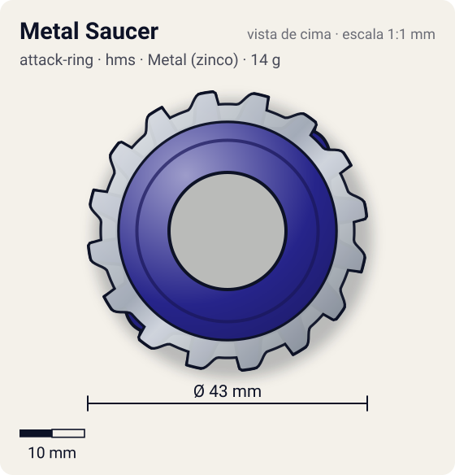
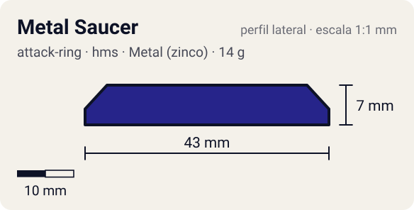

# Metal Saucer

<!-- auto:inicio (gerado por npm run build:research; não edite este bloco) -->
 

| Medidas e material | |
|---|---|
| Diâmetro | 43 estimado mm |
| Altura / espessura | 7 estimado mm |
| Peso | 14 wiki g |
| Material | Metal (zinco) + ABS (metalico) |
| Estrelas Takara (A / D / S) | 3 / 3 / 2 |
| Usada em | [Gaia Dragoon MS (Strata Dragoon MS / Metal Spike)](../../../personagens/daichi-sumeragi/beyblades/gaia-dragoon-ms/) |
<!-- auto:fim -->

| Campo | Valor |
|---|---|
| Id | `attack-ring/metal-saucer` |
| Categoria | Attack Ring |
| Sistema | Hard Metal System (HMS) |
| Material | Metal (zinco) + ABS |
| Acabamento | metalico |
| Cores (primária / secundária / detalhe) | `#26248a` / `#9ea3a8` / `#d8262c` |

## Beys que usam

- `daichi-sumeragi/gaia-dragoon-ms` ([ficha](../../../personagens/daichi-sumeragi/beyblades/gaia-dragoon-ms/README.md))

## Formato

Contorno quase perfeitamente **circular**. A moldura metálica é um aro duplo (externo ~19,5 mm, interno ~13 mm) unido por 3 raios, com **16 dentes retangulares** curtos no aro externo (até ~21,5 mm). Por cima, a capa ABS azul-escura em anel grosso, com 2 abas opostas cobertas por adesivo vermelho "METAL SYSTEM" que chegam quase à linha dos dentes, e o texto "METAL SAUCER RING".

AR circular de HMS: moldura metálica com 16 entalhes de engrenagem em todo o perímetro + capa ABS azul com 2 abas vermelhas.

## Função em batalha

Contato serrilhado contínuo e peso na periferia: serve para spin steal e sobrevivência (wiki), mais que para ataque.

## Reação por sentido de rotação

- **Direita (horário visto de cima):** Dentes simétricos: comportamento igual nos dois sentidos; o serrilhado prende no adversário em vez de bater.
- **Esquerda (anti-horário):** Igual à direita.
- Sentido ótimo: **ambos**. Tipo de contato: **survival**, 16 contato(s), recoil 0,3 (0–1, estimado).

## Combos conhecidos

- Wiki: Metal Saucer, Circle Wide, Bearing Core (Wolborg MS) ou Bearing Core 2 (Jiraiya MS): spin steal / sobrevivência.

## Medidas, material e stats

| Item | Valor | Fonte |
|---|---|---|
| Diâmetro | 43 mm | estimado (2 × maior raio da `forma`) |
| Altura | 7 mm | estimado |
| Peso | 14 g | wiki |
| Material | Metal (zinco) + ABS | Metal Frame com 16 entalhes (o mesmo do Advance Balancer) + ABS Caul azul. Defeito de projeto: a moldura chacoalha. |
| Ataque / Defesa / Stamina | — (não publicados) | — |
| Raio de contato | 21,5 mm | estimado |

## Forma (parâmetros do gerador de SVG)

Convenção: ângulos em graus, sentido horário visto de cima, 0° = topo; o setor (0 a 180°) se repete 2 vezes. Na rotação **direita** a face em `fim` é a que bate; na **esquerda**, a face em `inicio`. Anel base com raio 17 mm, furo central 9 mm, espessura 7 mm. `forma.moldura` descreve só a moldura metálica (simetria 16).

| início | pico | fim | raio (mm) | borda | altura (mm) | material |
|---|---|---|---|---|---|---|
| 20° | 45° | 70° | 20,5 | curva | 7 | ABS/PC |
| 4° | 11° | 18° | 21,5 | reta | 3 | metal |
| 26,5° | 33,5° | 40,5° | 21,5 | reta | 3 | metal |
| 49° | 56° | 63° | 21,5 | reta | 3 | metal |
| 71,5° | 78,5° | 85,5° | 21,5 | reta | 3 | metal |
| 94° | 101° | 108° | 21,5 | reta | 3 | metal |
| 116,5° | 123,5° | 130,5° | 21,5 | reta | 3 | metal |
| 139° | 146° | 153° | 21,5 | reta | 3 | metal |
| 161,5° | 168,5° | 175,5° | 21,5 | reta | 3 | metal |

## Observações

forma.lobos dá a silhueta combinada (caul + dentes); forma.moldura descreve só o Metal Frame. Lobos com "metal": true são de metal.

## Referências locais

- [referencia/gaia-dragoon-ms-attack-ring.jpg](referencia/gaia-dragoon-ms-attack-ring.jpg) (cópia de `personagens/daichi-sumeragi/beyblades/gaia-dragoon-ms/pecas/attack-ring.jpg`)
- [referencia/gaia-dragoon-ms-metal-frame.jpg](referencia/gaia-dragoon-ms-metal-frame.jpg) (cópia de `personagens/daichi-sumeragi/beyblades/gaia-dragoon-ms/pecas/metal-frame.jpg`)

## Fontes

- https://beyblade.fandom.com/wiki/Attack_Ring_-_Metal_Saucer
- https://beyblade.fandom.com/wiki/Strata_Dragoon_MS
